# Chương 6 – Cây

## 1. Cây và rừng

### Định nghĩa cây

**Cây** là một đồ thị **vô hướng**, **liên thông** và **không có chu trình** sơ cấp.

- Cây không có cạnh bội và khuyên ⇒ cây là một đơn đồ thị.

**Ví dụ:** Đồ thị nào là cây?

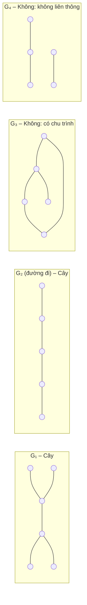

**Ví dụ thực tế:** cây thư mục trên máy tính, sơ đồ tổ chức công ty, cây gia phả.

### Rừng

**Rừng** là một đồ thị vô hướng **không có chu trình**.

- Rừng có thể có nhiều thành phần liên thông.
- Mỗi thành phần liên thông là một cây.

**Ví dụ 1:** Rừng gồm 3 cây

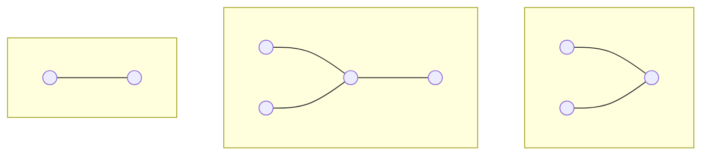

**Ví dụ 2:** Rừng có $n$ đỉnh và $k$ cây thì có bao nhiêu cạnh?

→ Mỗi cây $n_i$ đỉnh có $n_i - 1$ cạnh.
Tổng: $(n_1 - 1) + \cdots + (n_k - 1) = n - k$.

*Kiểm tra Ví dụ 1: $n = 9$, $k = 3$ ⇒ 6 cạnh. ✓*

### Định lý Daisy Chain (các định nghĩa tương đương)

$T$ là đồ thị có $n$ đỉnh. Các mệnh đề sau là **tương đương**:

1. $T$ là một cây.
2. $T$ không có chu trình và có $n-1$ cạnh.
3. $T$ liên thông và có $n-1$ cạnh.
4. $T$ liên thông, mọi cạnh đều là cầu.
5. Giữa hai đỉnh bất kỳ của $T$ luôn tồn tại một đường đi sơ cấp **duy nhất**.
6. $T$ không có chu trình, và nếu thêm một cạnh nối 2 đỉnh bất kỳ thì sẽ tạo ra một chu trình.

- **Ví dụ 1:** Đồ thị liên thông 10 đỉnh, 9 cạnh ⇒ là cây (theo 3).
- **Ví dụ 2:** Đồ thị liên thông 10 đỉnh, 10 cạnh ⇒ **không** là cây, chắc chắn có chu trình.
- **Tính chất:** Cây có $n \ge 2$ đỉnh có ít nhất **2 đỉnh treo** (bậc 1).

### Bài tập: Cây và rừng

**Bài 1.** Vẽ tất cả các cây (không đẳng cấu với nhau) có 4 đỉnh, 5 đỉnh và 6 đỉnh.

**Bài 2.** Có thể tìm được một cây có 8 đỉnh và thỏa điều kiện dưới đây hay không? Nếu có, vẽ cây đó ra; nếu không, giải thích tại sao.

- a) Mọi đỉnh đều có bậc 1.
- b) Mọi đỉnh đều có bậc 2.
- c) Có 6 đỉnh bậc 2 và 2 đỉnh bậc 1.
- d) Có đỉnh bậc 7 và 7 đỉnh bậc 1.

**Bài 3.** Một cây có $n_2$ đỉnh bậc 2, $n_3$ đỉnh bậc 3, ..., $n_k$ đỉnh bậc $k$. Hỏi có bao nhiêu đỉnh bậc 1?

**Bài 4.** Một rừng có 20 đỉnh và 15 cạnh. Rừng này gồm bao nhiêu cây?

### Lời giải mẫu: Bài 2

**Ý tưởng:** Cây 8 đỉnh có đúng $8-1 = 7$ cạnh ⇒ tổng bậc phải bằng $2 \times 7 = 14$.

- **a)** Tổng bậc $= 8 \times 1 = 8 \neq 14$ ⇒ **Không**.
- **b)** Tổng bậc $= 8 \times 2 = 16 \neq 14$ ⇒ **Không**. (Đồ thị liên thông đều bậc 2 là $C_8$, có chu trình.)
- **c)** Tổng bậc $= 6 \times 2 + 2 \times 1 = 14$ ✓ ⇒ **Có**: đường đi $P_8$.
- **d)** Tổng bậc $= 7 + 7 \times 1 = 14$ ✓ ⇒ **Có**: hình sao $K_{1,7}$.

*Lưu ý: tổng bậc bằng 14 mới chỉ là điều kiện **cần**. Ở c), d) ta phải vẽ được cây cụ thể.*

**c)** $P_8$


**d)** $K_{1,7}$

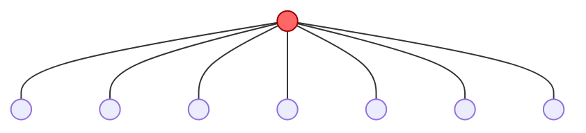

---

## 2. Cây có gốc và cây m-phân

### Cây có gốc

**Cây có gốc:** một cây với một đỉnh được chọn làm **gốc**; các cạnh được định hướng từ gốc đi ra.

**Ví dụ:** Cùng một cây, chọn gốc khác nhau thì được cây có gốc khác nhau.

Cây $T$:

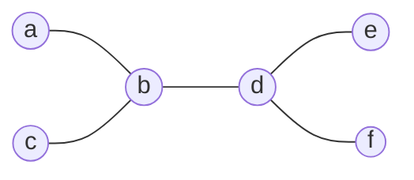

Gốc $a$:

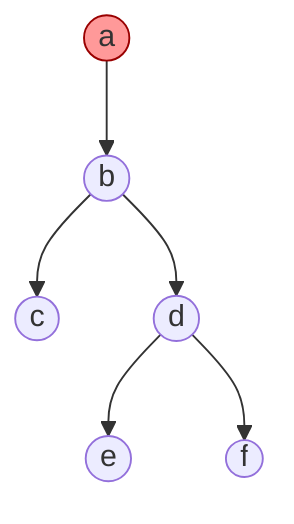

Gốc $d$:

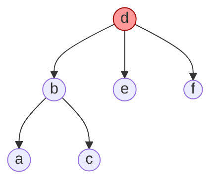

*Gốc a: cây cao 3 mức. Gốc d: cây chỉ cao 2 mức.*

### Các khái niệm trên cây có gốc

- **Cha** của $v$: đỉnh ngay trên $v$. **Con**: ngược lại.
- **Anh em**: các đỉnh có cùng cha.
- **Tổ tiên**: các đỉnh trên đường đi từ gốc đến $v$. **Con cháu**: ngược lại.
- **Lá**: đỉnh không có con. **Đỉnh trong**: đỉnh có con.
- **Cây con** gốc $v$: gồm $v$ và mọi con cháu của $v$.
- **Mức** của $v$: độ dài đường đi từ gốc đến $v$ (gốc có mức 0).
- **Chiều cao**: mức lớn nhất.

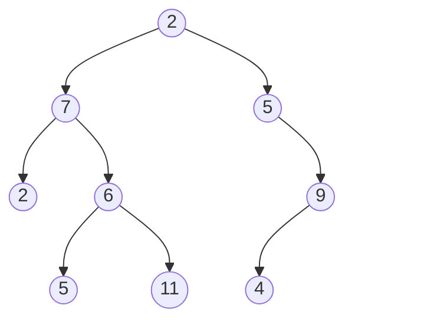

Mức 0: $2$ — Mức 1: $7, 5$ — Mức 2: $2, 6, 9$ — Mức 3: $5, 11, 4$. **Chiều cao = 3.**

### Cây m-phân

- **Cây $m$-phân**: cây có gốc, mỗi đỉnh trong có **không quá** $m$ con.
- **Cây $m$-phân đầy đủ**: mỗi đỉnh trong có **đúng** $m$ con.
- $m = 2$: **cây nhị phân**.

$T_1$ – Nhị phân **đầy đủ**:

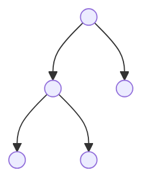

$T_2$ – Tam phân **đầy đủ**:

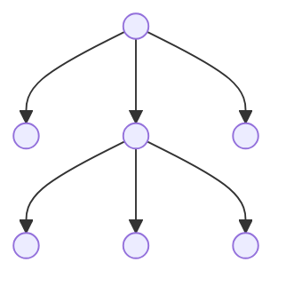

$T_3$ – Tứ phân, **không** đầy đủ:

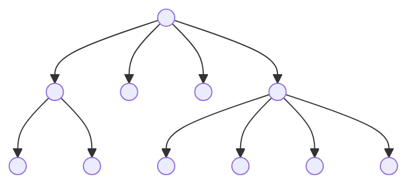

**Ví dụ thực tế:** cây đấu loại trực tiếp (knock-out) là cây nhị phân đầy đủ: mỗi trận có 2 đội.

### Tính chất của cây m-phân đầy đủ

Cho cây $m$-phân đầy đủ có $n$ đỉnh, $i$ đỉnh trong và $l$ lá. Khi đó:

- $n = m \cdot i + 1$ (mỗi đỉnh trong có $m$ con, cộng gốc)
- $n = l + i$
- $i = \dfrac{n-1}{m}$
- $l = (m-1)i + 1 = \dfrac{(m-1)n + 1}{m}$

**Ví dụ 1:** Kiểm tra $T_2$ (tam phân đầy đủ): $i = 2$, $n = 3 \cdot 2 + 1 = 7$, $l = 2 \cdot 2 + 1 = 5$. ✓

**Ví dụ 2:** Giải đấu loại trực tiếp có 32 đội. Có bao nhiêu trận?
→ Cây nhị phân đầy đủ, $l = 32$ lá (đội), mỗi trận là một đỉnh trong: $i = \dfrac{l-1}{m-1} = 31$ trận.

**Ví dụ 3:** Thư dây chuyền: mỗi người gửi cho 4 người khác hoặc không gửi. Có 100 người gửi thư. Bao nhiêu người nhận thư?
→ $m = 4$, $i = 100$: $n = 401$, số người nhận $= n - 1 = 400$.

### Bài tập: Cây có gốc và cây m-phân

**Bài 1.** Cho $G$ là một cây 5-phân đầy đủ có 100 đỉnh trong. Hỏi $G$ có tất cả bao nhiêu đỉnh, bao nhiêu lá?

**Bài 2.** Cây 3-phân đầy đủ có 100 đỉnh thì có bao nhiêu lá?

**Bài 3.** Có tồn tại cây nhị phân đầy đủ có 10 lá và chiều cao 3 không? Vì sao?

**Bài 4.** Chứng minh rằng cây $m$-phân có chiều cao $h$ thì có nhiều nhất $m^h$ lá.

**Bài 5.** Một giải bóng đá có 24 đội đá loại trực tiếp (đội thua bị loại, không có trận hòa). Cần tổ chức bao nhiêu trận để tìm ra nhà vô địch?

### Lời giải mẫu: Bài 1 và Bài 2

**Bài 1:** Cây 5-phân đầy đủ, 100 đỉnh trong.

- Dữ kiện: $m = 5$, $i = 100$.
- Số đỉnh: $n = m \cdot i + 1 = 5 \cdot 100 + 1 = 501$.
- Số lá: $l = n - i = 501 - 100 = 401$.

*Kiểm tra: $l = (m-1)i + 1 = 4 \cdot 100 + 1 = 401$. ✓*

**Bài 2:** Cây 3-phân đầy đủ, 100 đỉnh.

- Dữ kiện: $m = 3$, $n = 100$.
- Số đỉnh trong: $i = \dfrac{n-1}{m} = \dfrac{99}{3} = 33$.
- Số lá: $l = n - i = 100 - 33 = 67$.

*Kiểm tra: $l = \dfrac{(m-1)n+1}{m} = \dfrac{2 \cdot 100 + 1}{3} = 67$. ✓*

> **Mẹo**
> Xác định dữ kiện đã cho ($m$ và một trong $n, i, l$), rồi chọn công thức phù hợp. Kết quả $i$ phải là số nguyên, nếu không thì cây như vậy **không tồn tại**.

---

## 3. Phép duyệt cây nhị phân

### Duyệt cây nhị phân

**Duyệt cây:** liệt kê tất cả các đỉnh của cây theo một thứ tự xác định, mỗi đỉnh một lần.

Ba phương pháp, đều định nghĩa **đệ quy** (mỗi nút có tối đa con trái và con phải):

| Tiền tự (Pre-order) | Trung tự (In-order) | Hậu tự (Post-order) |
|---|---|---|
| 1. Gốc | 1. Trung tự con trái | 1. Hậu tự con trái |
| 2. Tiền tự con trái | 2. Gốc | 2. Hậu tự con phải |
| 3. Tiền tự con phải | 3. Trung tự con phải | 3. Gốc |

Thứ tự thăm (số trên nút) của từng phương pháp:

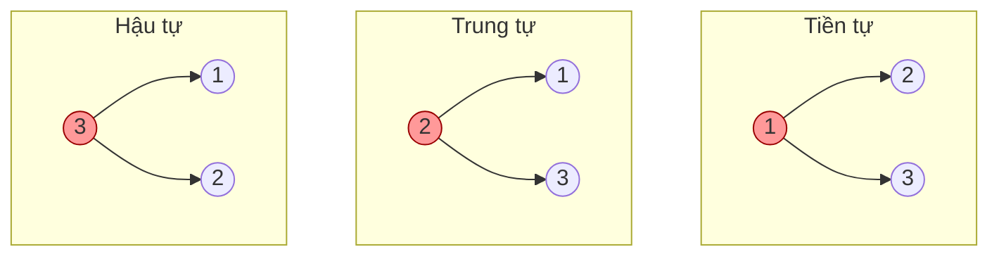

*Mẹo nhớ: tên gọi chỉ **vị trí của gốc**: tiền (trước), trung (giữa), hậu (sau). Con trái luôn trước con phải.*

### Duyệt cây: Ví dụ 1

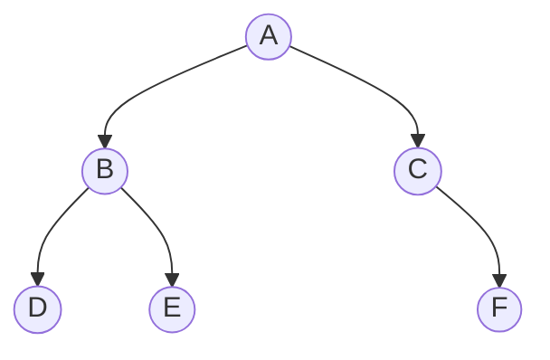

- **Tiền tự** (gốc – trái – phải): $A$, [tiền tự cây $B$], [tiền tự cây $C$] $= A\,B\,D\,E\,C\,F$ ⇒ **ABDECF**
- **Trung tự** (trái – gốc – phải): [trung tự cây $B$], $A$, [trung tự cây $C$] $= D\,B\,E\,A\,C\,F$ ⇒ **DBEACF**
- **Hậu tự** (trái – phải – gốc): [hậu tự cây $B$], [hậu tự cây $C$], $A$ $= D\,E\,B\,F\,C\,A$ ⇒ **DEBFCA**

### Duyệt cây: Ví dụ 2 (cách đi vòng quanh cây)

**Mẹo:** đi một vòng quanh cây, bắt đầu từ bên trái gốc, luôn sát các cạnh.

- Tiền tự: ghi nút khi đi qua **bên trái** nút.
- Trung tự: ghi nút khi đi qua **bên dưới** nút.
- Hậu tự: ghi nút khi đi qua **bên phải** nút.

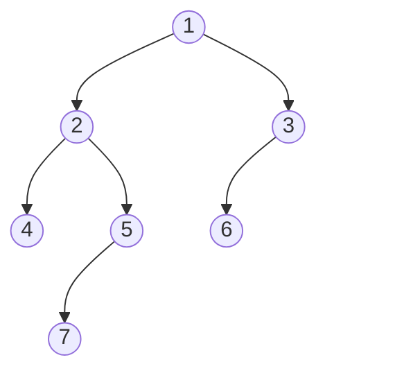

- **Tiền tự:** 1 2 4 5 7 3 6
- **Trung tự:** 4 2 7 5 1 6 3
- **Hậu tự:** 4 7 5 2 6 3 1

**Nhận xét:**

- Tiền tự luôn bắt đầu bằng **gốc**.
- Hậu tự luôn kết thúc bằng **gốc**.
- Trung tự: gốc nằm giữa, bên trái là cây con trái, bên phải là cây con phải.

### Bài tập: Duyệt cây nhị phân

**Bài 1.** Duyệt các cây sau lần lượt bằng các thuật toán tiền tự, trung tự và hậu tự:

**a)**

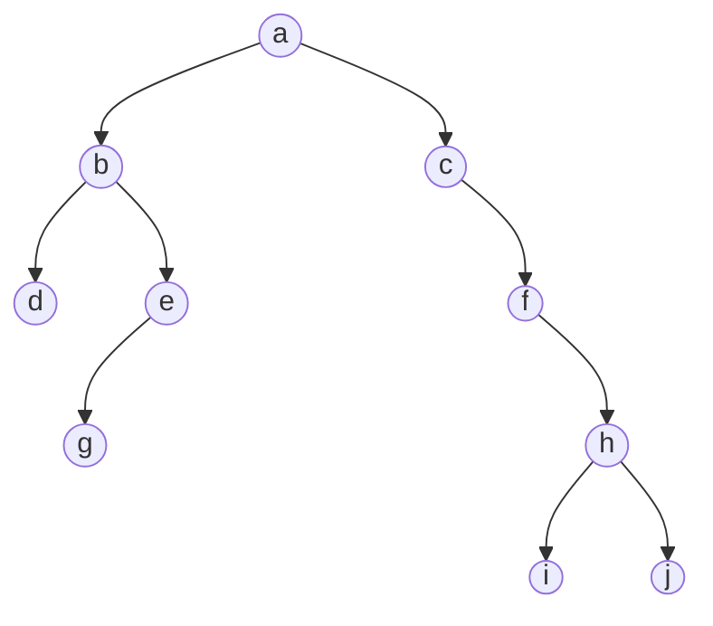

**b)**

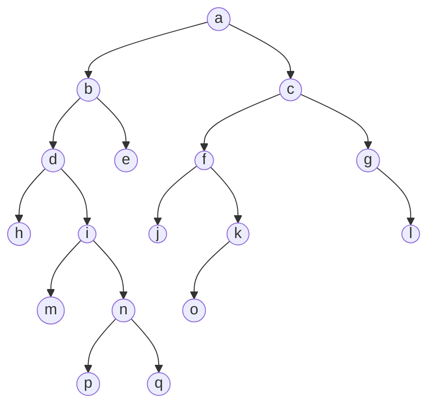

**Bài 2.** Một cây nhị phân có duyệt tiền tự là $A\,B\,D\,C\,E\,F$ và trung tự là $D\,B\,A\,E\,C\,F$. Hãy vẽ cây đó.

### Lời giải mẫu: Bài 1a

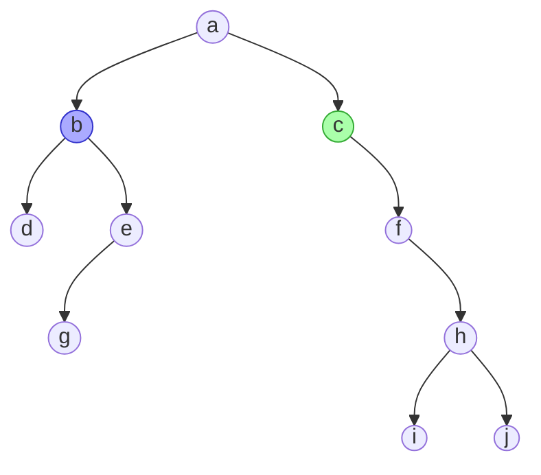

*Cây con trái gốc $b$ (xanh dương); cây con phải gốc $c$ (xanh lá).*

**Bước 1:** Duyệt riêng từng cây con.

- Cây con gốc $b$: tiền tự $b\,d\,e\,g$; trung tự $d\,b\,g\,e$; hậu tự $d\,g\,e\,b$.
- Cây con gốc $c$: tiền tự $c\,f\,h\,i\,j$; trung tự $c\,f\,i\,h\,j$; hậu tự $i\,j\,h\,f\,c$.

**Bước 2:** Ghép với gốc $a$ theo đúng thứ tự.

| | | | |
|---|---|---|---|
| **Tiền tự** | $a$ | $b\,d\,e\,g$ | $c\,f\,h\,i\,j$ |
| **Trung tự** | $d\,b\,g\,e$ | $a$ | $c\,f\,i\,h\,j$ |
| **Hậu tự** | $d\,g\,e\,b$ | $i\,j\,h\,f\,c$ | $a$ |

Viết liền:

- **Tiền tự:** $a\ b\,d\,e\,g\ c\,f\,h\,i\,j$
- **Trung tự:** $d\,b\,g\,e\ a\ c\,f\,i\,h\,j$
- **Hậu tự:** $d\,g\,e\,b\ i\,j\,h\,f\,c\ a$

*Chú ý: $e$ chỉ có con trái $g$, nên trung tự của cây gốc $e$ là $g\,e$.*

---

## 4. Cây biểu thức và ký pháp nghịch đảo Ba Lan

### Cây biểu thức số học

**Cây biểu thức** là cây nhị phân:

- Mỗi **nút trong** là một toán tử hai ngôi (+, -, *, /, ^)
- Mỗi **lá** là một toán hạng (số hoặc biến).
- Nút trong có toán tử $\circ$, con trái là biểu thức $E_1$, con phải là $E_2$ thì biểu diễn $E_1 \circ E_2$.

**Ví dụ 1:** $(a + b) * c$

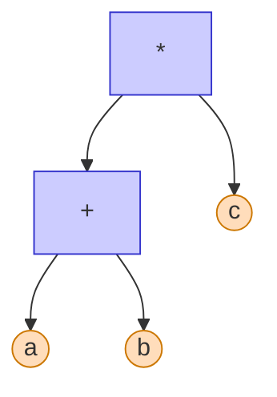

**Ví dụ 2:** $E = (2 + 3)^2 - (4 - 1) * (15/5)$

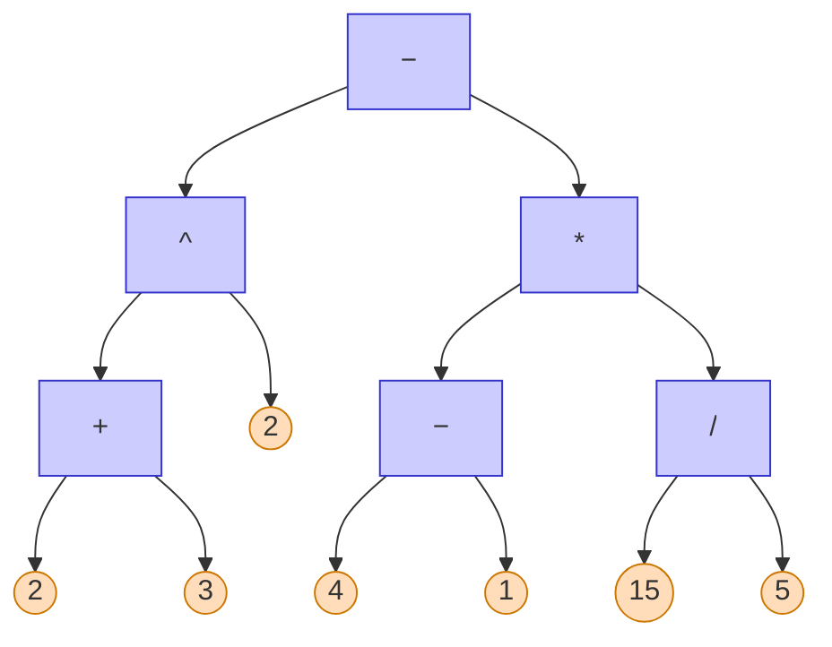

*Toán tử thực hiện **cuối cùng** nằm ở gốc. Ở Ví dụ 2 đó là phép trừ ở giữa.*

### Ba cách viết biểu thức

Duyệt cây biểu thức theo 3 cách, ta được 3 cách viết biểu thức:

| Duyệt | Ký pháp | Ví dụ 2: $(2+3)^2 - (4-1) * (15/5)$ |
|---|---|---|
| Tiền tự | Tiền tố (Ba Lan) | $- \ ^\wedge\ + \ 2\ 3\ 2\ *\ -\ 4\ 1\ /\ 15\ 5$ |
| Trung tự | Trung tố | $2 + 3^2 - 4 - 1 * 15/5$ (cần ngoặc!) |
| Hậu tự | Hậu tố (RPN) | $2\ 3\ +\ 2\ ^\wedge\ 4\ 1\ -\ 15\ 5\ /\ *\ -$ |

- **Ví dụ 1:** $(a + b) * c$ → tiền tố: $*\ +\ a\ b\ c$; hậu tố: $a\ b\ +\ c\ *$.
- **Nhận xét:** ký pháp tiền tố và hậu tố **không cần dấu ngoặc**, vẫn xác định duy nhất thứ tự tính.

### Ký pháp nghịch đảo Ba Lan (RPN)

**RPN** (Reverse Polish Notation): biểu thức ở dạng **hậu tố**, dùng để tính giá trị trên máy tính: tính từ trái qua phải, không dùng ngoặc, dùng **ngăn xếp (stack)**.

**Thuật toán:** đọc lần lượt từng ký hiệu:

- Nếu là **số**: đẩy vào stack.
- Nếu là **toán tử**: lấy ra 2 số trên đỉnh stack (số lấy ra trước là toán hạng **phải**), tính, rồi đẩy kết quả vào stack.

**Ví dụ 1:** Tính $5\ 1\ 2\ +\ 4\ *\ +\ 3\ -$

| Đọc | 5 | 1 | 2 | + | 4 | * | + | 3 | − |
|---|---|---|---|---|---|---|---|---|---|
| **Stack** | 5 | 5 1 | 5 1 2 | 5 **3** | 5 3 4 | 5 **12** | **17** | 17 3 | **14** |

Kết quả: **14**. *(Biểu thức ban đầu: $5 + (1 + 2) * 4 - 3$.)*

### RPN: Ví dụ 2

Tính giá trị biểu thức $E = (2 + 3)^2 - (4 - 1) * (15/5)$ với RPN: $2\ 3\ +\ 2\ ^\wedge\ 4\ 1\ -\ 15\ 5\ /\ *\ -$

| Đọc | 2 | 3 | + | 2 | ^ | 4 | 1 | − | 15 | 5 | / | * | − |
|---|---|---|---|---|---|---|---|---|---|---|---|---|---|
| **Stack** | 2 | 2 3 | **5** | 5 2 | **25** | 25 4 | 25 4 1 | 25 **3** | 25 3 15 | 25 3 15 5 | 25 3 **3** | 25 **9** | **16** |

- Đọc $+$: lấy 3 và 2, tính $2 + 3 = 5$.
- Đọc $^\wedge$: lấy 2 và 5, tính $5^2 = 25$.
- Đọc $/$: lấy 5 và 15, tính $15/5 = 3$ *(chú ý thứ tự: số dưới chia số trên)*.
- Đọc $-$ cuối cùng: $25 - 9 = 16$.

### Bài tập: Cây biểu thức và ký pháp Ba Lan

**Bài 1.** Viết các biểu thức sau theo ký pháp Ba Lan và ký pháp nghịch đảo Ba Lan:

a) $\dfrac{(A+B)(C+D)}{(A-B)C+D} + \dfrac{A^2 + BD}{C^2 - BD}$

b) $\left[(a-b)^4 - \dfrac{c}{3} - 5d\right]^2 + \left(\dfrac{a-d}{3}\right)^4 \dfrac{(3a+4b-2d)^3}{5}$

**Bài 2.** Vẽ cây biểu thức và tính giá trị của biểu thức hậu tố: $4\ 2\ 3\ *\ +\ 6\ 2\ /\ -$.

**Bài 3.** Tính giá trị biểu thức tiền tố: $*\ +\ 3\ 4\ -\ 10\ ^\wedge\ 2\ 3$.

**Bài 4.** Vẽ cây biểu thức của $(x + y)^2 + (x - 4)/3$, rồi viết dạng tiền tố và hậu tố.

### Lời giải mẫu: Bài 1a (1) – Vẽ cây biểu thức

$$E = \frac{(A+B)(C+D)}{(A-B)C+D} + \frac{A^2 + BD}{C^2 - BD}$$

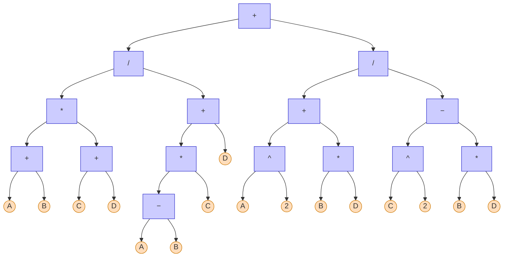

**Cách vẽ:** tìm phép toán thực hiện **cuối cùng** (phép $+$ giữa hai phân số) đặt làm gốc, rồi lặp lại với từng vế.

### Lời giải mẫu: Bài 1a (2) – Ký pháp Ba Lan

**Chia nhỏ:** đặt $E_1 = (A+B)(C+D)$, $E_2 = (A-B)C + D$, $E_3 = A^2 + BD$, $E_4 = C^2 - BD$. Khi đó $E = \dfrac{E_1}{E_2} + \dfrac{E_3}{E_4}$.

| | Tiền tố (Ba Lan) | Hậu tố (nghịch đảo Ba Lan) |
|---|---|---|
| $E_1$ | $*\ +\ A\ B\ +\ C\ D$ | $A\ B\ +\ C\ D\ +\ *$ |
| $E_2$ | $+\ *\ -\ A\ B\ C\ D$ | $A\ B\ -\ C\ *\ D\ +$ |
| $E_3$ | $+\ ^\wedge\ A\ 2\ *\ B\ D$ | $A\ 2\ ^\wedge\ B\ D\ *\ +$ |
| $E_4$ | $-\ ^\wedge\ C\ 2\ *\ B\ D$ | $C\ 2\ ^\wedge\ B\ D\ *\ -$ |

**Ghép lại:**

- **Tiền tố:** $+\ /\ E_1\ E_2\ /\ E_3\ E_4$
  $+\ /\ *\ +\ A\ B\ +\ C\ D\ +\ *\ -\ A\ B\ C\ D\ /\ +\ ^\wedge\ A\ 2\ *\ B\ D\ -\ ^\wedge\ C\ 2\ *\ B\ D$
- **Hậu tố:** $E_1\ E_2\ /\ E_3\ E_4\ /\ +$
  $A\ B\ +\ C\ D\ +\ *\ A\ B\ -\ C\ *\ D\ +\ /\ A\ 2\ ^\wedge\ B\ D\ *\ +\ C\ 2\ ^\wedge\ B\ D\ *\ -\ /\ +$

---

## 5. Cây khung

### Cây khung (Spanning Tree)

**Cây khung** của đồ thị $G$ là một cây thỏa: là **đồ thị con** của $G$, và chứa **tất cả các đỉnh** của $G$.

- Một đồ thị có thể có nhiều cây khung.
- Cây khung của $G$ có $n$ đỉnh thì có đúng $n-1$ cạnh.

**Ví dụ:** Đồ thị $G$ và 3 cây khung của nó (cạnh đỏ đậm là cạnh thuộc cây khung, cạnh xám là cạnh bị bỏ):

$G$:

```mermaid
graph LR
  a((" ")) --- b((" "))
  a --- d((" "))
  a --- e((" "))
  b --- e
  b --- c((" "))
  d --- e
  e --- c
```

$T_1$:

```mermaid
graph LR
  a((" ")) --- b((" "))
  a --- d((" "))
  a --- e((" "))
  b --- e
  b --- c((" "))
  d --- e
  e --- c
  linkStyle default stroke:#ccc,stroke-width:1px
  linkStyle 0,4,5,6 stroke:#e00,stroke-width:3px
```

$T_2$:

```mermaid
graph LR
  a((" ")) --- b((" "))
  a --- d((" "))
  a --- e((" "))
  b --- e
  b --- c((" "))
  d --- e
  e --- c
  linkStyle default stroke:#ccc,stroke-width:1px
  linkStyle 0,1,2,4 stroke:#e00,stroke-width:3px
```

$T_3$:

```mermaid
graph LR
  a((" ")) --- b((" "))
  a --- d((" "))
  a --- e((" "))
  b --- e
  b --- c((" "))
  d --- e
  e --- c
  linkStyle default stroke:#ccc,stroke-width:1px
  linkStyle 1,3,5,6 stroke:#e00,stroke-width:3px
```

> **Định lý**
> Một đồ thị là liên thông khi và chỉ khi nó có cây khung.

### Đếm số cây khung

**Ví dụ 1:** $C_n$ có bao nhiêu cây khung?

- Bỏ **đúng 1 cạnh** bất kỳ của chu trình thì được một đường đi (là cây).
- ⇒ $C_n$ có $n$ cây khung.

4 cây khung của $C_4$ (mỗi cây là $C_4$ bỏ đi một cạnh):

```mermaid
graph LR
  subgraph S1[" "]
    a1((1)) --- a2((2)) --- a3((3)) --- a4((4))
  end
  subgraph S2[" "]
    b2((2)) --- b3((3)) --- b4((4)) --- b1((1))
  end
  subgraph S3[" "]
    c3((3)) --- c4((4)) --- c1((1)) --- c2((2))
  end
  subgraph S4[" "]
    d4((4)) --- d1((1)) --- d2((2)) --- d3((3))
  end
```

**Ví dụ 2:** $K_3$ có bao nhiêu cây khung? → $K_3 = C_3$ nên có **3** cây khung.

**Ví dụ 3:** Số cây khung của $K_n$ (**Định lý Cayley**):

$$\tau(K_n) = n^{n-2}$$

$K_3$: $3^1 = 3$, $K_4$: $4^2 = 16$, $K_5$: $5^3 = 125$.

*Chú ý: đếm cây khung là đếm các tập cạnh khác nhau, kể cả khi các cây đó đẳng cấu với nhau.*

### Bài tập: Cây khung

**Bài 1.** Các đồ thị sau có tất cả bao nhiêu cây khung? a) $K_3$ b) $K_{2,2}$ c) $C_n$ d) $W_n$.

**Bài 2.** Hãy tìm tất cả cây khung cho mỗi đồ thị sau: a) $K_5$ b) $K_{4,4}$ c) $K_{1,6}$ d) $Q_3$ e) $C_5$ f) $W_5$.

**Bài 3.** Đồ thị $K_n$ với $n = 3, 4, 5$ có bao nhiêu cây khung **không đẳng cấu**?

**Bài 4.** Phải bỏ đi ít nhất bao nhiêu cạnh của một đồ thị liên thông có $n$ đỉnh, $m$ cạnh để được một cây khung?

### Lời giải mẫu: Bài 1 (a, b, c)

**a) $K_3$:** 3 cạnh, bỏ 1 cạnh bất kỳ: **3** cây khung.

```mermaid
graph LR
  subgraph K3["K₃"]
    k1((" ")) --- k2((" "))
    k2 --- k3((" "))
    k3 --- k1
  end
  subgraph R1["bỏ cạnh 1"]
    x1((" ")) --- x2((" ")) --- x3((" "))
  end
  subgraph R2["bỏ cạnh 2"]
    y1((" ")) --- y3((" ")) --- y2((" "))
  end
  subgraph R3["bỏ cạnh 3"]
    z2((" ")) --- z1((" ")) --- z3((" "))
  end
```

**b) $K_{2,2}$:** $K_{2,2}$ chính là $C_4$. **4** cây khung.

```mermaid
graph LR
  subgraph K22["K₂,₂"]
    u1((" ")) --- v1((" "))
    u1 --- v2((" "))
    u2((" ")) --- v1
    u2 --- v2
  end
```

**c) $C_n$:** $C_n$ có $n$ đỉnh, $n$ cạnh. Cây khung có $n-1$ cạnh ⇒ phải bỏ **đúng 1 cạnh**. Bỏ cạnh nào thì phần còn lại cũng là một đường đi qua mọi đỉnh (một cây). Có $n$ cách chọn cạnh bỏ ⇒ $n$ cây khung.

> **Phương pháp chung**
> Cây khung của đồ thị $n$ đỉnh, $m$ cạnh có $n-1$ cạnh ⇒ cần bỏ $m - n + 1$ cạnh sao cho **không còn chu trình** và vẫn **liên thông**.

---

## 6. Cây khung nhỏ nhất

### Cây khung nhỏ nhất

**Cây khung nhỏ nhất** của đồ thị liên thông có trọng số: cây khung có **tổng trọng số nhỏ nhất**.

**Ứng dụng:**

- **Nối dây điện:** nối nguồn điện tới $N$ máy (trực tiếp hoặc qua máy khác) với tổng chiều dài dây ngắn nhất.
- **Mạng giao thông:** xây thêm các tuyến đường để mọi nút đi lại được với nhau, với tổng chi phí ít nhất.
- **Mạng máy tính, đường ống nước, cáp quang, ...**

**Ví dụ:** Nối 4 làng bằng đường điện. Chi phí (triệu đồng):

```mermaid
graph LR
  A((A)) ---|3| B((B))
  A ---|2| D((D))
  B ---|6| C((C))
  D ---|4| C
  A ---|5| C
  B ---|7| D
  linkStyle 0,1,3 stroke:#e00,stroke-width:3px
```

Chọn các cạnh $AD$ (2), $AB$ (3), $CD$ (4): tổng **9**.
*Làm sao chắc chắn là nhỏ nhất? → Dùng thuật toán Prim hoặc Kruskal.*

### Thuật toán Prim

**Ý tưởng:** "lan rộng" cây từ một đỉnh.

- Chọn một đỉnh bất kỳ, đặt vào cây $T$.
- Trong khi $T$ có ít hơn $n$ đỉnh: ghép vào $T$ cạnh có trọng số **nhỏ nhất** nối **một đỉnh trong $T$** với **một đỉnh ngoài $T$**.

*Dừng khi $T$ có đủ $n$ đỉnh ($n-1$ cạnh). Có thể có nhiều cây khung nhỏ nhất.*

**Mô tả bằng nhãn** (giống Dijkstra):

1. **Khởi tạo:** $V_T = \{s\}$, $E_T = \varnothing$; $d_v = w(s,v)$ nếu $v$ kề $s$, ngược lại $d_v = \infty$.
2. **Chọn:** đỉnh $u \notin V_T$ có $d_u$ nhỏ nhất; thêm $u$ vào $V_T$ và cạnh tương ứng vào $E_T$. Nếu $V_T = V$ thì dừng.
3. **Cập nhật:** $d_v = \min\{d_v, w(u,v)\}$ với $v \notin V_T$. Quay lại bước 2.

*Khác Dijkstra: nhãn là trọng số **một cạnh** nối vào cây, không phải độ dài cả đường đi.*

### Prim: Ví dụ 1

```mermaid
graph LR
  f((f)) ---|2| a((a))
  a ---|5| b((b))
  f ---|6| e((e))
  e ---|3| b
  b ---|4| c((c))
  e ---|4| d((d))
  d ---|1| c
  linkStyle 0,1,3,4,6 stroke:#e00,stroke-width:3px
```

| Đỉnh | Cạnh | a | b | c | d | e | f |
|---|---|---|---|---|---|---|---|
| a | – | – | 5a | ∞ | ∞ | ∞ | **2a** |
| f | af (2) | | **5a** | ∞ | ∞ | 6f | – |
| b | ab (5) | | – | 4b | ∞ | **3b** | |
| e | be (3) | | | **4b** | 4e | – | |
| c | bc (4) | | | – | **1c** | | |
| d | cd (1) | | | | – | | |

**Tổng trọng số:** $2 + 5 + 3 + 4 + 1 = 15$.

Ô "5a": nhãn $d = 5$, nối vào cây qua đỉnh $a$.
Sau bước 4, $c$ và $d$ cùng nhãn 4; chọn $c$ (hoặc $d$ cũng được).

### Thuật toán Kruskal

**Ý tưởng:** chọn dần các cạnh **rẻ nhất trên toàn đồ thị**, miễn là không tạo chu trình.

1. Sắp xếp các cạnh theo trọng số không giảm: $w(e_1) \le w(e_2) \le \cdots \le w(e_m)$.
2. Lần lượt xét từng cạnh: nếu thêm vào $T$ **không tạo chu trình** thì chọn, ngược lại bỏ qua.
3. Dừng khi $T$ có đủ $n-1$ cạnh.

**So sánh Prim và Kruskal:**

| | Prim | Kruskal |
|---|---|---|
| Chọn cạnh | nhỏ nhất **nối vào cây** | nhỏ nhất **trên toàn đồ thị** |
| Trong quá trình | luôn là **một cây** | có thể là **một rừng** |
| Phù hợp | đồ thị **dày** (nhiều cạnh) | đồ thị **thưa** (ít cạnh) |

### Kruskal: Ví dụ 1 (cùng đồ thị)

```mermaid
graph LR
  f((f)) ---|2| a((a))
  a ---|5| b((b))
  f ---|6| e((e))
  e ---|3| b
  b ---|4| c((c))
  e ---|4| d((d))
  d ---|1| c
  linkStyle 0,1,3,4,6 stroke:#e00,stroke-width:3px
```

**Sắp xếp:** $cd$ (1), $af$ (2), $be$ (3), $bc$ (4), $ed$ (4), $ab$ (5), $fe$ (6).

| Cạnh | T.số | Quyết định |
|---|---|---|
| cd | 1 | Chọn |
| af | 2 | Chọn |
| be | 3 | Chọn |
| bc | 4 | Chọn |
| ed | 4 | Bỏ: chu trình $ebcde$ |
| ab | 5 | Chọn: đủ 5 cạnh |

**Tổng trọng số:** $1 + 2 + 3 + 4 + 5 = 15$.

*Nhận xét: cây này khác cây của Prim nhưng **cùng tổng 15**: cây khung nhỏ nhất có thể không duy nhất.*

### Kruskal: Ví dụ 2

```mermaid
graph LR
  A((A)) ---|7| B((B))
  A ---|5| D((D))
  B ---|8| C((C))
  B ---|9| D
  B ---|7| E((E))
  C ---|5| E
  D ---|15| E
  D ---|6| F((F))
  E ---|8| F
  E ---|9| G((G))
  F ---|11| G
  linkStyle 0,1,4,5,7,9 stroke:#e00,stroke-width:3px
```

- Trọng số 5: chọn $AD$, $CE$.
- Trọng số 6: chọn $DF$.
- Trọng số 7: chọn $AB$, $BE$.
- Trọng số 8: $BC$ tạo chu trình $B\,C\,E\,B$, $EF$ tạo chu trình $E\,F\,D\,A\,B\,E$ ⇒ bỏ cả hai.
- Trọng số 9: $BD$ tạo chu trình (bỏ); chọn $EG$. Đủ 6 cạnh, dừng.

**Tổng:** $5 + 5 + 6 + 7 + 7 + 9 = 39$.

### Cây khung lớn nhất

**Cây khung lớn nhất:** cây khung có **tổng trọng số lớn nhất**.

**Cách tìm:** dùng Prim hoặc Kruskal, nhưng mỗi bước chọn cạnh có trọng số **lớn nhất** (thay vì nhỏ nhất).

```mermaid
graph LR
  f((f)) ---|2| a((a))
  a ---|5| b((b))
  f ---|6| e((e))
  e ---|3| b
  b ---|4| c((c))
  e ---|4| d((d))
  d ---|1| c
  linkStyle 1,2,3,4,5 stroke:#33f,stroke-width:3px
```

**Ví dụ:** Kruskal với thứ tự **giảm dần**: $fe$ (6), $ab$ (5), $bc$ (4), $ed$ (4), $be$ (3), $af$ (2), $cd$ (1).

- Chọn $fe$ (6), $ab$ (5), $bc$ (4), $ed$ (4), $be$ (3).
- Đủ 5 cạnh. Tổng: $6 + 5 + 4 + 4 + 3 = 22$.

### Bài tập: Cây khung nhỏ nhất (1)

**Bài 1.** Tìm cây khung nhỏ nhất của các đồ thị sau theo thuật toán Kruskal và Prim.

**a)**

```mermaid
graph TD
  a((a)) ---|42| b((b))
  a ---|4| c((c))
  a ---|10| e((e))
  b ---|14| e
  b ---|3| f((f))
  c ---|3| d((d))
  d ---|1| e
  e ---|11| f
  c ---|15| g((g))
  d ---|5| g
  d ---|20| h((h))
  g ---|7| h
  h ---|9| f
```

**b)**

```mermaid
graph TD
  a((a)) ---|1| b((b))
  a ---|2| e((e))
  a ---|4| c((c))
  b ---|3| e
  b ---|3| d((d))
  c ---|3| e
  c ---|1| d
  e ---|2| d
```

**Bài 2.** Hãy đề xuất hai thuật toán (dựa trên Prim, Kruskal) tìm cây khung **lớn nhất**, rồi áp dụng cho các đồ thị ở Bài 1.

### Bài tập: Cây khung nhỏ nhất (2)

**Bài 3.** Tìm cây khung nhỏ nhất bằng thuật toán Prim của đồ thị gồm các đỉnh $A, \ldots, H$ cho bởi ma trận trọng số:

| | A | B | C | D | E | F | G | H |
|---|---|---|---|---|---|---|---|---|
| **A** | ∞ | 16 | 15 | 23 | 19 | 18 | 32 | 20 |
| **B** | 16 | ∞ | 13 | 33 | 24 | 20 | 19 | 11 |
| **C** | 15 | 13 | ∞ | 13 | 29 | 21 | 20 | 19 |
| **D** | 23 | 33 | 13 | ∞ | 22 | 30 | 21 | 12 |
| **E** | 19 | 24 | 29 | 22 | ∞ | 34 | 23 | 21 |
| **F** | 18 | 20 | 21 | 30 | 34 | ∞ | 17 | 14 |
| **G** | 32 | 19 | 20 | 21 | 23 | 17 | ∞ | 18 |
| **H** | 20 | 11 | 19 | 12 | 21 | 14 | 18 | ∞ |

**Bài 4.** Chứng minh rằng nếu mọi cạnh có trọng số đôi một khác nhau thì cây khung nhỏ nhất là **duy nhất**.

### Lời giải mẫu: Bài 1a bằng Kruskal

```mermaid
graph TD
  a((a)) ---|42| b((b))
  a ---|4| c((c))
  a ---|10| e((e))
  b ---|14| e
  b ---|3| f((f))
  c ---|3| d((d))
  d ---|1| e
  e ---|11| f
  c ---|15| g((g))
  d ---|5| g
  d ---|20| h((h))
  g ---|7| h
  h ---|9| f
  linkStyle 1,4,5,6,9,11,12 stroke:#e00,stroke-width:3px
```

**Sắp xếp:** $de$ 1, $bf$ 3, $cd$ 3, $ac$ 4, $dg$ 5, $gh$ 7, $hf$ 9, $ae$ 10, $ef$ 11, ...

| Cạnh | T.số | Các cây hiện tại |
|---|---|---|
| de | 1 | $\{d, e\}$ |
| bf, cd | 3 | $\{c, d, e\}$, $\{b, f\}$ |
| ac | 4 | $\{a, c, d, e\}$, $\{b, f\}$ |
| dg | 5 | $\{a, c, d, e, g\}$, $\{b, f\}$ |
| gh | 7 | $\{a, c, d, e, g, h\}$, $\{b, f\}$ |
| hf | 9 | nối 2 cây, đủ 7 cạnh |

**Tổng trọng số:** $1 + 3 + 3 + 4 + 5 + 7 + 9 = 32$.

**Kiểm tra bằng Prim (từ $a$):** $ac$ 4, $cd$ 3, $de$ 1, $dg$ 5, $gh$ 7, $hf$ 9, $fb$ 3. Cùng tổng 32. ✓

---

## Kết thúc

Cảm ơn các em đã theo dõi!
