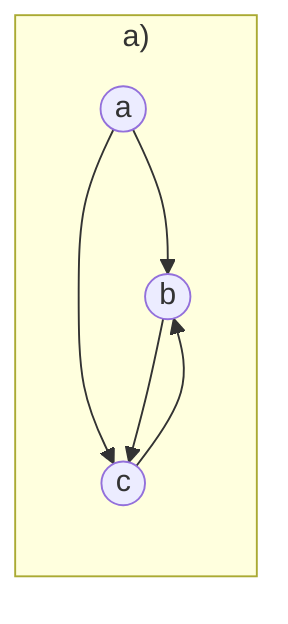
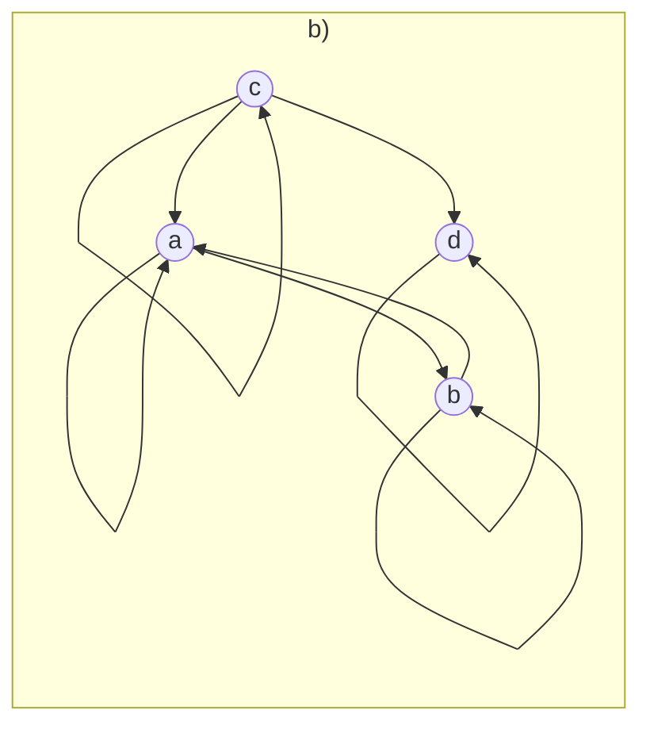
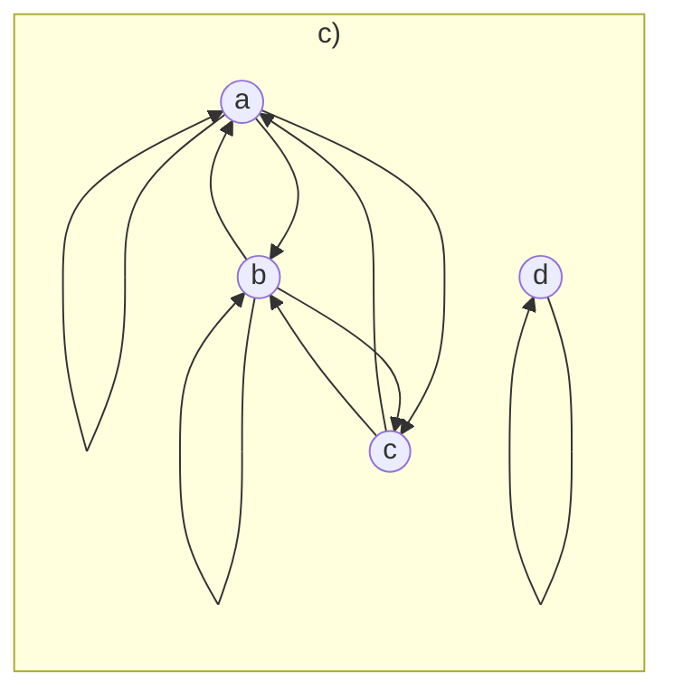
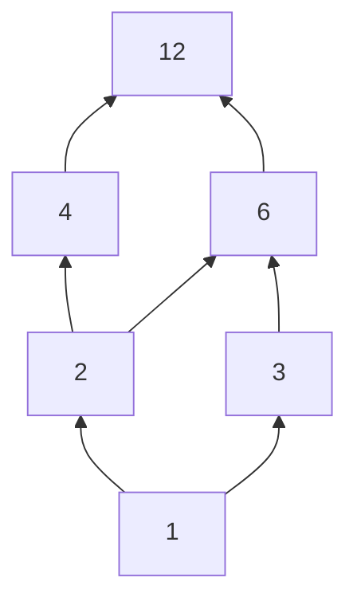
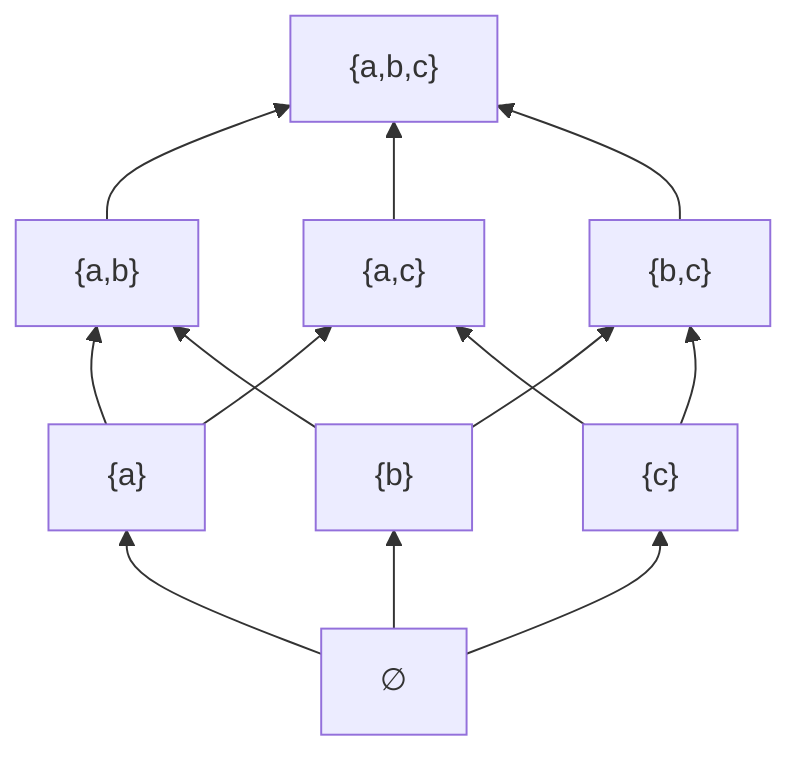
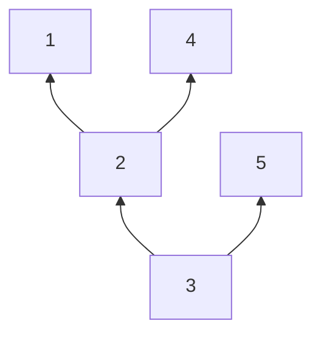

# Chương 3 – Quan hệ

# 3.1 Quan hệ hai ngôi và các tính chất

## 1. Định nghĩa
- **Tích Đề-các:** $A \times B = \{(a,b) \mid a\in A,\ b\in B\}$.
- **Quan hệ hai ngôi** từ $A$ đến $B$ là tập $R \subseteq A \times B$ (chọn ra một số cặp trong $A\times B$).
- Nếu $(a,b)\in R$ thì $a$ có quan hệ $R$ với $b$, viết $aRb$.
- Khi $A = B$, $R$ gọi là quan hệ hai ngôi **trên** $A$.
- Nếu $|A|=|B|=3$ thì $|A\times B| = 9$, mỗi cặp được chọn hoặc không, nên có $2^9 = 512$ quan hệ từ $A$ đến $B$.

**Ví dụ (từ $A$ đến $B$)**
- $A=\{a_1,a_2,a_3\}$, $B=\{b_1,b_2,b_3\}$, $R=\{(a_1,b_1),(a_1,b_3),(a_3,b_3)\}$; $a_2$ không có quan hệ với phần tử nào.
- $A=\{\text{An},\text{Vũ},\text{Hân}\}$, $B=\{\text{Toán},\text{Lý}\}$, $aRb \iff$ "$a$ đăng ký học môn $b$":
  $R=\{(\text{An},\text{Toán}),(\text{Vũ},\text{Toán}),(\text{Vũ},\text{Lý}),(\text{Hân},\text{Lý})\}$.

**Ví dụ (trên một tập)** — $A=\{1,2,3,4\}$:
- $aRb \iff a \mid b$: $R=\{(1,1),(1,2),(1,3),(1,4),(2,2),(2,4),(3,3),(4,4)\}$, $|R|=8$.
- $aSb \iff a<b$: $S=\{(1,2),(1,3),(1,4),(2,3),(2,4),(3,4)\}$, $|S|=6$.

## Biểu diễn bằng đồ thị có hướng
Với $R$ trên $A$: mỗi phần tử là một **đỉnh**; nếu $aRb$ vẽ mũi tên $a\to b$; nếu $aRa$ vẽ một **vòng** tại $a$.

## 2. Các tính chất của quan hệ
Cho $R$ là quan hệ hai ngôi trên $A$.

| Tính chất | Định nghĩa | Trên đồ thị |
|---|---|---|
| **Phản xạ** | $\forall a\in A,\ aRa$ | Mọi đỉnh đều có vòng |
| **Đối xứng** | $\forall a,b\in A,\ aRb \Rightarrow bRa$ | Mỗi mũi tên đều có mũi tên ngược chiều |
| **Phản xứng** | $\forall a,b\in A,\ (aRb \land bRa)\Rightarrow a=b$ | Giữa hai đỉnh khác nhau không có mũi tên hai chiều |
| **Bắc cầu (truyền)** | $\forall a,b,c\in A,\ (aRb\land bRc)\Rightarrow aRc$ | Đi được $a\to b\to c$ thì phải có đường tắt $a\to c$ |

Phản xứng tương đương: nếu $a\neq b$ thì không thể đồng thời có $aRb$ và $bRa$.

**Ví dụ**
- *Phản xạ:* trên $A=\{1,2,3,4\}$, $R_1=\{(1,1),(1,2),(2,1),(2,2),(3,4),(4,1),(4,4)\}$ không phản xạ vì $(3,3)\notin R_1$; $R_2=\{(1,1),(1,2),(1,4),(2,2),(3,3),(4,1),(4,4)\}$ phản xạ. Trên $\mathbb Z$: $\le$ phản xạ, $>$ không phản xạ.
- *Đối xứng:* $R_1=\{(1,1),(1,2),(2,1)\}$ đối xứng. Trên $\mathbb Z$, $aRb\iff a+b$ chẵn là đối xứng. Phản ví dụ: $\le$ trên $\mathbb Z$ ($1\le 2$ nhưng $2\not\le 1$).
- *Phản xứng:* $\le$ trên $\mathbb Z$ phản xứng; "ước của" trên $\mathbb Z^+$ phản xứng (vì $a\mid b$ và $b\mid a$ với $a,b>0$ thì $a=b$). Phản ví dụ: $R_1=\{(1,1),(1,2),(2,1)\}$ có $1R_12$, $2R_11$ nhưng $1\neq 2$.
- *Bắc cầu:* $\le$ và "ước của" có tính bắc cầu. Phản ví dụ: $R=\{(1,2),(2,3)\}$ trên $\{1,2,3\}$ không bắc cầu vì thiếu $(1,3)$.

### Lưu ý: đối xứng và phản xứng
"Không đối xứng" **không** có nghĩa là "phản xứng". Trên $A=\{1,2,3\}$:

| Quan hệ | Đối xứng | Phản xứng |
|---|:-:|:-:|
| $\{(1,1),(2,2)\}$ | Có | Có |
| $\{(1,2),(2,1)\}$ | Có | Không |
| $\{(1,2)\}$ | Không | Có |
| $\{(1,2),(2,1),(1,3)\}$ | Không | Không |

### Luyện tập nhanh
Trên $A=\{1,2,3\}$: $R=\{(1,1),(2,2),(3,3),(1,2),(2,3),(1,3)\}$ (chính là $\le$), $S=\{(1,2),(2,1)\}$.

| Tính chất | $R$ | $S$ |
|---|:-:|:-:|
| Phản xạ | Có | Không (thiếu $(1,1)$) |
| Đối xứng | Không | Có |
| Phản xứng | Có | Không |
| Bắc cầu | Có | Không (có $(1,2),(2,1)$ nhưng thiếu $(1,1)$) |

---

# 3.2 Biểu diễn quan hệ bằng ma trận

## Ma trận của quan hệ
Cho $R$ từ $A=\{a_1,\dots,a_m\}$ đến $B=\{b_1,\dots,b_n\}$. Ma trận $M_R=[m_{ij}]$ cỡ $m\times n$:

$$
m_{ij}=\begin{cases}1 & \text{nếu } (a_i,b_j)\in R\\ 0 & \text{nếu } (a_i,b_j)\notin R\end{cases}
$$

Hàng ứng với phần tử của $A$, cột ứng với phần tử của $B$.

**Ví dụ 1:** $A=\{1,2,3\}$, $B=\{1,2\}$, $aRb\iff a>b$, $R=\{(2,1),(3,1),(3,2)\}$:

$$
M_R=\begin{bmatrix}0&0\\1&0\\1&1\end{bmatrix}
$$

**Ví dụ 2:** $A=\{1,2,3,4\}$, $aRb\iff a\mid b$:

$$
M_R=\begin{bmatrix}1&1&1&1\\0&1&0&1\\0&0&1&0\\0&0&0&1\end{bmatrix}
$$

Đường chéo chính toàn số 1; phần dưới đường chéo toàn số 0.

## Nhận biết tính chất qua $M_R$ (ma trận vuông)

| Tính chất | Dấu hiệu trên $M_R$ |
|---|---|
| Phản xạ | Đường chéo chính toàn số 1 ($m_{ii}=1$) |
| Đối xứng | Đối xứng gương qua đường chéo chính ($m_{ij}=m_{ji}$) |
| Phản xứng | Với $i\neq j$, không có cặp $(m_{ij},m_{ji})$ nào cùng bằng 1 |
| Bắc cầu | Khó nhận ra trực tiếp, phải kiểm tra theo định nghĩa |

**Ví dụ đọc tính chất** (trên $A=\{1,2,3\}$):

$$
M_1=\begin{bmatrix}1&1&1\\0&1&1\\0&0&1\end{bmatrix},\qquad
M_2=\begin{bmatrix}1&1&0\\1&1&1\\0&1&1\end{bmatrix}
$$

- $M_1$: đường chéo toàn 1 ⇒ phản xạ; $m_{12}=1$ nhưng $m_{21}=0$ ⇒ không đối xứng; không có cặp $m_{ij}=m_{ji}=1$ ($i\ne j$) ⇒ phản xứng (đây là $\le$ trên $\{1,2,3\}$).
- $M_2$: đường chéo toàn 1 ⇒ phản xạ; đối xứng qua đường chéo ⇒ đối xứng, không phản xứng; $1R2$, $2R3$ nhưng $m_{13}=0$ ⇒ không bắc cầu.

## Các phép toán trên quan hệ
Cho $R,S$ là các quan hệ từ $A$ đến $B$.

| Phép toán | Định nghĩa | Trên ma trận |
|---|---|---|
| Quan hệ ngược $R^{-1}$ | $\{(b,a)\mid (a,b)\in R\}$ | Chuyển vị: $M_{R^{-1}}=M_R^{T}$ |
| Quan hệ bù $\overline R$ | $\{(a,b)\mid (a,b)\notin R\}$ | Đổi $0\leftrightarrow 1$ ở mọi ô |
| Hợp $R\cup S$ | $(a,b)\in R$ hoặc $(a,b)\in S$ | Ô bằng 1 nếu ít nhất một ô bằng 1 (OR) |
| Giao $R\cap S$ | $(a,b)\in R$ và $(a,b)\in S$ | Ô bằng 1 nếu cả hai ô bằng 1 (AND) |
| Hiệu $R\setminus S$ | $(a,b)\in R$ và $(a,b)\notin S$ | $M_R$ là 1 và $M_S$ là 0 |

Ví dụ: trên $\mathbb Z$, $R=\{(a,b)\mid a>b\}$ thì $R^{-1}=\{(a,b)\mid a<b\}$, $\overline R=\{(a,b)\mid a\le b\}$.

**Ví dụ bằng ma trận:** trên $A=\{1,2\}$, $M_R=\begin{bmatrix}1&1\\0&0\end{bmatrix}$, $M_S=\begin{bmatrix}1&0\\1&0\end{bmatrix}$.

$$
M_{R^{-1}}=\begin{bmatrix}1&0\\1&0\end{bmatrix},\;
M_{\overline R}=\begin{bmatrix}0&0\\1&1\end{bmatrix},\;
M_{R\cup S}=\begin{bmatrix}1&1\\1&0\end{bmatrix},\;
M_{R\cap S}=\begin{bmatrix}1&0\\0&0\end{bmatrix},\;
M_{R\setminus S}=\begin{bmatrix}0&1\\0&0\end{bmatrix}
$$

---

## Bài tập (3.1 và 3.2)

### Bài 5
Với mỗi quan hệ dưới đây trên tập $\{1,2,3,4\}$, xác định xem nó có phản xạ, đối xứng, bắc cầu không?

- a) $\{(1,2),(2,3),(3,2)\}$
- b) $\{(1,1),(2,2),(3,3),(4,4)\}$
- c) $\{(1,3),(1,4),(2,3),(3,1),(3,2),(4,1)\}$

**Lời giải**

| Quan hệ | Phản xạ | Đối xứng | Bắc cầu |
|---|---|---|---|
| a) | Không: thiếu $(1,1)$ | Không: có $(1,2)$, thiếu $(2,1)$ | Không: $(1,2),(2,3)$ nhưng thiếu $(1,3)$ |
| b) | Có: đủ 4 vòng | Có: mỗi cặp ngược lại chính nó | Có: chỉ có dạng $(a,a)$, và $(a,a)\Rightarrow(a,a)$ |
| c) | Không: thiếu $(1,1)$ | Có: $(1,3)$–$(3,1)$, $(1,4)$–$(4,1)$, $(2,3)$–$(3,2)$ | Không: $(1,3),(3,1)$ nhưng thiếu $(1,1)$ |

Nhận xét: b) là quan hệ bằng nhau ($aRb\iff a=b$), có đủ 3 tính chất.

### Bài 7
Xác định xem quan hệ $R$ trên tập số thực có tính phản xạ, đối xứng, phản xứng, bắc cầu hay không, với $(x,y)\in R$ khi và chỉ khi:

- a) $x=2y$
- b) $x+y=2$
- c) $xy\ge 0$

**Lời giải** (để chứng minh "Không", chỉ cần một phản ví dụ)

| | Phản xạ | Đối xứng | Phản xứng | Bắc cầu |
|---|---|---|---|---|
| a) $x=2y$ | Không: $1\ne 2\cdot1$ | Không: $2R1$ nhưng $1\ne 2\cdot 2$ | Có: $x=2y,\ y=2x\Rightarrow x=4x\Rightarrow x=y=0$ | Không: $4R2,\ 2R1$ nhưng $4\ne 2\cdot 1$ |
| b) $x+y=2$ | Không: $0+0\ne 2$ | Có: $x+y=y+x$ | Không: $0R2,\ 2R0$ nhưng $0\neq 2$ | Không: $0R2,\ 2R0$ nhưng $0+0\ne 2$ |
| c) $xy\ge 0$ | Có: $x\cdot x=x^2\ge 0$ | Có: $xy=yx$ | Không: $1R2,\ 2R1$ nhưng $1\ne 2$ | Không: $1R0,\ 0R(-1)$ nhưng $1\cdot(-1)<0$ |

Chú ý câu c): số $0$ "nối" được với mọi số nên tính bắc cầu bị phá vỡ khi đi qua $0$.

### Bài 20
Cho $R$ là một quan hệ được biểu diễn bởi ma trận

$$
M_R=\begin{bmatrix}0&1&1\\1&1&0\\1&0&1\end{bmatrix}
$$

Tìm ma trận biểu diễn quan hệ $\overline R$ và $R^{-1}$.

**Lời giải**

$$
M_{\overline R}=\begin{bmatrix}1&0&0\\0&0&1\\0&1&0\end{bmatrix}\ (\text{đổi }0\leftrightarrow1),\qquad
M_{R^{-1}}=M_R^T=\begin{bmatrix}0&1&1\\1&1&0\\1&0&1\end{bmatrix}
$$

$M_{R^{-1}}$ giống hệt $M_R$ vì $M_R$ đối xứng qua đường chéo chính. Tổng quát: $R$ đối xứng $\iff R^{-1}=R$.

### Bài 21
Cho $R_1$ và $R_2$ là hai quan hệ trên tập $A$ được biểu diễn bằng các ma trận:

$$
M_{R_1}=\begin{bmatrix}0&1&0\\1&1&1\\1&0&0\end{bmatrix},\qquad
M_{R_2}=\begin{bmatrix}0&1&0\\0&1&1\\1&1&1\end{bmatrix}
$$

Tìm ma trận của: a) $R_1\cup R_2$, $R_1\cap R_2$; b) $R_1\setminus R_2$, $R_2\setminus R_1$.

**Lời giải**

$$
M_{R_1\cup R_2}=\begin{bmatrix}0&1&0\\1&1&1\\1&1&1\end{bmatrix},\;
M_{R_1\cap R_2}=\begin{bmatrix}0&1&0\\0&1&1\\1&0&0\end{bmatrix}
$$

$$
M_{R_1\setminus R_2}=\begin{bmatrix}0&0&0\\1&0&0\\0&0&0\end{bmatrix},\;
M_{R_2\setminus R_1}=\begin{bmatrix}0&0&0\\0&0&0\\0&1&1\end{bmatrix}
$$

Kiểm tra: $R_1\cup R_2=(R_1\cap R_2)\cup(R_1\setminus R_2)\cup(R_2\setminus R_1)$, số ô bằng 1: $7=4+1+2$. ✓

### Bài 23
Liệt kê các cặp được sắp trong các quan hệ được biểu diễn bởi các đồ thị có hướng sau. (Gợi ý: mỗi mũi tên $x\to y$ cho cặp $(x,y)$; mỗi vòng tại $x$ cho cặp $(x,x)$.)

**Lời giải**
- a) $\{(a,b),(a,c),(b,c),(c,b)\}$: 4 mũi tên, không có vòng.
- b) $\{(a,a),(b,b),(c,c),(d,d),(a,b),(b,a),(c,a),(c,d)\}$: 4 vòng và 4 mũi tên.
- c) $\{(a,a),(b,b),(d,d),(a,b),(b,a),(a,c),(c,a),(b,c),(c,b)\}$: 3 vòng (không có vòng tại $c$) và 6 mũi tên.

Quan hệ đối xứng: chỉ có c), vì mọi mũi tên đều có chiều ngược lại.

---

# 3.3 Quan hệ tương đương

## 1. Định nghĩa
Quan hệ $R$ trên $A$ gọi là **tương đương** nếu nó có tính **phản xạ, đối xứng và bắc cầu**. Ý tưởng: gom các phần tử "giống nhau" theo một tiêu chí nào đó.

**Ví dụ**
- "Cùng họ" giữa các sinh viên trong lớp.
- Đồng dư modulo $m$ trên $\mathbb Z$: $a\equiv b \pmod m \iff m\mid(a-b)$.
- $R$ trên $\mathbb R$: $aRb\iff a-b\in\mathbb Z$ (hai số có cùng phần lẻ thập phân, ví dụ $2.3\,R\,5.3$).
- Phản ví dụ: $\le$ trên $\mathbb Z$ không tương đương vì không đối xứng.

**Ví dụ 1 (là tương đương):** $A=\{1,\dots,6\}$, $aRb\iff a\equiv b\pmod 3$.
- Phản xạ: $a-a=0\ \vdots\ 3$.
- Đối xứng: nếu $3\mid(a-b)$ thì $b-a=-(a-b)$ cũng chia hết cho 3.
- Bắc cầu: nếu $3\mid(a-b)$ và $3\mid(b-c)$ thì $a-c=(a-b)+(b-c)\ \vdots\ 3$.

**Ví dụ 2 (không là tương đương):** $A=\{1,2,3\}$, $S=\{(1,1),(2,2),(3,3),(1,2),(2,1),(2,3),(3,2)\}$.
Phản xạ và đối xứng thỏa, nhưng $1S2$, $2S3$ mà $(1,3)\notin S$ ⇒ vi phạm bắc cầu.

## 2. Lớp tương đương
Cho $R$ tương đương trên $A$, $a\in A$. Lớp tương đương của $a$:

$$[a]_R=\{b\in A\mid bRa\}$$

Ví dụ: $A=\{1,\dots,6\}$, $a\equiv b\pmod 3$: $[1]=\{1,4\}$, $[2]=\{2,5\}$, $[3]=\{3,6\}$. Nhận xét $[1]=[4]$ vì $1R4$.
Đồng dư modulo 8 trên $\mathbb Z$: $[0]_8=\{\dots,-16,-8,0,8,16,\dots\}$, $[1]_8=\{\dots,-15,-7,1,9,17,\dots\}$.

## Tập thương
$$A/R=\{[a]_R\mid a\in A\}$$

- $A=\{1,\dots,6\}$, mod 3: $A/R=\{\{1,4\},\{2,5\},\{3,6\}\}$.
- $\mathbb Z/\!\equiv_3\ =\{[0],[1],[2]\}$ (chỉ 3 phần tử dù $\mathbb Z$ vô hạn).

**Tính chất quan trọng:** các lớp tương đương **không giao nhau** và **phủ kín** $A$, tức tạo thành một **phân hoạch** của $A$.

---

## Bài tập (3.3)

### Bài 1
Xét quan hệ tương đương $T$ trên $\mathbb R$ xác định bởi $xTy\iff x-y\in\mathbb Z$.
- a) Xác định lớp tương đương của $1$ đối với $T$.
- b) Xác định lớp tương đương của $1/2$ đối với $T$.

### Bài 2
Trên $\mathbb Z$, xét quan hệ $T$: $\forall x,y\in\mathbb Z,\ xTy\iff x-y$ là số chẵn.
$T$ có phải là quan hệ tương đương không? Vì sao? Nếu có, hãy tìm các lớp tương đương và tập thương $\mathbb Z/T$.

**Lời giải**

*Kiểm tra quan hệ tương đương* ($x-y$ chẵn nghĩa là $x-y=2k$, $k\in\mathbb Z$):
- Phản xạ: $x-x=0=2\cdot0$ chẵn ⇒ $xTx$.
- Đối xứng: $xTy$, tức $x-y=2k$ ⇒ $y-x=2(-k)$ chẵn ⇒ $yTx$.
- Bắc cầu: $x-y=2k$, $y-z=2l$ ⇒ $x-z=2(k+l)$ chẵn ⇒ $xTz$.

Vậy $T$ là quan hệ tương đương.

*Lớp tương đương và tập thương:*
- $xT0\iff x$ chẵn: $[0]_T=\{x\in\mathbb Z\mid x\text{ chẵn}\}=\{\dots,-4,-2,0,2,4,\dots\}$.
- $xT1\iff x-1$ chẵn $\iff x$ lẻ: $[1]_T=\{x\in\mathbb Z\mid x\text{ lẻ}\}=\{\dots,-3,-1,1,3,5,\dots\}$.
- Mọi số nguyên đều chẵn hoặc lẻ nên chỉ có 2 lớp: $\mathbb Z/T=\{[0]_T,[1]_T\}$.

### Bài 3
Cho $A=\{-2,-1,0,1,2,3,4,5\}$, xét quan hệ $R$ trên $A$: $xRy\iff x-3y$ là số chẵn.
- a) Chứng minh $R$ là quan hệ tương đương trên $A$.
- b) Tìm các lớp tương đương $[1]_R$ và $[2]_R$.

*Gợi ý:* $x-3y=(x-y)-2y$. So sánh với Bài 2.

### Bài 4
Trên mặt phẳng tọa độ $\mathbb R^2$, xét quan hệ $R$: $(x,y)R(a,b)\iff x^2+y^2=a^2+b^2$.
- a) Chứng minh $R$ là quan hệ tương đương trên $\mathbb R^2$.
- b) Mô tả hình học của lớp tương đương $[(3,4)]_R$.
- c) Nêu ý nghĩa hình học tổng quát của các lớp tương đương đối với quan hệ này.

### Bài 5
Cho $S=\{1,2,3,4,5\}$, $\mathcal P(S)$ là tập lũy thừa của $S$. Xét quan hệ $R$ trên $\mathcal P(S)$: $ARB\iff |A|=|B|$.
- a) Chứng minh $R$ là quan hệ tương đương trên $\mathcal P(S)$.
- b) Tập thương $\mathcal P(S)/R$ có bao nhiêu phần tử?
- c) Tìm số phần tử của lớp tương đương chứa tập $A=\{1,2\}$.

### Bài 6
Trên $\mathbb Z$, xét quan hệ $R$: $aRb\iff 3a+4b$ chia hết cho $7$.
- a) Chứng minh $R$ là quan hệ tương đương. *Gợi ý:* thử biểu diễn $3a+4b$ qua hiệu $(a-b)$.
- b) Tìm lớp tương đương $[0]_R$.
- c) Chứng minh rằng quan hệ này thực chất chính là quan hệ đồng dư modulo $7$.

### Bài 7
Cho hàm số $f:\mathbb Z\to\mathbb Z$, $f(n)=n^2+n+1$. Xét quan hệ $R$ trên $\mathbb Z$: $nRm\iff f(n)=f(m)$.
- a) Chứng minh $R$ là quan hệ tương đương.
- b) Xác định các phần tử của lớp tương đương $[1]_R$.
- c) Một lớp tương đương bất kỳ trong quan hệ này có tối đa bao nhiêu phần tử?

### Bài 8
Cho $A=\{1,2,3,4,5,6\}$.
- a) Tìm số quan hệ tương đương khác nhau trên $A$ sao cho mỗi lớp tương đương có đúng 2 phần tử.
- b) Nếu quan hệ tương đương $R$ tạo ra tập thương $A/R=\{\{1,3,5\},\{2,4,6\}\}$, hãy liệt kê tất cả các cặp thuộc $R$.

---

# 3.4 Quan hệ thứ tự

## 1. Định nghĩa (poset)
Quan hệ $R$ trên $A$ gọi là **quan hệ thứ tự** nếu nó **phản xạ, phản xứng và bắc cầu**. Ký hiệu $\preceq$. Cặp $(A,\preceq)$ gọi là **tập sắp thứ tự (poset)**.

So sánh: quan hệ tương đương cần *đối xứng*, quan hệ thứ tự cần *phản xứng*.

**Ví dụ**
- $(\mathbb Z,\le)$ là poset.
- $(\mathcal P(S),\subseteq)$ là poset: $X\subseteq X$; $X\subseteq Y,\ Y\subseteq X\Rightarrow X=Y$; $X\subseteq Y\subseteq Z\Rightarrow X\subseteq Z$.
- $(\mathbb Z^+,\mid)$ cũng là poset.

## 2. Thứ tự toàn phần và bán phần
- **Toàn phần:** mọi cặp phần tử đều so sánh được ($a\preceq b$ hoặc $b\preceq a$).
- **Bán phần:** tồn tại các phần tử không so sánh được.

Ví dụ:
- $(\mathbb Z^+,\le)$ là toàn phần.
- $(\mathbb Z^+,\mid)$ là bán phần vì $5\nmid 7$ và $7\nmid 5$.
- $(\mathcal P(\{a,b\}),\subseteq)$ là bán phần vì $\{a\}\not\subseteq\{b\}$ và $\{b\}\not\subseteq\{a\}$.

## 3. Biểu đồ Hasse
Cách vẽ cho poset hữu hạn:
1. Vẽ đồ thị có hướng đầy đủ, xếp $b$ ở trên $a$ nếu $a\prec b$.
2. Bỏ các **vòng** (phản xạ là hiển nhiên).
3. Bỏ các **cạnh bắc cầu** (suy ra được từ các cạnh khác), ví dụ $1\to4$ (vì $1\to2\to4$).
4. Bỏ **mũi tên** (chiều luôn từ dưới lên).

Chỉ giữ các cặp "kề nhau": $a\prec b$ và không có $c$ nằm giữa.

**Ví dụ 1:** $(\{1,2,3,4,6,12\},\mid)$. Các cạnh Hasse: $1-2,\ 1-3,\ 2-4,\ 2-6,\ 3-6,\ 4-12,\ 6-12$.

**Ví dụ 2:** $(\mathcal P(S),\subseteq)$ với $S=\{a,b,c\}$: xếp các tập con theo số phần tử (0 phần tử ở dưới cùng, 3 phần tử ở trên cùng).

Chú ý: không nối $\varnothing$ với $\{a,b\}$ vì đã có đường $\varnothing-\{a\}-\{a,b\}$.

## 4. Phần tử tối tiểu và tối đại
Trong poset $(S,\preceq)$, phần tử $a$ là:
- **Tối tiểu** nếu không có $x\neq a$ sao cho $x\preceq a$ (trên Hasse: không có phần tử nào nằm dưới và nối với $a$).
- **Tối đại** nếu không có $x\neq a$ sao cho $a\preceq x$ (trên Hasse: không có phần tử nào nằm trên và nối với $a$).

Trong poset hữu hạn, phần tử tối đại và tối tiểu luôn tồn tại nhưng có thể không duy nhất. Mẹo: vẽ Hasse trước; tối tiểu là các điểm ở "đáy", tối đại là các điểm ở "đỉnh" của từng nhánh.

**Ví dụ**
- $\{2,4,5,10,12,20,25\}$ với quan hệ ước số: tối đại $12,20,25$; tối tiểu $2,5$.
- $(\{1,2,3,4,6,12\},\mid)$: tối tiểu $1$ (duy nhất), tối đại $12$ (duy nhất).

---

## Bài tập (3.4)

### Bài 1
Trên tập $X$, xét quan hệ $R$: $xRy\iff x^2+3x\le y^2+3y$.
- a) $X=\mathbb R$: $R$ có những tính chất nào trong phản xạ, đối xứng, phản xứng, bắc cầu? Giải thích.
- b) $X=\mathbb N$: $R$ có phải là quan hệ thứ tự trên $\mathbb N$ không? Tại sao? Nếu là thứ tự, đây là thứ tự bán phần hay toàn phần?

### Bài 2
Cho $\mid$ là quan hệ "chia hết" trên $\mathbb Z$: $\forall a,b\in\mathbb Z,\ a\mid b\iff\exists k\in\mathbb Z: b=k\cdot a$.
- a) Kiểm tra các tính chất phản xạ, phản xứng, bắc cầu của $\mid$ trên $\mathbb Z$. $\mid$ có thực sự là quan hệ thứ tự trên $\mathbb Z$ không? Giải thích.
- b) Quan hệ $\mid$ trên $\mathbb Z$ (nếu là thứ tự) có phải là thứ tự toàn phần không? Tại sao?

### Bài 3
Cho $A=\{1,2,3,4,5\}$, quan hệ $R$ trên $A$:

$$R=\{(1,1);(2,1);(2,2);(2,4);(3,1);(3,2);(3,3);(3,4);(3,5);(4,4);(5,5)\}$$

- a) $R$ có là quan hệ tương đương không? Có là quan hệ thứ tự không? Tại sao?
- b) Nếu $R$ là quan hệ thứ tự, hãy vẽ biểu đồ Hasse cho $(A,R)$.

**Lời giải**

*a) Kiểm tra các tính chất*
- Phản xạ: có đủ $(1,1),(2,2),(3,3),(4,4),(5,5)$ ⇒ **Có**.
- Đối xứng: $(2,1)\in R$ nhưng $(1,2)\notin R$ ⇒ **Không**.
- Phản xứng: với $a\ne b$, không có cặp nào xuất hiện cả hai chiều ⇒ **Có**.
- Bắc cầu: xét các cặp nối tiếp $(a,b),(b,c)$ với $a\neq b\neq c$: $(3,2),(2,1)\Rightarrow(3,1)\in R$ ✓; $(3,2),(2,4)\Rightarrow(3,4)\in R$ ✓; không còn trường hợp nào khác ⇒ **Có**.

Kết luận: $R$ **không** là quan hệ tương đương (không đối xứng); $R$ **là** quan hệ thứ tự.

*b) Biểu đồ Hasse* (quy ước $(a,b)\in R$ nghĩa là $a\preceq b$, nên $b$ vẽ phía trên $a$)
1. Bỏ các vòng $(1,1),\dots,(5,5)$.
2. Bỏ các cặp bắc cầu: $(3,1)$ vì $3\prec2\prec1$; $(3,4)$ vì $3\prec2\prec4$.
3. Các cặp kề nhau còn lại: $(3,2),(3,5),(2,1),(2,4)$.

Nhận xét: tối tiểu: $3$; tối đại: $1,4,5$; $1$ và $4$ không so sánh được ⇒ thứ tự bán phần.

### Bài 4
Cho $X=\{2;4;6;8;10;14;16;15;20;30;36;40;60\}$ với quan hệ $\mid$ là "ước số của".
- a) Vẽ biểu đồ Hasse cho $(X,\mid)$.
- b) Tìm các phần tử tối đại và tối tiểu của $X$.

### Bài 10
Trong các trường hợp sau, tìm các phần tử lớn nhất, nhỏ nhất, tối đại, tối tiểu (nếu có) của các tập hợp với quan hệ thứ tự tương ứng. Vẽ các biểu đồ Hasse.
- a) $U_{30}=\{n\in\mathbb N\mid n\mid 30\}$ với quan hệ ước số $\mid$.
- b) $X=\{2;3;4;6;8;10;80\}$ với quan hệ ước số $\mid$.
- c) $X=\{1,2,3,4,6,8,10,11\}$ với quan hệ $R$: $xRy\iff x=y$ hay $x\le y-1$.

### Bài 11
Cho $X=\{2,5,8,10,20,40\}$ và $\vdots$ là quan hệ "chia hết" trên $X$.
- a) Chứng tỏ $\vdots$ là quan hệ thứ tự. Vẽ biểu đồ Hasse cho $(X,\vdots)$.
- b) Tìm các phần tử tối đại và tối tiểu của $X$.
- c) Tìm các phần tử lớn nhất và nhỏ nhất của $X$.

### Bài 12
Cho $X=\{1,2,3,4,5\}$. $R$ và $S$ là hai quan hệ hai ngôi trên $X$ có ma trận biểu diễn:

$$
M_R=\begin{bmatrix}1&0&0&0&0\\1&1&0&1&0\\1&1&1&1&1\\0&0&0&1&0\\0&0&0&0&1\end{bmatrix},\qquad
M_S=\begin{bmatrix}1&0&1&1&0\\0&1&1&1&0\\0&0&1&1&0\\0&0&0&1&0\\1&1&1&1&1\end{bmatrix}
$$

Chứng minh $R$ và $S$ là quan hệ thứ tự trên $X$. Vẽ biểu đồ Hasse cho các quan hệ này.

*Gợi ý:* phản xạ → đường chéo chính; phản xứng → so sánh các ô đối xứng qua đường chéo; bắc cầu → kiểm tra theo định nghĩa.

### Câu 13
Cho $S=\{1,2,3,5,6,10,15,30\}$ (các ước số lớn hơn 0 của 30). Vẽ biểu đồ Hasse cho $(S,\mid)$ và $(S,\vdots)$.

*Gợi ý:* so sánh hai biểu đồ. Quan hệ $\vdots$ là quan hệ ngược của $\mid$.

### Câu 14
Vẽ biểu đồ Hasse cho $S$ với quan hệ thứ tự tương ứng.
- a) $(S=\{1,2,3,4,5,6,7,8\},\ \vdots)$
- b) $(S=\{1,2,3,6,12,24,36,48\},\ \mid)$
