# Chương 5 – Các khái niệm cơ bản của lý thuyết đồ thị

> Nguồn: slide *Chương 5* – Cấu trúc Rời rạc (UIT), TS. Nguyễn Văn Hợi.
> Các hình vẽ trong slide được dựng lại bằng **mermaid** (bố cục tự động nên có thể khác hình gốc, nhưng các đỉnh và cạnh giống nhau). Đường tô đỏ là đường đi/chu trình/đường ngắn nhất được nêu trong slide.

---

# 1. Các khái niệm cơ bản

## Mở đầu: đồ thị ở quanh ta
Đồ thị là mô hình gồm các **đối tượng** (đỉnh) và các **mối quan hệ** (cạnh) giữa chúng.

**Ví dụ 1: Mạng máy tính** (đỉnh: máy tính; cạnh: dây cáp nối)

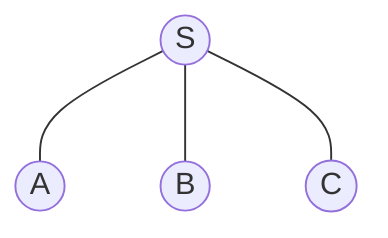

**Ví dụ 2: Mạng xã hội** (đỉnh: người; cạnh: là bạn bè)

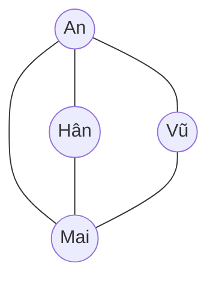

**Ví dụ 3: Bản đồ giao thông** (đỉnh: thành phố; cạnh: đường đi, có độ dài)

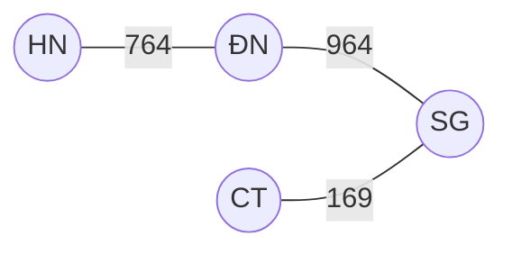

Lý thuyết đồ thị giúp giải các bài toán: tìm đường ngắn nhất, thiết kế mạng, lập lịch, …

## Định nghĩa đồ thị
Đồ thị $G=(V,E)$ với $V\neq\varnothing$:
- $V$: tập các **đỉnh** (vertex); $E$: tập các **cạnh** (edge).
- Mỗi cạnh $e\in E$ ứng với 2 đỉnh $v,w\in V$: $v,w$ là hai đỉnh **kề** nhau; $e$ **liên thuộc** với $v$ và $w$. Ký hiệu $e=vw$.
- Nếu $v\equiv w$: $e$ gọi là **vòng** (khuyên) tại $v$.

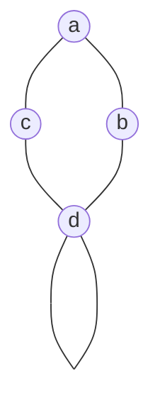

$a$ và $b$ kề nhau, $e_1=ab$ liên thuộc với $a,b$; có một vòng tại $d$.

## Đơn đồ thị và đa đồ thị
- **Cạnh bội (song song):** các cạnh phân biệt cùng ứng với một cặp đỉnh.
- **Đơn đồ thị:** đồ thị không có vòng và không có cạnh song song.
- **Đa đồ thị:** đồ thị không phải đơn đồ thị.

Ví dụ: đồ thị nào là đơn đồ thị?

**$G_1$** (đơn đồ thị)

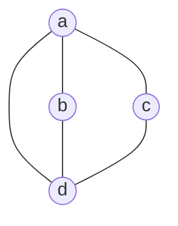

**$G_2$** (đa đồ thị: 2 cạnh song song $ab$)

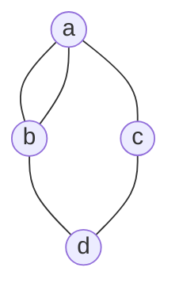

**$G_3$** (đa đồ thị: có vòng tại $b$)

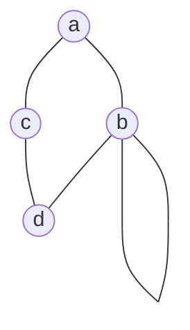

## Đồ thị con, đồ thị đầy đủ, đồ thị hữu hạn
- **Đồ thị con:** $G'=(V',E')$ là đồ thị con của $G=(V,E)$ nếu $V'\subseteq V$, $E'\subseteq E$.
- **Đồ thị đầy đủ $K_n$:** đơn đồ thị $n$ đỉnh mà mọi cặp đỉnh đều kề nhau.
- **Đồ thị hữu hạn:** $V$ và $E$ hữu hạn; ngược lại là đồ thị vô hạn.

Ví dụ: $G'$ và $G''$ có phải là đồ thị con của $G$ không?

**$G$**

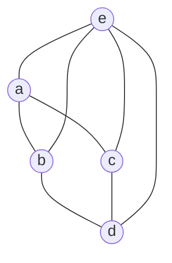

**$G'$** (là đồ thị con: bỏ đỉnh $e$ và các cạnh tới $e$)

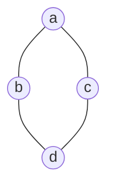

**$G''$** (không là đồ thị con: cạnh $ad$ không có trong $G$)

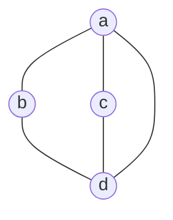

---

# 2. Bậc của đỉnh

## Định nghĩa
- **Bậc** của đỉnh $v$: số cạnh liên thuộc với $v$. Ký hiệu $\deg(v)$ hay $d(v)$. Mỗi **vòng** được tính là **2** cạnh tới một đỉnh.
- **Đỉnh cô lập:** $\deg(v)=0$. **Đỉnh treo:** $\deg(v)=1$; cạnh treo có đầu mút là đỉnh treo.
- **Đồ thị rỗng:** $\deg(v)=0$ với mọi $v$.

**Ví dụ 1:** tính bậc các đỉnh.

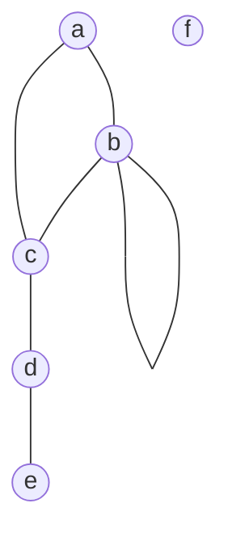

| $v$ | $a$ | $b$ | $c$ | $d$ | $e$ | $f$ |
|:-:|:-:|:-:|:-:|:-:|:-:|:-:|
| $\deg$ | 2 | 4 | 3 | 2 | 1 | 0 |

$\deg(b)=2+2$ (vòng tính 2). $e$ là đỉnh treo, $f$ là đỉnh cô lập.

## Định lý bắt tay
**Định lý 1.1.** Trong mọi đồ thị $G=(V,E)$:

$$\sum_{v\in V}\deg(v)=2|E|$$

(Mỗi cạnh có 2 đầu mút nên được đếm 2 lần.)
**Hệ quả:** trong mọi đồ thị, số đỉnh bậc lẻ là một số chẵn.

- Ví dụ 1 (tiếp): tổng bậc $=2+4+3+2+1+0=12=2\times6$ cạnh. ✓
- Ví dụ 2: không có đồ thị 5 đỉnh với bậc $3,3,3,3,3$ vì tổng bậc $=15$ lẻ.
- Ví dụ 3: đồ thị có bậc các đỉnh $4,3,3,2,2$ có $|E|=(4+3+3+2+2)/2=7$ cạnh.

## Định lý về đỉnh cùng bậc
**Định lý 1.2.** Trong mọi đơn đồ thị có nhiều hơn 1 đỉnh, tồn tại ít nhất hai đỉnh cùng bậc.

*Ý chứng minh* (với $|V|=n$): bậc mỗi đỉnh thuộc $\{0,1,\dots,n-1\}$, nhưng không thể đồng thời có đỉnh bậc $0$ và đỉnh bậc $n-1$. Chỉ còn $n-1$ giá trị cho $n$ đỉnh ⇒ theo nguyên lý chuồng bồ câu có 2 đỉnh cùng bậc.

**Định lý 1.3.** Trong mọi đơn đồ thị có nhiều hơn 2 đỉnh và có đúng hai đỉnh cùng bậc thì hai đỉnh này không đồng thời có bậc bằng $0$ hoặc $n-1$.

## Giải toán bằng phương pháp đồ thị
1. Xây dựng đồ thị mô tả bài toán: mỗi đỉnh là một đối tượng, mỗi cạnh là quan hệ giữa hai đối tượng.
2. Dùng các định nghĩa, tính chất, định lý để suy ra điều cần chứng minh.

- Ví dụ 1: trong một cuộc họp có ít nhất 2 đại biểu, luôn có hai đại biểu có số người quen bằng nhau. Đỉnh: đại biểu; cạnh: hai người quen nhau; số người quen $=$ bậc. Theo Định lý 1.2 ⇒ có 2 đỉnh cùng bậc. ✓
- Ví dụ 2: số người trên trái đất đã bắt tay một số lẻ lần là số chẵn. Đỉnh: người; cạnh: một lần bắt tay. Theo hệ quả Định lý 1.1. ✓

## Bài tập: Bậc của đỉnh

**Bài 1.** Tìm số đỉnh, số cạnh, bậc của mỗi đỉnh. Chỉ rõ đỉnh cô lập và đỉnh treo (nếu có).

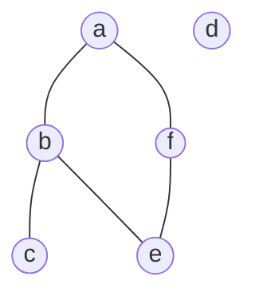

**Bài 2.** Một đồ thị vô hướng có các đỉnh có bậc lần lượt là $4,3,3,2,2$. Tính số cạnh và vẽ đồ thị này.

**Bài 3.** Tính số đỉnh của một đồ thị đều bậc 4 và có 10 cạnh.

**Bài 4.** Một đồ thị có 100 đỉnh, mỗi đỉnh đều có bậc 50. Tính số cạnh của nó.

**Bài 5.** Có tồn tại đơn đồ thị 6 đỉnh với bậc các đỉnh là $5,5,4,3,2,1$ không? Vì sao?

---

# 3. Biểu diễn đồ thị

## Các cách biểu diễn
- **Biểu diễn hình học:** mỗi đỉnh là một điểm, mỗi cạnh là một đường nối 2 đỉnh liên thuộc với nó.
- **Biểu diễn bằng ma trận** (thường dùng trên máy tính): ma trận kề, ma trận liên thuộc.
- **Biểu diễn bằng danh sách kề.**

Hai hình vẽ khác nhau có thể biểu diễn **cùng một đồ thị**; điều quan trọng là đỉnh nào kề đỉnh nào. Ví dụ đồ thị sau (cạnh $ab,ad,ac,bc,dc$) có thể vẽ theo nhiều cách:

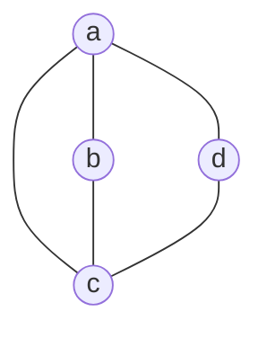

## Ma trận kề
Ma trận kề của $G$ với $n$ đỉnh $v_1,\dots,v_n$ là ma trận vuông cấp $n$, $A=(a_{ij})$ với $a_{ij}=$ số cạnh nối $v_i$ và $v_j$.
Tính chất: phụ thuộc thứ tự liệt kê đỉnh; ma trận đối xứng; một vòng tại $v_k$ cho $a_{kk}=1$; tổng hàng $i$ bằng $\deg(v_i)$.

**Ví dụ 1** (đơn đồ thị):

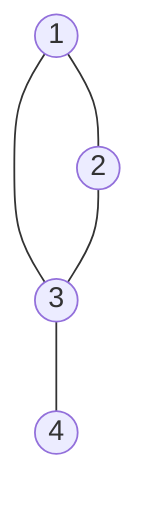

$$
A=\begin{bmatrix}0&1&1&0\\1&0&1&0\\1&1&0&1\\0&0&1&0\end{bmatrix}
$$

Hàng 1: đỉnh 1 kề 2 và 3.

**Ví dụ 2** (đa đồ thị):

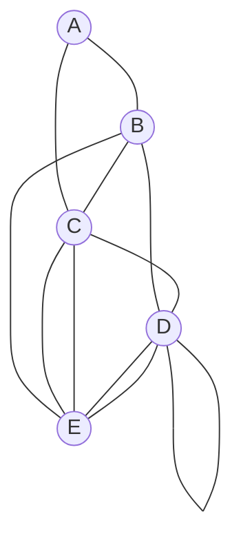

$$
A=\begin{bmatrix}0&1&1&0&0\\1&0&1&1&1\\1&1&0&1&2\\0&1&1&1&2\\0&1&2&2&0\end{bmatrix}
\quad(\text{thứ tự đỉnh } A,B,C,D,E)
$$

$a_{CE}=2$: có 2 cạnh song song giữa $C$ và $E$; $a_{DD}=1$: có một vòng tại $D$. Ma trận đối xứng.

## Ma trận liên thuộc
$M=(m_{ij})_{n\times m}$ ($n$ đỉnh, $m$ cạnh): $m_{ij}=1$ nếu cạnh $e_j$ liên thuộc với đỉnh $v_i$, ngược lại $m_{ij}=0$.
Tính chất: cạnh bội có các cột giống nhau; một vòng ứng với cột có đúng một số 1.

**Ví dụ** ($e_1$, $e_8$ là vòng; $e_2$, $e_3$ là cạnh bội $v_1v_2$):

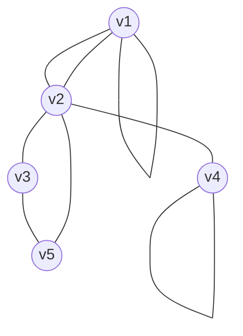

$$
M=\begin{array}{c|cccccccc}
 & e_1&e_2&e_3&e_4&e_5&e_6&e_7&e_8\\\hline
v_1&1&1&1&0&0&0&0&0\\
v_2&0&1&1&1&0&1&1&0\\
v_3&0&0&0&1&1&0&0&0\\
v_4&0&0&0&0&0&0&1&1\\
v_5&0&0&0&0&1&1&0&0
\end{array}
$$

## Danh sách kề
Với mỗi đỉnh, liệt kê các đỉnh kề với nó. Tiết kiệm bộ nhớ khi đồ thị có ít cạnh.

**Ví dụ 1:**

| Đỉnh | Đỉnh kề |
|:-:|---|
| $a$ | $b,c,e$ |
| $b$ | $a$ |
| $c$ | $a,c,d,e$ |
| $d$ | $c,e$ |
| $e$ | $a,c,d$ |

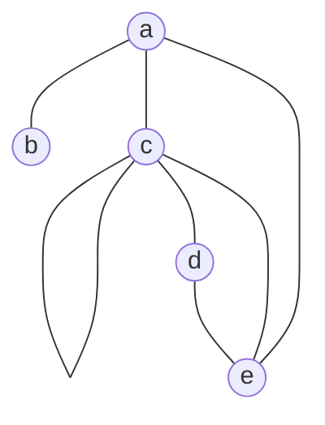

**Ví dụ 2:** vẽ đồ thị từ danh sách kề $1:\{2,4\}$, $2:\{1,3\}$, $3:\{2,4\}$, $4:\{1,3\}$ ⇒ chu trình $C_4$.

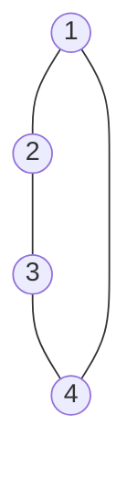

## Bài tập: Biểu diễn đồ thị
**Bài 1.** Biểu diễn các đồ thị sau bằng ma trận kề: a) $K_4$ b) $K_{1,4}$ c) $K_{2,3}$ d) $C_4$ e) $W_4$ f) $Q_3$.

**Bài 2.** Vẽ các đồ thị có hướng biểu diễn bằng các ma trận kề sau:

$$
\text{a)}\begin{bmatrix}0&1&0\\1&0&1\\0&1&0\end{bmatrix}\qquad
\text{b)}\begin{bmatrix}0&0&1&1\\0&0&1&0\\1&1&0&1\\1&1&1&0\end{bmatrix}\qquad
\text{c)}\begin{bmatrix}1&1&1&0\\0&0&1&0\\1&0&2&0\\1&1&1&0\end{bmatrix}
$$

**Bài 3.** Vẽ các đồ thị vô hướng biểu diễn bằng các ma trận kề sau:

$$
\text{a)}\begin{bmatrix}1&2&3\\2&0&4\\3&4&0\end{bmatrix}\qquad
\text{b)}\begin{bmatrix}1&2&0&1\\2&0&3&0\\0&3&1&1\\1&0&1&0\end{bmatrix}
$$

---

# 4. Một số đồ thị đặc biệt

## Đồ thị đầy đủ $K_n$
Đơn đồ thị $n$ đỉnh, mọi cặp đỉnh đều kề nhau.
- Số đỉnh $|V|=n$; bậc $\deg(v)=n-1$ với mọi $v$.
- Số cạnh $|E|=\dfrac{n(n-1)}{2}=C_n^2$.

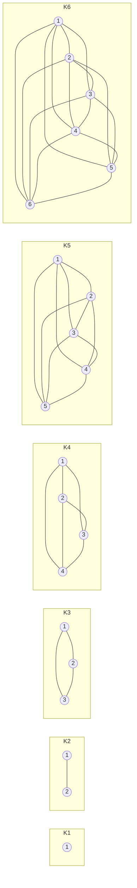

- Ví dụ 1: $K_5$ có $\frac{5\cdot4}{2}=10$ cạnh, $K_6$ có $15$ cạnh.
- Ví dụ 2: giải đấu vòng tròn 10 đội (mỗi cặp đấu 1 trận) có $C_{10}^2=45$ trận, là số cạnh của $K_{10}$.

## Đồ thị vòng $C_n$ và đồ thị bánh xe $W_n$
- **Đồ thị vòng $C_n$** ($n\ge3$): $|V|=n$, $\deg(v)=2$, $|E|=n$.
- **Đồ thị bánh xe $W_n$:** nối các đỉnh của $C_n$ với một đỉnh mới $u$. $|V|=n+1$, $|E|=2n$, $\deg(u)=n$, các đỉnh khác có bậc $3$.

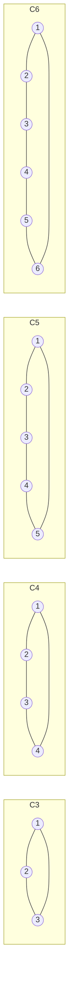

```mermaid
graph LR
    subgraph w3_s["W3"]
        w31(("1")) --- w32(("2"))
        w32 --- w33(("3"))
        w33 --- w31
        w3u(("u")) --- w31
        w3u --- w32
        w3u --- w33
    end
    subgraph w4_s["W4"]
        w41(("1")) --- w42(("2"))
        w42 --- w43(("3"))
        w43 --- w44(("4"))
        w44 --- w41
        w4u(("u")) --- w41
        w4u --- w42
        w4u --- w43
        w4u --- w44
    end
    subgraph w5_s["W5"]
        w51(("1")) --- w52(("2"))
        w52 --- w53(("3"))
        w53 --- w54(("4"))
        w54 --- w55(("5"))
        w55 --- w51
        w5u(("u")) --- w51
        w5u --- w52
        w5u --- w53
        w5u --- w54
        w5u --- w55
    end
    subgraph w6_s["W6"]
        w61(("1")) --- w62(("2"))
        w62 --- w63(("3"))
        w63 --- w64(("4"))
        w64 --- w65(("5"))
        w65 --- w66(("6"))
        w66 --- w61
        w6u(("u")) --- w61
        w6u --- w62
        w6u --- w63
        w6u --- w64
        w6u --- w65
        w6u --- w66
    end
```

- Ví dụ 1: $C_7$ có 7 cạnh; $W_7$ có 8 đỉnh và 14 cạnh.
- Ví dụ 2: mạng vòng (token ring) là $C_n$; mạng có một máy chủ trung tâm nối thêm với mọi máy trong vòng là $W_n$.

## Đồ thị đều bậc $k$ và khối lập phương $Q_n$
- **Đồ thị $k$-đều:** mọi đỉnh có cùng bậc $k$; khi đó $|E|=\dfrac{n\cdot k}{2}$ (định lý bắt tay).
  - $C_n$ đều bậc 2; $K_n$ đều bậc $n-1$.
  - Đồ thị đều bậc 3 có 10 đỉnh thì có $\frac{10\cdot3}{2}=15$ cạnh.
  - Không có đồ thị đều bậc 3 với 5 đỉnh vì $5\cdot3=15$ lẻ.
- **Khối $n$-lập phương $Q_n$:** có $2^n$ đỉnh, mỗi đỉnh là một dãy nhị phân độ dài $n$; hai đỉnh kề nhau khi và chỉ khi hai dãy khác nhau đúng 1 bit. $|V|=2^n$, $\deg(v)=n$, $|E|=n\cdot2^{n-1}$.

```mermaid
graph LR
    subgraph q1_s["Q1"]
        q10(("0")) --- q11(("1"))
    end
    subgraph q2_s["Q2"]
        q200(("00")) --- q201(("01"))
        q200 --- q210(("10"))
        q201 --- q211(("11"))
        q210 --- q211
    end
    subgraph q3_s["Q3"]
        q3000(("000")) --- q3001(("001"))
        q3000 --- q3010(("010"))
        q3000 --- q3100(("100"))
        q3001 --- q3011(("011"))
        q3001 --- q3101(("101"))
        q3010 --- q3011
        q3010 --- q3110(("110"))
        q3011 --- q3111(("111"))
        q3100 --- q3101
        q3100 --- q3110
        q3101 --- q3111
        q3110 --- q3111
    end
```

## Đồ thị bù
Hai đơn đồ thị $G$ và $\overline G$ **bù nhau** nếu chúng có chung các đỉnh, và cạnh nào thuộc $G$ thì không thuộc $\overline G$ và ngược lại.
Nhận xét: $|E(G)|+|E(\overline G)|=|E(K_n)|=\dfrac{n(n-1)}{2}$.

**Ví dụ 1:**

**$G=C_5$**

```mermaid
graph TB
    a(("a")) --- b(("b"))
    b --- c(("c"))
    c --- d(("d"))
    d --- e(("e"))
    e --- a
```

**$\overline G$** (cũng là một chu trình 5 đỉnh)

```mermaid
graph TB
    a(("a")) --- c(("c"))
    a --- d(("d"))
    b(("b")) --- d
    b --- e(("e"))
    c --- e
```

**Ví dụ 2:** $2+4=6=|E(K_4)|$ ✓

**$G$**

```mermaid
graph TB
    a(("a")) --- b(("b"))
    b --- c(("c"))
    d(("d"))
```

**$\overline G$**

```mermaid
graph TB
    a(("a")) --- c(("c"))
    a --- d(("d"))
    b(("b")) --- d
    c --- d
```

## Đồ thị lưỡng phân
Tập đỉnh chia được thành 2 tập $V_1,V_2$ không rỗng, rời nhau, sao cho mỗi cạnh nối một đỉnh của $V_1$ với một đỉnh của $V_2$. **Lưỡng phân đầy đủ $K_{m,n}$:** mọi đỉnh của $V_1$ ($|V_1|=m$) kề mọi đỉnh của $V_2$ ($|V_2|=n$); có $m\cdot n$ cạnh.

**Mẹo kiểm tra:** tô 2 màu sao cho hai đỉnh kề nhau khác màu. Tô được $\iff$ lưỡng phân.

**$K_{2,3}$**

```mermaid
graph TB
    a1(("a1")) --- b1(("b1"))
    a1 --- b2(("b2"))
    a1 --- b3(("b3"))
    a2(("a2")) --- b1
    a2 --- b2
    a2 --- b3
```

**$K_{3,3}$**

```mermaid
graph TB
    a1(("a1")) --- b1(("b1"))
    a1 --- b2(("b2"))
    a1 --- b3(("b3"))
    a2(("a2")) --- b1
    a2 --- b2
    a2 --- b3
    a3(("a3")) --- b1
    a3 --- b2
    a3 --- b3
```

**$C_6$** (lưỡng phân: $V_1=\{2,4,6\}$, $V_2=\{1,3,5\}$)

```mermaid
graph TB
    1(("1")) --- 2(("2"))
    2 --- 3(("3"))
    3 --- 4(("4"))
    4 --- 5(("5"))
    5 --- 6(("6"))
    6 --- 1
```

**$K_3$** (không lưỡng phân)

```mermaid
graph TB
    a(("a")) --- b(("b"))
    b --- c(("c"))
    c --- a
```

$K_3$ không lưỡng phân vì $c$ kề cả $a$ và $b$, không đặt vào tập nào được.

## Bài tập: Một số đồ thị đặc biệt
**Bài 1.** Hãy vẽ các đồ thị: a) $K_7$ b) $K_{1,8}$ c) $K_{4,4}$ d) $C_7$ e) $W_7$.

**Bài 2.** Các đồ thị sau có bao nhiêu đỉnh, cạnh? a) $K_n$ b) $C_n$ c) $W_n$ d) $K_{m,n}$.

**Bài 3.** Các đồ thị sau có là đồ thị lưỡng phân không?

**a)**

```mermaid
graph TB
    a(("a")) --- c(("c"))
    b(("b")) --- c
    d(("d")) --- c
    e(("e")) --- c
```

**b)**

```mermaid
graph TB
    a(("a")) --- b(("b"))
    b --- c(("c"))
    c --- d(("d"))
    d --- a
    c --- e(("e"))
```

**c)**

```mermaid
graph TB
    a(("a")) --- b(("b"))
    b --- c(("c"))
    b --- f(("f"))
    a --- d(("d"))
    a --- e(("e"))
    c --- f
    c --- e
```

**Bài 4.** Nếu đơn đồ thị $G$ có 15 cạnh và $\overline G$ có 13 cạnh thì $G$ có bao nhiêu đỉnh?

**Bài 5.** Vẽ các đồ thị: a) đều bậc 3 có 10 đỉnh; b) đều bậc 4 có 8 đỉnh.

**Bài 6.** Vẽ đồ thị bù của $K_{3,3}$ và của $W_4$.

---

# 5. Sự đẳng cấu của các đồ thị

## Định nghĩa
$G=(V,E)$ **đẳng cấu** với $G'=(V',E')$, ký hiệu $G\cong G'$, nếu:
- tồn tại song ánh $f:V\to V'$,
- bảo toàn quan hệ liền kề: $\forall u,v\in V:\ uv\in E\iff f(u)f(v)\in E'$.

Hiểu đơn giản: hai đồ thị đẳng cấu là cùng một đồ thị, chỉ khác tên đỉnh và cách vẽ.

Nếu $G\cong G'$ thì (**điều kiện cần**): $|V|=|V'|$, $|E|=|E'|$; $\deg(v)=\deg(f(v))$ với mọi $v$ ⇒ hai đồ thị có cùng dãy bậc.

- **Không đẳng cấu:** chỉ ra một điều kiện cần bị vi phạm.
- **Đẳng cấu:** xây dựng song ánh bảo toàn quan hệ liền kề.

**Ví dụ 1:** $G$ và $H$ có đẳng cấu không?

**$G$**

```mermaid
graph TB
    u1(("u1")) --- u2(("u2"))
    u2 --- u3(("u3"))
    u3 --- u4(("u4"))
    u4 --- u1
```

**$H$**

```mermaid
graph TB
    v1(("v1")) --- v2(("v2"))
    v3(("v3")) --- v4(("v4"))
    v1 --- v4
    v2 --- v3
```

Cùng 4 đỉnh, 4 cạnh, mọi đỉnh bậc 2. Song ánh: $u_1\mapsto v_1,\ u_2\mapsto v_4,\ u_3\mapsto v_3,\ u_4\mapsto v_2$. Kiểm tra từng cạnh: $u_1u_2\mapsto v_1v_4$ ✓, $u_2u_3\mapsto v_4v_3$ ✓, $u_3u_4\mapsto v_3v_2$ ✓, $u_4u_1\mapsto v_2v_1$ ✓ ⇒ $G\cong H$ (cả hai đều là $C_4$).

**Ví dụ 2:** $C_5$ và $\overline{C_5}$ có đẳng cấu không?

**$C_5$**

```mermaid
graph TB
    1(("1")) --- 2(("2"))
    2 --- 3(("3"))
    3 --- 4(("4"))
    4 --- 5(("5"))
    5 --- 1
```

**$\overline{C_5}$** (đi theo $1\to3\to5\to2\to4\to1$)

```mermaid
graph TB
    1(("1")) --- 3(("3"))
    3 --- 5(("5"))
    5 --- 2(("2"))
    2 --- 4(("4"))
    4 --- 1
```

Song ánh: $1\mapsto1,\ 2\mapsto3,\ 3\mapsto5,\ 4\mapsto2,\ 5\mapsto4$ ⇒ $C_5\cong\overline{C_5}$.

**Ví dụ 3:** $C_6$ và 2 tam giác có đẳng cấu không?

**$C_6$**

```mermaid
graph TB
    1(("1")) --- 2(("2"))
    2 --- 3(("3"))
    3 --- 4(("4"))
    4 --- 5(("5"))
    5 --- 6(("6"))
    6 --- 1
```

**Hai tam giác rời nhau**

```mermaid
graph TB
    a(("a")) --- b(("b"))
    b --- c(("c"))
    c --- a
    d(("d")) --- e(("e"))
    e --- f(("f"))
    f --- d
```

Cùng 6 đỉnh, 6 cạnh, mọi đỉnh bậc 2. Nhưng $C_6$ liên thông, còn đồ thị bên phải gồm 2 mảnh rời nhau ⇒ **không đẳng cấu**.
*Bài học:* cùng số đỉnh, số cạnh, dãy bậc là chưa đủ để kết luận đẳng cấu.

## Đồ thị tự bù
$G$ **tự bù** nếu $G\cong\overline G$. Nếu $G$ tự bù có $n$ đỉnh thì $|E(G)|=\frac12\cdot\frac{n(n-1)}{2}=\frac{n(n-1)}{4}$.

- Ví dụ 1: $C_5$ tự bù (ví dụ trước).
- Ví dụ 2: đường đi $P_4$ tự bù.

**$P_4$**

```mermaid
graph LR
    a(("a")) --- b(("b"))
    b --- c(("c"))
    c --- d(("d"))
```

**$\overline{P_4}$** ($c-a-d-b$ cũng là đường đi 4 đỉnh)

```mermaid
graph LR
    c(("c")) --- a(("a"))
    a --- d(("d"))
    d --- b(("b"))
```

- Ví dụ 3: $C_4$ không tự bù: $C_4$ có 4 cạnh, nhưng đồ thị tự bù 4 đỉnh phải có $\frac{4\cdot3}{4}=3$ cạnh.

**Định lý 1.4.** Hai đồ thị có ma trận kề (theo một thứ tự nào đó của các đỉnh) bằng nhau thì đẳng cấu với nhau.

## Bài tập: Sự đẳng cấu
**Bài 1.** Các cặp đồ thị sau có đẳng cấu với nhau không? Nếu có, hãy chỉ ra song ánh.

**a)** $G$ và $H$

```mermaid
graph TB
    u1(("u1")) --- u2(("u2"))
    u2 --- u3(("u3"))
    u3 --- u4(("u4"))
    u4 --- u5(("u5"))
    u5 --- u1
```

```mermaid
graph TB
    v1(("v1")) --- v3(("v3"))
    v1 --- v4(("v4"))
    v2(("v2")) --- v5(("v5"))
    v2 --- v4
    v3 --- v5
```

**b)** $G$ và $H$

```mermaid
graph TB
    u1(("u1")) --- u2(("u2"))
    u2 --- u3(("u3"))
    u3 --- u4(("u4"))
    u4 --- u1
    u5(("u5")) --- u1
    u5 --- u2
    u5 --- u3
    u5 --- u4
```

```mermaid
graph TB
    v1(("v1")) --- v2(("v2"))
    v1 --- v3(("v3"))
    v1 --- v4(("v4"))
    v1 --- v5(("v5"))
    v2 --- v3
    v3 --- v4
    v4 --- v5
    v5 --- v2
```

**Bài 2.** Tìm các đồ thị tự bù có 4 đỉnh.

**Bài 3.** Với số nguyên $n$ nào thì $C_n$ tự bù?

**Bài 4.** Chứng minh rằng nếu $G$ tự bù có $n$ đỉnh thì $n\equiv0$ hoặc $n\equiv1\pmod 4$.

**Bài 5.** Vẽ tất cả các đơn đồ thị (không đẳng cấu) có 4 đỉnh và 3 cạnh.

---

# 6. Đồ thị có hướng

## Định nghĩa
Đồ thị có hướng $G=(V,E)$: $V$ là tập đỉnh; $E=\{(a,b)\mid a,b\in V\}$ là tập **cung** (cạnh có hướng).
- Cung $e=(a,b)$ ký hiệu $e=\overrightarrow{ab}$: hướng từ $a$ đến $b$; $a$ là **đỉnh đầu**, $b$ là **đỉnh cuối**.
- $e$ là **khuyên** (vòng) $\iff a=b$.
- Đồ thị vô hướng tương ứng: bỏ chiều các cung.

Ví dụ: đường một chiều trong thành phố, quan hệ "theo dõi" trên mạng xã hội, lời gọi hàm trong chương trình.

```mermaid
graph TB
    a(("a")) --> b(("b"))
    b --> b
    b --> d(("d"))
    a --> d
    d --> c(("c"))
    c --> a
```

## Bậc vào và bậc ra
- **Bậc vào** $\deg^-(v)$: số cung có đỉnh cuối là $v$. **Bậc ra** $\deg^+(v)$: số cung có đỉnh đầu là $v$.
- Một khuyên tại $v$ góp 1 vào $\deg^-(v)$ và 1 vào $\deg^+(v)$.

**Ví dụ 1** (đồ thị ở trên):

| | $a$ | $b$ | $c$ | $d$ | Tổng |
|:-:|:-:|:-:|:-:|:-:|:-:|
| $\deg^-$ | 1 | 2 | 1 | 2 | 6 |
| $\deg^+$ | 2 | 2 | 1 | 1 | 6 |

**Định lý 1.5.** $\displaystyle\sum_{v\in V}\deg^+(v)=\sum_{v\in V}\deg^-(v)=|E|$.
**Đồ thị cân bằng:** $\deg^+(v)=\deg^-(v)$ với mọi $v\in V$.

**Ví dụ 2:** đồ thị sau có cân bằng không?

```mermaid
graph TB
    a(("a")) --> b(("b"))
    b --> c(("c"))
    c --> d(("d"))
    d --> a
    a --> c
    c --> a
```

$\deg^+(a)=2=\deg^-(a)$, $\deg^+(c)=2=\deg^-(c)$, các đỉnh $b,d$: vào 1, ra 1 ⇒ **cân bằng**.

**Ví dụ 3:** 9 đội bóng bàn thi đấu vòng tròn một lượt (không hòa). Có thể mỗi đội đều thắng đúng 5 đội khác không?
Đỉnh: đội bóng; cung $\overrightarrow{ab}$: $a$ thắng $b$. Số trận $=C_9^2=36=$ số cung. Nếu mỗi đội thắng 5 trận: $\sum\deg^+(v)=9\times5=45\neq36$ ⇒ **không thể**.
Câu hỏi thêm: với 7 đội, mỗi đội thắng đúng 3 trận được không? ($7\times3=21=C_7^2$)

## Bài tập: Đồ thị có hướng
**Bài 1.** Xác định số đỉnh, số cung, bậc vào và bậc ra của mỗi đỉnh của đồ thị sau. Đồ thị có cân bằng không?

```mermaid
graph TB
    a(("a")) --> a
    a --> b(("b"))
    d(("d")) --> a
    d --> b
    b --> c(("c"))
    b --> e(("e"))
    e --> c
    d --> c
    c --> d
```

**Bài 2.** Có 7 đội bóng thi đấu vòng tròn một lượt, không có trận hòa. Có thể mỗi đội đều thắng đúng 3 trận không? Nếu có, hãy vẽ một đồ thị minh họa.

**Bài 3.** Chứng minh rằng trong một giải đấu vòng tròn (không hòa), tổng bình phương số trận thắng bằng tổng bình phương số trận thua.

**Bài 4.** Ma trận kề của đồ thị có hướng có đối xứng không? Khi nào thì đối xứng?

---

# 7. Đường đi, chu trình và sự liên thông

## Đường đi
**Đường đi** độ dài $n$ từ $v_0$ đến $v_n$: dãy $n$ cạnh liên tiếp $v_0v_1,\ v_1v_2,\dots,v_{n-1}v_n$. Ký hiệu $v_0v_1v_2\dots v_n$.
- **Đường đi đơn:** không qua cạnh nào quá một lần.
- **Đường đi sơ cấp:** không qua đỉnh nào quá một lần.
- Đường đi sơ cấp ⇒ đường đi đơn (chiều ngược lại không đúng).

```mermaid
graph TB
    a(("a")) --- b(("b"))
    a --- d(("d"))
    a --- c(("c"))
    b --- c
    b --- e(("e"))
    c --- e
    c --- d
```

- Ví dụ 1: $abecd$: đường đi sơ cấp, độ dài 4.
- Ví dụ 2: $dabca$: qua đỉnh $a$ hai lần nhưng không lặp cạnh ⇒ đơn, không sơ cấp.
- Ví dụ 3: $abcbe$: lặp cạnh $bc$ ⇒ không đơn.

## Chu trình
**Chu trình:** đường đi khép kín $v_0v_1\dots v_nv_0$, độ dài ít nhất là 3.
- **Chu trình đơn:** không qua cạnh nào quá 1 lần.
- **Chu trình sơ cấp:** không qua đỉnh nào quá 1 lần (trừ đỉnh đầu trùng đỉnh cuối).

(Trên đồ thị ở mục Đường đi:)
- Ví dụ 1: $abca$: chu trình sơ cấp độ dài 3.
- Ví dụ 2: $abecda$: chu trình sơ cấp độ dài 5, qua mọi đỉnh.
- Ví dụ 3: $cbecdac$: không lặp cạnh nhưng qua $c$ ở giữa ⇒ chu trình đơn, không sơ cấp.

**Định lý 1.6 và 1.7.**
- Đồ thị vô hướng có $\ge3$ đỉnh, mọi đỉnh bậc $\ge2$ thì có chu trình sơ cấp.
- Đồ thị vô hướng có $\ge4$ đỉnh, mọi đỉnh bậc $\ge3$ thì có chu trình sơ cấp độ dài chẵn.

## Tính liên thông trong đồ thị vô hướng
- Hai đỉnh $u,v$ **liên thông** nếu có đường đi nối chúng.
- $G$ **liên thông** nếu hai đỉnh phân biệt bất kỳ đều liên thông.
- **Thành phần liên thông** chứa $v$: gồm $v$, mọi đỉnh liên thông với $v$ và mọi cạnh nối các đỉnh đó.

**Định lý 1.8.** $G$ liên thông $\iff$ $G$ có duy nhất một thành phần liên thông.

Ví dụ: đồ thị sau có mấy thành phần liên thông?

```mermaid
graph TB
    a(("a")) --- b(("b"))
    a --- c(("c"))
    b --- d(("d"))
    c --- d
    e(("e")) --- f(("f"))
    e --- g(("g"))
    f --- g
    h(("h"))
```

3 thành phần: $\{a,b,c,d\}$, $\{e,f,g\}$, $\{h\}$ ⇒ không liên thông.

## Đỉnh cắt và cầu
- $u$ là **đỉnh cắt** (điểm khớp) nếu bỏ $u$ và các cạnh liên thuộc thì số thành phần liên thông tăng lên.
- $e$ là **cầu** nếu bỏ cạnh $e$ thì số thành phần liên thông tăng lên.

**Ví dụ 1:** đỉnh cắt $c,d$; cầu $cd$.

```mermaid
graph LR
    a(("a")) --- b(("b"))
    a --- c(("c"))
    b --- c
    c --- d(("d"))
    d --- e(("e"))
    d --- f(("f"))
    e --- f
```

**Ví dụ 2:**

**$P_4$** (đỉnh cắt $b,c$; mọi cạnh đều là cầu)

```mermaid
graph LR
    a(("a")) --- b(("b"))
    b --- c(("c"))
    c --- d(("d"))
```

**$C_4$** (không có đỉnh cắt, không có cầu)

```mermaid
graph TB
    p(("p")) --- q(("q"))
    q --- r(("r"))
    r --- s(("s"))
    s --- p
```

Ứng dụng: trong mạng máy tính, đỉnh cắt và cầu là các điểm yếu, hỏng thì mạng bị chia cắt.

## Các định lý về tính liên thông
- **Định lý 1.9.** Đơn đồ thị $G$ có $n\ge2$ đỉnh và $\deg(u)+\deg(v)\ge n$ với mọi $u,v$ thì $G$ liên thông. Hệ quả: đơn đồ thị $n$ đỉnh có $\deg(v)\ge n/2$ với mọi $v$ thì liên thông.
- **Định lý 1.10.** Nếu đồ thị $G$ có đúng 2 đỉnh bậc lẻ thì 2 đỉnh này phải liên thông với nhau. (Thành phần liên thông chứa một đỉnh bậc lẻ phải chứa một số chẵn đỉnh bậc lẻ.)
- **Định lý 1.11.** $G$ là đồ thị lưỡng phân $\iff$ mọi chu trình của $G$ đều có độ dài chẵn. Ví dụ: $C_6$ lưỡng phân; $K_3$ không.

## Liên thông trong đồ thị có hướng
- **Liên thông mạnh:** với hai đỉnh $u,v$ bất kỳ, luôn có đường đi từ $u$ đến $v$ **và** từ $v$ đến $u$.
- **Liên thông yếu:** đồ thị vô hướng tương ứng là liên thông.
- Liên thông mạnh ⇒ liên thông yếu; chiều ngược lại không đúng.

**Ví dụ 1** (liên thông mạnh)

```mermaid
graph TB
    a(("a")) --> b(("b"))
    b --> c(("c"))
    c --> d(("d"))
    d --> a
    a --> c
```

**Ví dụ 2** (liên thông yếu)

```mermaid
graph TB
    a(("a")) --> b(("b"))
    a --> d(("d"))
    b --> c(("c"))
    d --> c
```

Ví dụ 1: chu trình $a\to b\to c\to d\to a$ đi qua mọi đỉnh ⇒ liên thông mạnh. Ví dụ 2: không có đường đi từ $c$ đến $a$, nhưng bỏ chiều thì liên thông ⇒ liên thông yếu.

## Một số phép biến đổi đồ thị
**Hợp của 2 đồ thị:** $G\cup G'=(V\cup V',E\cup E')$.

**$G$**

```mermaid
graph TB
    1(("1")) --- 2(("2"))
    1 --- 3(("3"))
    2 --- 3
```

**$G'$**

```mermaid
graph TB
    2(("2")) --- 3(("3"))
    2 --- 4(("4"))
    3 --- 4
```

**$G\cup G'$**

```mermaid
graph TB
    1(("1")) --- 2(("2"))
    1 --- 3(("3"))
    2 --- 3
    2 --- 4(("4"))
    3 --- 4
```

**Phép phân chia sơ cấp:** thay cạnh $e=uv$ bởi một đỉnh mới $w$ cùng 2 cạnh $uw$, $wv$.

Trước: 

```mermaid
graph LR
    u(("u")) --- v(("v"))
```

Sau khi phân chia cạnh $uv$ bằng đỉnh mới $w$:

```mermaid
graph LR
    u(("u")) --- w(("w"))
    w --- v(("v"))
```

**Đồng phôi:** $G$ và $G'$ đồng phôi nếu nhận được từ cùng một đồ thị bằng một dãy các phép phân chia sơ cấp. Ví dụ: $C_3,C_4,C_5$ đồng phôi với nhau (phân chia một cạnh của $C_3$ nhiều lần), nhưng không đẳng cấu.

## Bài tập: Đường đi, chu trình, liên thông
**Bài 1.** Đồ thị a) dưới đây có liên thông không? Có mấy thành phần liên thông?
**Bài 2.** Tìm tất cả các đỉnh cắt và cầu của đồ thị b).

(Hình a) là hình sao 6 cánh: dạng hai tam giác chồng nhau, các giao điểm không phải là đỉnh, chỉ có 6 chấm đen ở các mũi nhọn.)

**a)** (hai tam giác rời nhau: 6 đỉnh, 2 thành phần)

```mermaid
graph TB
    1(("1")) --- 2(("2"))
    2 --- 3(("3"))
    3 --- 1
    4(("4")) --- 5(("5"))
    5 --- 6(("6"))
    6 --- 4
```

**b)**

```mermaid
graph TB
    a(("a")) --- b(("b"))
    a --- c(("c"))
    b --- c
    c --- d(("d"))
    d --- e(("e"))
    e --- f(("f"))
    c --- f
```

**Bài 3.** Tìm số đường đi độ dài $n$ giữa 2 đỉnh liền kề tùy ý trong $K_{3,3}$ với: a) $n=2$ b) $n=3$ c) $n=4$ d) $n=5$.

**Bài 4.** Cho $G$ là đơn đồ thị có $n$ đỉnh, $m$ cạnh. Chứng minh:

$$m>\frac{(n-1)(n-2)}{2}\ \Rightarrow\ G\text{ liên thông.}$$

**Bài 5.** Chứng minh: nếu $G$ không liên thông thì $\overline G$ liên thông.

---

# 8. Chu trình và đường đi Euler

## Bài toán 7 cây cầu ở Königsberg
Thành phố có 4 vùng đất $A,B,C,D$ nối với nhau bởi 7 cây cầu. **Câu hỏi:** có thể xuất phát từ một điểm, đi qua tất cả 7 cây cầu, mỗi cây đúng một lần, rồi trở về điểm xuất phát không?

Mô hình hóa (Euler, 1736): đỉnh là các vùng đất, cạnh là các cây cầu ⇒ tìm một chu trình đơn đi qua mọi cạnh của đa đồ thị.

```mermaid
graph TB
    A(("A")) --- C(("C"))
    A --- C
    A --- B(("B"))
    A --- B
    A --- D(("D"))
    C --- D
    B --- D
```

## Định nghĩa Euler
Cho đồ thị $G=(V,E)$ liên thông.
- **Chu trình Euler:** chu trình đơn chứa tất cả các cạnh của $G$.
- **Đồ thị Euler:** đồ thị có chứa một chu trình Euler.
- **Đường đi Euler:** đường đi đơn chứa tất cả các cạnh của $G$.

Hiểu đơn giản: "vẽ hình bằng một nét", không nhấc bút, không tô lại nét nào.

**$G_1$** (chu trình Euler: $abcdeca$)

```mermaid
graph TB
    a(("a")) --- b(("b"))
    a --- c(("c"))
    b --- c
    c --- d(("d"))
    c --- e(("e"))
    d --- e
```

**$G_2$** (chỉ có đường đi Euler: $cedcbad$)

```mermaid
graph TB
    e(("e")) --- d(("d"))
    e --- c(("c"))
    d --- c
    d --- a(("a"))
    c --- b(("b"))
    a --- b
```

**$G_3=K_4$** (không có chu trình, không có đường đi Euler)

```mermaid
graph TB
    a(("a")) --- b(("b"))
    a --- c(("c"))
    a --- d(("d"))
    b --- c
    b --- d
    c --- d
```

## Định lý Euler (đồ thị vô hướng)
- **Chu trình Euler:** đồ thị liên thông $G$ có chu trình Euler $\iff$ mọi đỉnh đều có bậc chẵn.
- **Đường đi Euler:** đồ thị liên thông $G$ có đường đi Euler nhưng không có chu trình Euler $\iff$ $G$ có đúng 2 đỉnh bậc lẻ. Đường đi bắt đầu ở một đỉnh lẻ và kết thúc ở đỉnh lẻ kia.

Kiểm tra lại các ví dụ:
- $G_1$: mọi đỉnh bậc chẵn ($2,2,4,2,2$). $G_2$: đúng 2 đỉnh lẻ $c,d$. $K_4$: 4 đỉnh bậc 3.
- Königsberg: $\deg(A)=5$, $\deg(B)=\deg(C)=\deg(D)=3$; 4 đỉnh bậc lẻ ⇒ không có chu trình, cũng không có đường đi Euler.
- $K_n$ có chu trình Euler khi mọi đỉnh bậc $n-1$ chẵn $\iff$ $n$ lẻ.

## Thuật toán Fleury tìm chu trình Euler
Xuất phát từ một đỉnh bất kỳ, tuân theo hai quy tắc:
1. Mỗi khi đi qua một cạnh thì **xóa cạnh đó**, xóa đỉnh cô lập (nếu có).
2. Tại mỗi đỉnh, **chỉ đi theo cầu nếu không còn lựa chọn nào khác**.

```mermaid
graph TB
    a(("a")) --- b(("b"))
    b --- c(("c"))
    c --- d(("d"))
    h(("h")) --- g(("g"))
    g --- f(("f"))
    f --- e(("e"))
    b --- g
    c --- f
    h --- b
    g --- a
    c --- e
    d --- f
```

Bắt đầu từ $a$: $a\to b$. Tại $b$: đi $b\to c$. Tại $c$: đi vòng $c\to f\to d\to c$. Tại $c$: chỉ còn cạnh $ce$ (cầu): $c\to e\to f$. Tiếp tục: $f\to g\to h\to b\to g\to a$.
**Chu trình Euler:** $abcfdcefghbga$ (12 cạnh, mỗi cạnh đúng 1 lần).

## Euler trong đồ thị có hướng
- $G$ có chu trình Euler $\iff$ $G$ liên thông mạnh và $\deg^+(v)=\deg^-(v)$ với mọi $v$.
- $G$ có đường đi Euler nhưng không có chu trình Euler $\iff$ $G$ liên thông yếu và có đúng 2 đỉnh $s,t$ với $\deg^+(s)=\deg^-(s)+1$, $\deg^+(t)=\deg^-(t)-1$, các đỉnh khác có bậc vào bằng bậc ra.

**Ví dụ 1** (chu trình $abcda$)

```mermaid
graph TB
    a(("a")) --> b(("b"))
    b --> c(("c"))
    c --> d(("d"))
    d --> a
```

**Ví dụ 2** (đường đi Euler $abcdac$)

```mermaid
graph TB
    a(("a")) --> b(("b"))
    b --> c(("c"))
    c --> d(("d"))
    d --> a
    a --> c
```

Ví dụ 2: $a$: ra 2, vào 1; $c$: ra 1, vào 2.

## Bài tập: Euler
**Bài 1.** Các đồ thị sau có chu trình Euler, đường đi Euler hay không? Nếu có, hãy xây dựng chu trình, đường đi đó.

**a)**

```mermaid
graph TB
    a(("a")) --- d(("d"))
    a --- e(("e"))
    d --- e
    d --- b(("b"))
    d --- f(("f"))
    e --- f
    e --- c(("c"))
    b --- f
    f --- c
```

**b)**

```mermaid
graph TB
    a(("a")) --- b(("b"))
    b --- c(("c"))
    a --- d(("d"))
    a --- e(("e"))
    b --- e
    c --- f(("f"))
    d --- e
    e --- f
    d --- g(("g"))
    e --- h(("h"))
    e --- i(("i"))
    f --- i
    g --- h
    h --- i
```

**c)**

```mermaid
graph TB
    a(("a")) --- b(("b"))
    a --- c(("c"))
    b --- c
    b --- d(("d"))
    c --- d
    b --- g(("g"))
    e(("e")) --- f(("f"))
    e --- g
    f --- g
    f --- h(("h"))
    g --- h
```

*Gợi ý:* tính bậc mọi đỉnh trước. Mọi đỉnh chẵn → chu trình; đúng 2 đỉnh lẻ → đường đi.

**Bài 2.** Với giá trị nào của $n$ thì các đồ thị sau có chu trình Euler? a) $K_n$ b) $C_n$ c) $W_n$ d) $K_{n,n}$.

**Bài 3.** Người ta xây thêm 1 cây cầu ở Königsberg. Nên xây giữa hai vùng nào để có thể đi qua mọi cây cầu, mỗi cây đúng một lần (không cần về chỗ cũ)? Nếu muốn về đúng chỗ cũ thì cần xây thêm ít nhất bao nhiêu cây cầu?

**Bài 4.** Có thể vẽ $K_5$ bằng một nét không? Còn $K_{2,4}$ và $K_{3,3}$?

**Bài 5.** Một người đưa thư phải đi qua mọi con phố của một khu dân cư (mỗi phố là một cạnh). Khi nào người đó có thể đi hết mà không phải đi lại phố nào? Giải thích bằng định lý Euler.

---

# 9. Chu trình và đường đi Hamilton

## Định nghĩa Hamilton
- **Chu trình Hamilton:** chu trình bắt đầu từ một đỉnh $v$, đi qua **tất cả các đỉnh** còn lại, mỗi đỉnh đúng một lần, rồi quay về $v$.
- **Đồ thị Hamilton:** đồ thị có chứa chu trình Hamilton.
- **Đường đi Hamilton:** đường đi sơ cấp qua tất cả các đỉnh.

So sánh: Euler đi qua mọi **cạnh**; Hamilton đi qua mọi **đỉnh**.

**Ví dụ 1** (chu trình Hamilton $abecda$)

```mermaid
graph TB
    a(("a")) --- b(("b"))
    b --- e(("e"))
    e --- c(("c"))
    c --- d(("d"))
    d --- a
    b --- c
    linkStyle 0 stroke:#e53935,stroke-width:3px
    linkStyle 1 stroke:#e53935,stroke-width:3px
    linkStyle 2 stroke:#e53935,stroke-width:3px
    linkStyle 3 stroke:#e53935,stroke-width:3px
    linkStyle 4 stroke:#e53935,stroke-width:3px
```

**Ví dụ 2** (chỉ có đường đi Hamilton $v_1v_3v_5v_6v_2v_4$)

```mermaid
graph LR
    v1(("v1")) --- v3(("v3"))
    v1 --- v5(("v5"))
    v3 --- v5
    v5 --- v6(("v6"))
    v6 --- v2(("v2"))
    v6 --- v4(("v4"))
    v2 --- v4
```

**Ví dụ 3** ($K_{1,4}$: không có đường đi Hamilton)

```mermaid
graph TB
    u(("u")) --- a(("a"))
    u --- b(("b"))
    u --- c(("c"))
    u --- d(("d"))
```

Ví dụ 3: phải qua $u$ nhiều lần nên $K_{1,4}$ không có đường đi Hamilton.

## Điều kiện đủ để có chu trình Hamilton
Chưa có điều kiện cần và đủ đơn giản. Một số điều kiện đủ:
- **Định lý Ore (1960).** Đơn đồ thị liên thông $G$ có $n\ge3$ đỉnh và $\deg(v)+\deg(w)\ge n$ với mọi cặp đỉnh không kề nhau $v,w$ thì $G$ có chu trình Hamilton.
- **Định lý Dirac (1952).** Đơn đồ thị $G$ có $n\ge3$ đỉnh và $\deg(v)\ge n/2$ với mọi $v$ thì $G$ có chu trình Hamilton.

Ví dụ: $K_n$ ($n\ge3$): $\deg(v)=n-1\ge n/2$ ⇒ có. $K_{3,3}$: $\deg(v)=3=6/2$ ⇒ có. $C_6$: $\deg(v)=2<3$, Dirac không áp dụng được, nhưng $C_6$ vẫn là chu trình Hamilton ⇒ đây chỉ là điều kiện đủ, không phải điều kiện cần.

## Phương pháp tìm chu trình Hamilton
- **Quy tắc 1:** nếu có đỉnh $v$ với $\deg(v)\le1$ thì không có chu trình Hamilton.
- **Quy tắc 2:** nếu $\deg(v)=2$ thì cả 2 cạnh tới $v$ đều phải thuộc chu trình.
- **Quy tắc 3:** chu trình Hamilton không chứa chu trình con thực sự nào.
- **Quy tắc 4:** khi đã chọn 2 cạnh tới $v$ thì xóa mọi cạnh còn lại tới $v$.

**Ví dụ 1:** đồ thị sau có chu trình Hamilton không? $\deg(f)=1$ ⇒ **không** (quy tắc 1).

```mermaid
graph TB
    a(("a")) --- b(("b"))
    a --- c(("c"))
    b --- c
    a --- d(("d"))
    b --- e(("e"))
    c --- e
    d --- e
    e --- f(("f"))
```

**Ví dụ 2:** $K_{2,3}$ có chu trình Hamilton không? Chu trình phải xen kẽ 2 phía, nên số đỉnh 2 phía phải bằng nhau; $2\neq3$ ⇒ **không**.

**Ví dụ 3:** $Q_3$ có chu trình Hamilton (mã Gray): $000\to001\to011\to010\to110\to111\to101\to100\to000$.

```mermaid
graph LR
    000(("000")) --- 001(("001"))
    000 --- 010(("010"))
    000 --- 100(("100"))
    001 --- 011(("011"))
    001 --- 101(("101"))
    010 --- 011
    010 --- 110(("110"))
    011 --- 111(("111"))
    100 --- 101
    100 --- 110
    101 --- 111
    110 --- 111
    linkStyle 0 stroke:#e53935,stroke-width:3px
    linkStyle 2 stroke:#e53935,stroke-width:3px
    linkStyle 3 stroke:#e53935,stroke-width:3px
    linkStyle 5 stroke:#e53935,stroke-width:3px
    linkStyle 6 stroke:#e53935,stroke-width:3px
    linkStyle 8 stroke:#e53935,stroke-width:3px
    linkStyle 10 stroke:#e53935,stroke-width:3px
    linkStyle 11 stroke:#e53935,stroke-width:3px
```

## Đường đi Hamilton trong đồ thị có hướng
**Định lý König.** Mọi đồ thị có hướng đầy đủ (đồ thị vô hướng tương ứng là $K_n$) đều có đường đi Hamilton.

Ý nghĩa (giải đấu): luôn sắp xếp được các đội thành một dãy, đội trước thắng đội ngay sau.

**Ví dụ 1** (giải đấu: đường đi Hamilton $c\to d\to a\to b$)

```mermaid
graph TB
    a(("a")) --> b(("b"))
    d(("d")) --> a
    a --> c(("c"))
    d --> b
    c --> b
    c --> d
    linkStyle 0 stroke:#e53935,stroke-width:3px
    linkStyle 1 stroke:#e53935,stroke-width:3px
    linkStyle 5 stroke:#e53935,stroke-width:3px
```

**Ví dụ 2** (không có đường đi Hamilton)

```mermaid
graph TB
    a(("a")) --> b(("b"))
    a --> c(("c"))
```

Ví dụ 2: đồ thị có hướng $a\to b$, $a\to c$ (không có cung giữa $b$ và $c$) không có đường đi Hamilton; định lý König yêu cầu đồ thị **đầy đủ**.

## Bài tập: Hamilton
**Bài 1.** Tìm chu trình Hamilton hoặc đường đi Hamilton (nếu có) của các đồ thị sau:

**a)**

```mermaid
graph TB
    a(("a")) --- b(("b"))
    a --- c(("c"))
    a --- f(("f"))
    b --- d(("d"))
    b --- e(("e"))
    c --- d
    c --- f
    c --- g(("g"))
    d --- e
    d --- g
    e --- g
    f --- g
```

**b)**

```mermaid
graph TB
    a(("a")) --- b(("b"))
    a --- c(("c"))
    b --- c
    b --- e(("e"))
    b --- f(("f"))
    c --- f
    c --- g(("g"))
    e --- f
    f --- g
```

**c)**

```mermaid
graph TB
    a(("a")) --- b(("b"))
    a --- c(("c"))
    b --- c
    c --- d(("d"))
    c --- e(("e"))
    d --- e
```

*Gợi ý:* dùng các quy tắc 1–4. Đỉnh bậc 2 thì cả 2 cạnh của nó phải nằm trong chu trình.

**Bài 2.** Với giá trị nào của $n$ thì các đồ thị sau có chu trình Hamilton? a) $K_n$ b) $C_n$ c) $W_n$ d) $K_{n,n}$.

**Bài 3.** Cho ví dụ về:
- a) Đồ thị có một chu trình vừa là chu trình Euler vừa là chu trình Hamilton.
- b) Đồ thị có một chu trình Euler và một chu trình Hamilton nhưng hai chu trình này không trùng nhau.
- c) Đồ thị có chu trình Euler nhưng không có chu trình Hamilton.
- d) Đồ thị có chu trình Hamilton nhưng không có chu trình Euler.

**Bài 4.** Với $m,n\ge2$, $K_{m,n}$ có chu trình Hamilton khi nào? Có đường đi Hamilton khi nào?

**Bài 5.** Có 7 người ngồi quanh bàn tròn. Mỗi tối họ đổi chỗ sao cho mỗi người ngồi cạnh những người khác nhau. Họ có thể làm như vậy trong tối đa bao nhiêu tối? (Gợi ý: chu trình Hamilton không chung cạnh trong $K_7$.)

---

# 10. Bài toán đường đi ngắn nhất

## Đồ thị có trọng số
- **Đồ thị có trọng số:** mỗi cạnh $e$ được gán một số thực $w(e)$ (độ dài, chi phí, thời gian, …).
- **Trọng số của đường đi** $p=v_1\to v_2\to\dots\to v_k$: $w(p)=\sum_{i=1}^{k-1}w(v_iv_{i+1})$.
- **Đường đi ngắn nhất:** đường đi có trọng số nhỏ nhất.

Ví dụ: đường đi ngắn nhất từ 1 đến 4?

```mermaid
graph LR
    1(("1")) ---|1| 2(("2"))
    2 ---|2| 3(("3"))
    3 ---|20| 4(("4"))
    1 ---|20| 6(("6"))
    6 ---|3| 3
    6 ---|4| 5(("5"))
    5 ---|5| 4
    linkStyle 0 stroke:#e53935,stroke-width:3px
    linkStyle 1 stroke:#e53935,stroke-width:3px
    linkStyle 4 stroke:#e53935,stroke-width:3px
    linkStyle 5 stroke:#e53935,stroke-width:3px
    linkStyle 6 stroke:#e53935,stroke-width:3px
```

- $1\to2\to3\to4$: $1+2+20=23$.
- $1\to2\to3\to6\to5\to4$: $1+2+3+4+5=15$ (đường tô đỏ).

Đường nhiều cạnh hơn vẫn có thể ngắn hơn!

## Thuật toán Dijkstra
Ý tưởng: mỗi lần lặp, tìm thêm được 1 đỉnh mà đường đi ngắn nhất từ $a$ đến nó đã xác định. Tìm đường đi ngắn nhất từ $a$ đến $z$; $L(v)$ là nhãn của đỉnh $v$.
1. **Khởi tạo:** $L(a)=0$, $L(v)=\infty$ với $v\neq a$, $S=\varnothing$.
2. Nếu $z\in S$ thì kết thúc.
3. **Chọn đỉnh:** chọn $u\notin S$ có $L(u)$ nhỏ nhất; đưa $u$ vào $S$.
4. **Sửa nhãn:** với mỗi đỉnh $v\notin S$ kề với $u$: $\;L(v)=\min\{L(v),\ L(u)+w(uv)\}$.
5. Quay lại bước 2.

> **Lưu ý:** Dijkstra chỉ đúng khi mọi trọng số **không âm**. Nhãn sau cùng của mỗi đỉnh là độ dài đường đi ngắn nhất từ $a$ đến đỉnh đó.

## Dijkstra: Ví dụ 1
Tìm đường đi ngắn nhất từ $a$ đến $z$.

```mermaid
graph LR
    a(("a")) ---|2| b(("b"))
    a ---|3| c(("c"))
    b ---|5| d(("d"))
    b ---|2| e(("e"))
    c ---|5| e
    d ---|1| e
    d ---|2| z(("z"))
    e ---|4| z
    linkStyle 0 stroke:#e53935,stroke-width:3px
    linkStyle 3 stroke:#e53935,stroke-width:3px
    linkStyle 5 stroke:#e53935,stroke-width:3px
    linkStyle 6 stroke:#e53935,stroke-width:3px
```

Ô "$x,y$": nhãn $L=x$, đỉnh đứng trước là $y$.

| Bước | $a$ | $b$ | $c$ | $d$ | $e$ | $z$ | $S$ |
|:-:|:-:|:-:|:-:|:-:|:-:|:-:|---|
| Khởi tạo | 0 | $\infty$ | $\infty$ | $\infty$ | $\infty$ | $\infty$ | $\varnothing$ |
| 1 | – | 2, $a$ | 3, $a$ | $\infty$ | $\infty$ | $\infty$ | $\{a\}$ |
| 2 | | – | 3, $a$ | 7, $b$ | 4, $b$ | $\infty$ | $\{a,b\}$ |
| 3 | | | – | 7, $b$ | 4, $b$ | $\infty$ | $\{a,b,c\}$ |
| 4 | | | | 5, $e$ | – | 8, $e$ | $\{a,b,c,e\}$ |
| 5 | | | | – | | 7, $d$ | $\{a,b,c,e,d\}$ |
| 6 | | | | | | – | $z\in S$: dừng |

**Kết quả:** đường đi $a\,b\,e\,d\,z$, độ dài $7$. Đường đi ngắn nhất từ $a$ đến $d$: $a\,b\,e\,d$, độ dài $5$.

## Dijkstra: Ví dụ 2 (đồ thị cho bằng ma trận)
Ma trận trọng số của đơn đồ thị $G$ (0: không có cạnh), thứ tự $A,B,C,D,E,F$:

$$
\begin{bmatrix}0&7&2&0&0&0\\7&0&0&2&1&0\\2&0&0&0&3&0\\0&2&0&0&9&3\\0&1&3&9&0&8\\0&0&0&3&8&0\end{bmatrix}
$$

```mermaid
graph LR
    A(("A")) ---|7| B(("B"))
    A ---|2| C(("C"))
    B ---|2| D(("D"))
    B ---|1| E(("E"))
    C ---|3| E
    D ---|9| E
    D ---|3| F(("F"))
    E ---|8| F
    linkStyle 1 stroke:#e53935,stroke-width:3px
    linkStyle 2 stroke:#e53935,stroke-width:3px
    linkStyle 3 stroke:#e53935,stroke-width:3px
    linkStyle 4 stroke:#e53935,stroke-width:3px
    linkStyle 6 stroke:#e53935,stroke-width:3px
```

Tìm đường đi ngắn nhất từ $A$ đến các đỉnh còn lại:

| Đỉnh | Độ dài | Đường đi |
|:-:|:-:|---|
| $C$ | 2 | $A\to C$ |
| $E$ | 5 | $A\to C\to E$ |
| $B$ | 6 | $A\to C\to E\to B$ |
| $D$ | 8 | $A\to C\to E\to B\to D$ |
| $F$ | 11 | $A\to C\to E\to B\to D\to F$ |

Chú ý: $L(B)$ giảm từ $7$ (đi thẳng) xuống $6$ (đi vòng qua $C,E$). $L(F)=\min\{8+3,\ 5+8\}=11$.

## Bài tập: Đường đi ngắn nhất
**Bài 1.** Tìm độ dài đường đi ngắn nhất giữa $a$ và $z$ trong các đồ thị có trọng số sau (gợi ý: lập bảng Dijkstra như Ví dụ 1, ghi cả đỉnh đứng trước để truy vết).

**a)**

```mermaid
graph LR
    a(("a")) ---|4| b(("b"))
    a ---|3| c(("c"))
    b ---|2| c
    b ---|5| d(("d"))
    c ---|3| d
    c ---|6| e(("e"))
    d ---|1| e
    d ---|5| f(("f"))
    e ---|5| g(("g"))
    f ---|2| g
    f ---|7| z(("z"))
    g ---|4| z
    linkStyle 1 stroke:#e53935,stroke-width:3px
    linkStyle 4 stroke:#e53935,stroke-width:3px
    linkStyle 6 stroke:#e53935,stroke-width:3px
    linkStyle 8 stroke:#e53935,stroke-width:3px
    linkStyle 11 stroke:#e53935,stroke-width:3px
```

**b)**

```mermaid
graph LR
    a(("a")) ---|30| b(("b"))
    a ---|50| c(("c"))
    b ---|19| c
    b ---|6| d(("d"))
    b ---|40| g(("g"))
    c ---|12| d
    c ---|10| f(("f"))
    d ---|35| g
    d ---|23| f
    g ---|11| f
    g ---|8| z(("z"))
    f ---|20| z
```

**Lời giải Bài 1a**

| Bước | $a$ | $b$ | $c$ | $d$ | $e$ | $f$ | $g$ | $z$ |
|:-:|:-:|:-:|:-:|:-:|:-:|:-:|:-:|:-:|
| Khởi tạo | 0 | $\infty$ | $\infty$ | $\infty$ | $\infty$ | $\infty$ | $\infty$ | $\infty$ |
| 1 | – | 4, $a$ | **3, $a$** | $\infty$ | $\infty$ | $\infty$ | $\infty$ | $\infty$ |
| 2 | | 4, $a$ | – | 6, $c$ | 9, $c$ | $\infty$ | $\infty$ | $\infty$ |
| 3 | | – | | 6, $c$ | 9, $c$ | $\infty$ | $\infty$ | $\infty$ |
| 4 | | | | – | 7, $d$ | 11, $d$ | $\infty$ | $\infty$ |
| 5 | | | | | – | 11, $d$ | 12, $e$ | $\infty$ |
| 6 | | | | | | – | 12, $e$ | 18, $f$ |
| 7 | | | | | | | – | 16, $g$ |

- B1: chọn $c$ (nhãn nhỏ nhất 3). B2: $L(b)=\min\{4,3+2\}=4$, giữ nguyên.
- B4: $L(e)=\min\{9,6+1\}=7$: đi qua $d$ ngắn hơn đi thẳng từ $c$.
- B6: chọn $f$, $L(z)=11+7=18$. B7: chọn $g$, $L(z)=\min\{18,12+4\}=16$.

**Truy vết ngược** từ $z$ theo đỉnh đứng trước: $z\leftarrow g\leftarrow e\leftarrow d\leftarrow c\leftarrow a$.

**Kết quả:** đường đi ngắn nhất $a\to c\to d\to e\to g\to z$ (đường tô đỏ), độ dài $3+3+1+5+4=16$.
Chú ý: đường qua $f$ ($a\,c\,d\,f\,z$) dài $3+3+5+7=18$, tuy ít cạnh hơn nhưng dài hơn.

**Bài 2.** Cho ma trận trọng số của đồ thị $G$ với các đỉnh $1,\dots,6$:

$$
\begin{bmatrix}0&4&2&0&0&0\\4&0&1&5&0&0\\2&1&0&8&10&0\\0&5&8&0&2&6\\0&0&10&2&0&3\\0&0&0&6&3&0\end{bmatrix}
$$

- a) Vẽ đồ thị $G$.
- b) Dùng thuật toán Dijkstra tìm độ dài đường đi ngắn nhất từ đỉnh 1 đến các đỉnh còn lại. Chỉ ra các đường đi đó.
- c) Nếu xóa cạnh nối đỉnh 2 và đỉnh 3 thì đường đi ngắn nhất từ 1 đến 6 thay đổi thế nào?

**Bài 3.** Vì sao thuật toán Dijkstra có thể cho kết quả sai khi đồ thị có cạnh trọng số âm? Cho một ví dụ.
