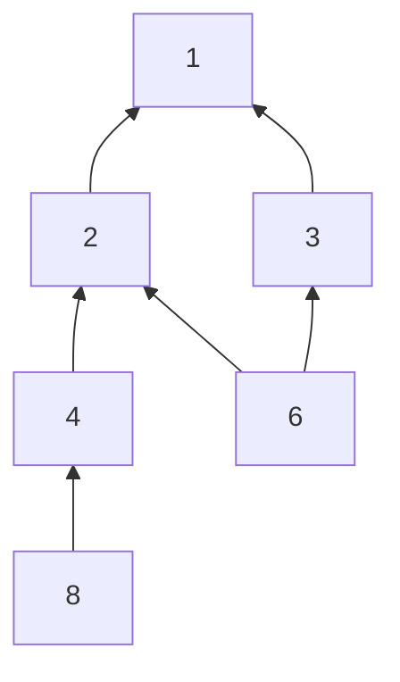
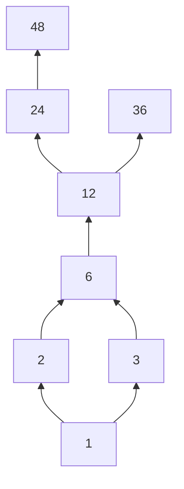

# Bài tập buổi 5

## Đề bài (3.4)

### Bài 1

#### a) $X = \mathbb{R}$

* **Phản xạ:** $xRx$ với mọi số thực $x$.
  
  $$x^2 + 3x \le x^2 + 3x \rightarrow xRx \rightarrow R \text{ phản xạ.}$$

* **Đối xứng:** với mọi $x, y \in \mathbb{R},\ xRy \rightarrow yRx$:
  
  $$x^2 + 3x \le y^2 + 3y \xrightarrow{?} y^2 + 3y \le x^2 + 3x$$
  
  Chọn $x = 0$ và $y = 1$, rõ ràng $0R1$ nhưng $1\overline{R}0 \rightarrow R$ **không đối xứng**.

* **Phản xứng:** với mọi $x, y \in \mathbb{R},\ xRy \text{ và } yRx \rightarrow x = y$.
  
  Chọn $x = 0$ và $y = -3$. Ta có $0R(-3)$ và $(-3)R0$ nhưng $0 \ne (-3) \rightarrow R$ **không phản xứng**.

* **Bắc cầu:** cho $x, y, z \in \mathbb{R},\ xRy \text{ và } yRz \rightarrow xRz$. Ta có:
  
  $$x^2 + 3x \le y^2 + 3y \text{ và } y^2 + 3y \le z^2 + 3z \rightarrow x^2 + 3x \le z^2 + 3z \rightarrow xRz \rightarrow R \text{ bắc cầu.}$$

**Kết luận:** Trên $\mathbb{R}$, $R$ có tính **phản xạ, bắc cầu**, và **không đối xứng, không phản xứng**.

#### b) $X = \mathbb{N}$

* **Phản xạ:** Ta có với mọi $x \in \mathbb{N}$:
  
  $$x^2 + 3x = x^2 + 3x \rightarrow xRx \rightarrow R \text{ phản xạ.}$$

* **Đối xứng:** Chọn $x = 0$ và $y = 1$, rõ ràng $0R1$ nhưng $1\overline{R}0 \rightarrow R$ **không đối xứng**.

* **Phản xứng:** Cho $xRy$ và $yRx \xrightarrow{?} x = y$. Ta có:
  
  $$\begin{aligned}
  x^2 + 3x \le y^2 + 3y &\rightarrow (x - y)(x + y + 3) \le 0 \\
  y^2 + 3y \le x^2 + 3x &\rightarrow (y - x)(x + y + 3) \le 0
  \end{aligned}$$
  
  Vì $x, y \in \mathbb{N} \rightarrow x + y + 3 > 0$ (khác $0$) $\rightarrow x - y = 0 \rightarrow x = y \Rightarrow R$ **phản xứng**.

* **Bắc cầu (truyền):** Cho $xRy$ và $yRz$, tương tự câu a) dễ dàng suy ra $xRz \rightarrow R$ **truyền (bắc cầu)**.

**Kết luận:**
* Vì $R$ thỏa mãn cả 3 tính chất: **phản xạ, phản xứng, truyền (bắc cầu)** nên $R$ là một **quan hệ thứ tự** trên $\mathbb{N}$.
* Đây là **thứ tự toàn phần** vì với mọi $x, y \in \mathbb{N}$, ta luôn có $x^2 + 3x \le y^2 + 3y$ hoặc $y^2 + 3y \le x^2 + 3x$, tức là $xRy$ hoặc $yRx$ (mọi cặp phần tử đều so sánh được với nhau).

### Bài 2

Ta có: $a \mid b \rightarrow a$ là ước của $b$ hay $b$ chia hết cho $a$.

#### a) Kiểm tra các tính chất trên $\mathbb{Z}$

* **Phản xạ:** Với mọi $a \in \mathbb{Z}$, ta có $a = 1 \cdot a \Rightarrow a \mid a \rightarrow$ **phản xạ**.

* **Phản xứng:** Cho $a \mid b$ và $b \mid a$, ta có $b$ chia hết cho $a$ và $a$ chia hết cho $b \xrightarrow{?} a = b$:
  
  $$b = ak \text{ và } a = bk' \rightarrow b = bkk' \quad (\text{với } k, k' \in \mathbb{Z}) \rightarrow kk' = 1$$
  
  Chọn $a = 1$ và $b = -1$. Rõ ràng $1 \mid (-1)$ và $(-1) \mid 1$, nhưng $1 \ne (-1) \rightarrow$ **không phản xứng**.

* **Bắc cầu:** Cho $a \mid b$ và $b \mid c \xrightarrow{?} a \mid c$. Ta có:
  
  $$b = ka \ (\text{với } k \in \mathbb{Z}) \text{ và } c = lb \ (\text{với } l \in \mathbb{Z}) \rightarrow c = lka \ (\text{với } lk \in \mathbb{Z}) \rightarrow a \mid c \rightarrow \text{bắc cầu.}$$

**Kết luận:** Quan hệ $\mid$ trên $\mathbb{Z}$ có tính phản xạ và bắc cầu, nhưng **không có tính phản xứng** nên $\mid$ **không phải là quan hệ thứ tự** trên $\mathbb{Z}$.

#### b) Quan hệ $\mid$ trên $\mathbb{Z}$ có phải là thứ tự toàn phần không?

* Quan hệ $\mid$ trên $\mathbb{Z}$ **không phải là quan hệ thứ tự** (do không có tính phản xứng ở câu a), nên nó cũng **không phải là thứ tự toàn phần**.
* *(Mở rộng: Kể cả khi thu hẹp trên tập số nguyên dương $\mathbb{Z}^+$ để trở thành quan hệ thứ tự thì $\mid$ vẫn chỉ là **thứ tự bán phần**, vì tồn tại các cặp số không chia hết cho nhau, chẳng hạn $2 \nmid 3$ và $3 \nmid 2$).*

## Bài 14

Với quan hệ chia hết, các cạnh của biểu đồ Hasse nối những cặp phần tử mà không có phần tử nào trong $S$ nằm giữa chúng. Ký hiệu $a\vdots b$ nghĩa là $a$ chia hết cho $b$, nên quan hệ $\vdots$ là quan hệ ngược của $\mid$

### a) $S=\{1,2,3,4,5,6,7,8\}$ với quan hệ $\vdots$

Các cạnh được vẽ theo chiều từ phần tử nhỏ lên phần tử lớn trong thứ tự $\vdots$

### b) $S=\{1,2,3,6,12,24,36,48\}$ với quan hệ $\mid$

