# Bài 4 – Các nguy cơ bảo mật trên hệ thống

> Môn: An toàn mạng máy tính

## Nội dung bài học

- Mục đích
- Các bước thực hiện
- Crack mật khẩu
- Leo thang đặc quyền
- Chạy ứng dụng
  - Keylogger
  - Spyware
- Ẩn file
  - Rootkits
  - Luồng dữ liệu NTFS
  - Steganography
- Xoá dấu vết
- Kiểm thử
- Bài tập

---

## 1. Mục đích

**Những gì đã có ở giai đoạn này** (kết quả từ các bài trước):

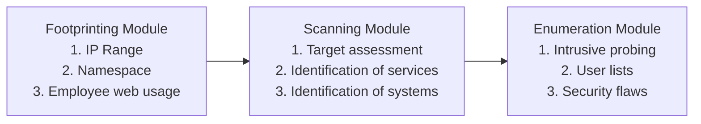

**Các giai đoạn hacking hệ thống, mục tiêu và kỹ thuật/exploit tương ứng:**

| Hacking-Stage | Goal | Technique/Exploit Used |
|---|---|---|
| Gaining Access | Vượt qua cơ chế kiểm soát truy cập để vào hệ thống | Crack mật khẩu, social engineering |
| Escalating Privileges | Chiếm quyền của user khác hoặc admin | Khai thác lỗ hổng hệ thống đã biết |
| Executing Applications | Tạo và duy trì truy cập từ xa vào hệ thống | Trojan, spyware, backdoor, keylogger |
| Hiding Files | Ẩn các hoạt động và dữ liệu đánh cắp của kẻ tấn công | Rootkit, steganography |
| Covering Tracks | Xoá dấu vết xâm nhập | Xoá log |

### System Hacking (toàn cảnh)

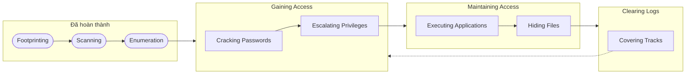

## 2. Các bước thực hiện

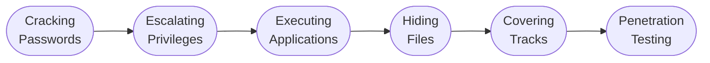

---

## 3. Crack mật khẩu

- Các kỹ thuật crack mật khẩu dùng để **khôi phục mật khẩu** từ hệ thống máy tính.
- Kẻ tấn công dùng các kỹ thuật này để **truy cập trái phép** vào hệ thống dễ bị tấn công.
- Hầu hết các kỹ thuật crack mật khẩu thành công là do mật khẩu **yếu hoặc dễ đoán**.

### Độ phức tạp của mật khẩu (Password Complexity)

Từ yếu đến mạnh hơn (theo ví dụ trong slide):

| Loại mật khẩu | Ví dụ |
|---|---|
| Chỉ chứa ký tự đặc biệt | `&*#@!(%` |
| Chỉ chứa số | `23698217` |
| Chỉ chứa chữ | `POTHMYDE` |
| Chữ và số | `meet123` |
| Chữ và ký tự đặc biệt | `bob@&ba` |
| Ký tự đặc biệt và số | `123@$45` |
| Chữ, ký tự đặc biệt và số | `ap1@52` |

### Password Cracking Techniques (kỹ thuật crack mật khẩu)

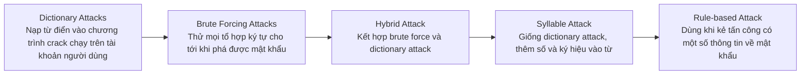

### Phân loại các kiểu tấn công mật khẩu (Types of Password Attacks)

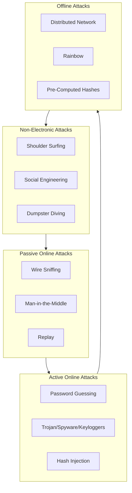

### Passive Online Attack – Wire Sniffing

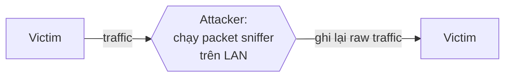

- Dữ liệu bắt được có thể gồm: mật khẩu gửi tới hệ thống từ xa qua Telnet, FTP, rlogin, và email gửi/nhận.
- Khó thực hiện (hard to perpetrate), tính toán phức tạp (computationally complex), nhưng công cụ sẵn có nhiều (tools available).

### Passive Online Attack – Man-in-the-Middle và Replay Attack

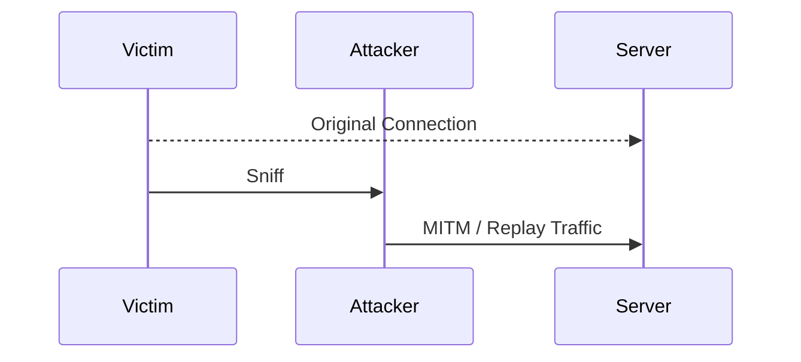

- **MITM**: kẻ tấn công chiếm quyền truy cập kênh liên lạc giữa victim và server để trích xuất thông tin.
- **Replay attack**: gói tin và token xác thực bị bắt bằng sniffer; sau khi trích xuất thông tin liên quan, các token được đặt lại lên mạng để lấy quyền truy cập.
- Lưu ý: tương đối khó thực hiện; phải được tin tưởng bởi một hoặc cả hai bên; đôi khi có thể bị phá bằng cách làm mất hiệu lực traffic.

### Active Online Attack – Password Guessing

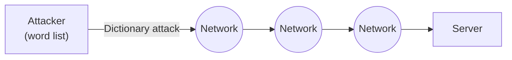

- Kẻ tấn công lấy một tập từ điển (từ và tên) và thử mọi tổ hợp để crack mật khẩu.
- Lưu ý: tốn thời gian, cần băng thông mạng lớn, dễ bị phát hiện.

### Active Online Attack – Trojan/Spyware/Keylogger

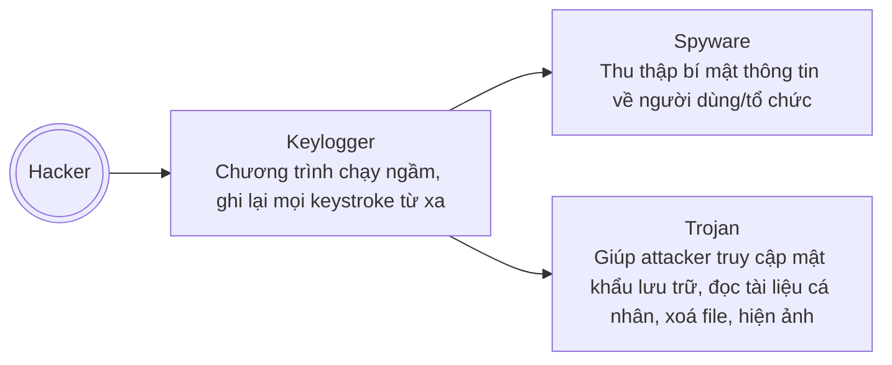

### Active Online Attack – Hash Injection Attack

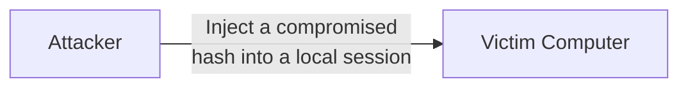

- Cho phép kẻ tấn công chèn một **hash bị xâm hại** vào một phiên nội bộ và dùng hash đó để xác thực với tài nguyên mạng.
- Kẻ tấn công tìm và trích xuất hash của một tài khoản **domain admin** đã đăng nhập.
- Kẻ tấn công dùng hash trích xuất được để đăng nhập vào **domain controller**.

### Rainbow Attacks – Pre-Computed Hash

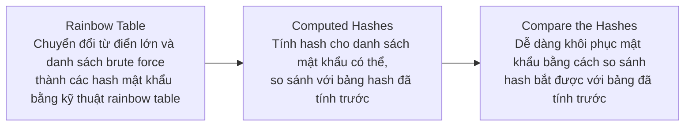

Ví dụ precomputed hashes (MD5):

```
1qazwed  -> 4259cc34599c530b28a6a8f225d668590
hh021da -> c744b1716cbf8d4dd0ff4ce31a177151
9da8dasf -> 3cd696a8571a843cda453a229d741643
sodifo8sf -> 7ad7d6fa6bb4fd28ab98b3dd33261e8f
```

### Distributed Network Attack (DNA)

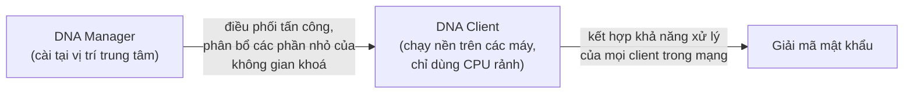

- Kỹ thuật DNA dùng để khôi phục file được bảo vệ bằng mật khẩu, tận dụng sức xử lý **chưa dùng tới** của các máy trong mạng.
- **DNA manager** cài tại vị trí trung tâm, nơi các máy chạy **DNA client** có thể truy cập qua mạng.

### Non-Electronic Attacks

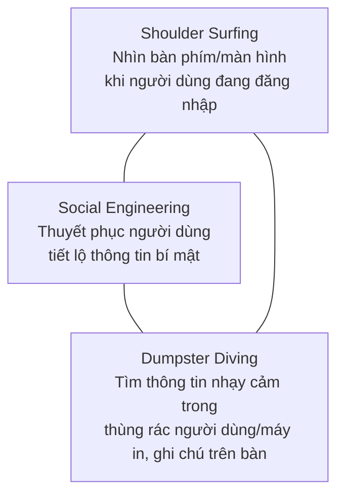

### Default Passwords

- Mật khẩu mặc định do nhà sản xuất cung cấp kèm thiết bị mới, được bảo vệ bằng mật khẩu đó.
- Công cụ tra cứu mật khẩu mặc định online: phenoelit-us.org, defaultpassword.com, cirt.net, default-password.info, defaultpassword.us, passwordsdatabase.com.
- Ví dụ bảng mật khẩu mặc định theo Vendor/Model/Version (3COM CoreBuilder, HiPerARC, LANplex, Huawei E960, NetBuilder…) với Access Type Telnet/SNMP/Multi và Username/Password tương ứng (Debug/Synnet, Tech/Tech, Admin/(none)...).

### Manual Password Cracking (Guessing)

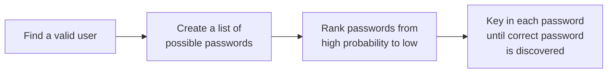

- Tần suất tấn công thấp (frequency of attacks is less), tỉ lệ thất bại cao (the failure rate is high).

### Stealing Passwords Using USB Drive

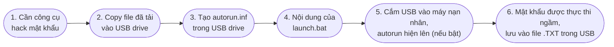

### How Hash Passwords are Stored in Windows SAM

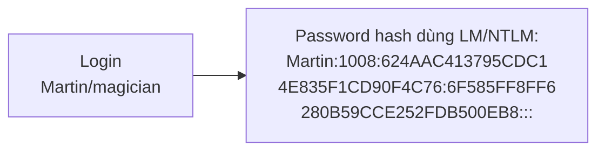

- File SAM nằm tại `c:\windows\system32\config\SAM`.
- Mỗi dòng SAM có dạng: `Username:UserID:LM Hash:NTLM Hash:::`
- Lưu ý: **LM hash đã bị vô hiệu hoá trong Windows Vista và Windows 7**; trên các hệ thống đó, LM hash sẽ trống (rỗng).

### Công cụ crack mật khẩu

| Công cụ | Ghi chú |
|---|---|
| **L0phtCrack** (l0phtcrack.com) | Audit mật khẩu LM/NTLM, báo cáo tài khoản đã crack, mật khẩu yếu, tài khoản hết hạn |
| **Ophcrack** | Dùng rainbow table để crack LM/NT hash |
| **Cain & Abel** (oxid.it) | Sniffer, cracker nhiều loại hash (LM&NTLM, MD2, MD4, MD5, SHA-1/2, Cisco, VNC, MySQL, Oracle, RADIUS, WPA-PSK…) |
| **RainbowCrack** | Dùng rainbow table (rcrack.exe) để tra ngược hash ra plaintext |
| John the Ripper, Proactive System Password Recovery, KerbCrack, Password Unlocker Bundle, Recover Keys, Windows Password Reset Professional, Windows Password Cracker, Windows Password Reset Standard | Các công cụ crack/khôi phục mật khẩu khác |

### How to Defend against Password Cracking?

1. Đặt mật khẩu khó đoán: 8–12 ký tự chữ-số kết hợp chữ hoa, chữ thường, số và ký hiệu.
2. Không dùng lại cùng một mật khẩu khi đổi mật khẩu.
3. Đặt chính sách đổi mật khẩu **30 ngày**.
4. Giám sát log server để phát hiện tấn công brute-force vào tài khoản người dùng.
5. Tránh lưu mật khẩu ở nơi không an toàn.
6. Không dùng mật khẩu có thể tìm thấy trong từ điển.
7. Không dùng mật khẩu như ngày sinh, tên vợ/chồng hoặc con cái, tên thú cưng.
8. Bật **SYSKEY** với mật khẩu mạnh để mã hoá và bảo vệ cơ sở dữ liệu SAM.

---

## 4. Leo thang đặc quyền (Privilege Escalation)

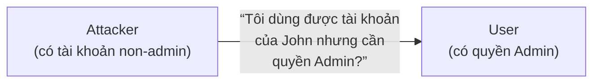

- Kẻ tấn công có thể truy cập mạng bằng một **tài khoản user không phải admin**, và bước kế tiếp là giành **quyền quản trị**.

### Kỹ thuật StickyKeys / AdminUser / DomainUser

**StickyKeys** – tính năng hỗ trợ tiếp cận (accessibility) trong Windows:

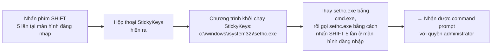

**Create a hidden admin account (AdminUser):**

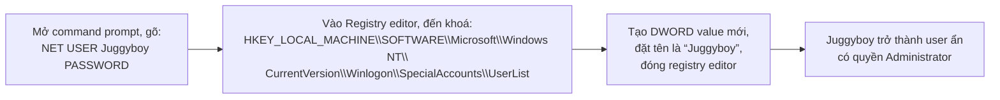

**Gain Domain Privileges (DomainUser):**

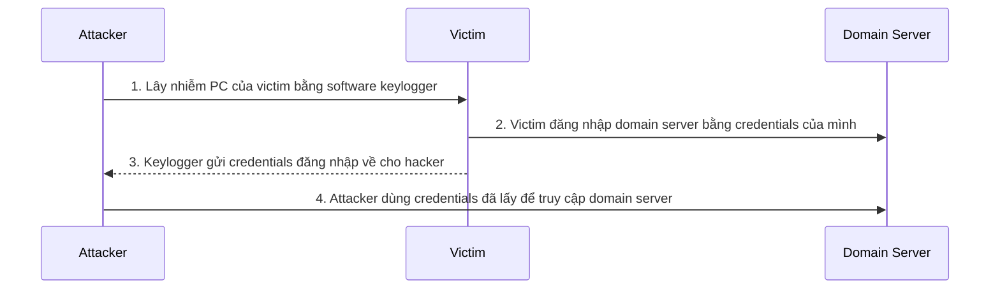

### Công cụ Privilege Escalation

Stellar Phoenix Password Recovery, Passware Password Recovery Kit, Password Unlocker Bundle, Offline NT Password & Registry Editor, Windows Password Reset Kit, Windows Password Recovery Tool, ElcomSoft System Recovery, Trinity Rescue Kit.

### How to Defend against Privilege Escalation?

```mermaid
flowchart TB
    E1["Use encryption technique<br/>to protect sensitive data"]
    E2["Restrict the interactive<br/>logon privileges"]
    E3["Run users and applications<br/>on the least privileges"]
    E4["Implement multi-factor<br/>authentication and authorization"]
    E5["Run services as<br/>unprivileged accounts"]
    E6["Patch the systems regularly"]
    E1 --- E2 --- E3 --- E4 --- E5 --- E6 --- E1
```

---

## 5. Chạy ứng dụng (Executing Applications)

- Ở giai đoạn này kẻ tấn công thực thi ứng dụng độc hại; gọi là **"owning"** hệ thống.

```mermaid
flowchart LR
    HK((("Hacker"))) --> KL["Keyloggers"]
    HK --> SPY["Spyware"]
    HK --> EX["Executes Program<br/>Remotely"]
    HK --> BD["Backdoors"]
    HK --> CR["Crackers"]
```

### Công cụ: RemoteExec

- **RemoteExec**: thực thi từ xa bất kỳ ứng dụng nào mà không cần cài agent (File Execution, hoặc Multiple actions với danh sách các hành động cần thực hiện trên nhiều máy tính).

---

## 6. Keylogger

- **Keystroke logger** là chương trình hoặc thiết bị phần cứng **theo dõi từng phím gõ** khi người dùng gõ trên bàn phím; đăng nhập vào một file hoặc truyền chúng đến vị trí từ xa.
- Keylogger được đặt **giữa phần cứng bàn phím và hệ điều hành**.
- Ứng dụng hợp pháp: giám sát hoạt động máy tính nhân viên tại văn phòng/cơ sở sản xuất, và cha mẹ giám sát hoạt động của con cái tại nhà.

### Cơ chế hoạt động của Keylogger

```mermaid
flowchart TB
    U["User gõ trên<br/>bàn phím (nhập PASSWORD)"] --> KB["Keyboard"]
    KB --> DR["Driver<br/>(keyboard.sys, mouse.sys, usb.sys, other drivers)"]
    DR -->|"dùng GetAsyncKeyState<br/>(character) == -32767"| WK["Windows Kernel<br/>(HAL)"]
    WK --> KLI["Keylogger Injection"]
    KLI --> DI["Driver Injection"]
    DI --> KI["Kernel Injection"]
    KI --> APP["Application"]
    APP --> LOG["Lưu vào log file"]
    LOG --> HK((("Hacker")))
    HK -->|"Gửi đến vị trí từ xa"| LG["(remote location)"]
```

### Các loại Keylogger phần cứng

PS/2 Keylogger, USB Keylogger, Wi-Fi Keylogger, Keylogger embedded inside the keyboard, Bluetooth Keylogger, Hardware Keylogger.

### Keylogger: Advanced Keylogger

- Xem log đã ghi và cấu hình: Logon passwords, Keystrokes, Screenshots, Visited websites, Clipboard; tuỳ chỉnh (Personalize, Clear logs, Open user manual, Register now).

### Công cụ Keylogger

iMonitorPC Business Plus, KeyProwler Pro, XPCSpy Pro, KeyProwler, PC Activity Monitor Standard, PC Activity Monitor Lite, Handy Keylogger, Stealth Keylogger.

### How to Defend against Keyloggers?

1. Cài phần mềm **antivirus** và cập nhật chữ ký (signature) thường xuyên.
2. Cài **Host-based IDS** để giám sát hệ thống và vô hiệu hoá việc cài keylogger.
3. Cài phần mềm **firewall** và **anti-keylogging** chuyên dụng, chất lượng tốt.
4. Giữ **hệ thống phần cứng** an toàn trong khu vực khoá, thường xuyên kiểm tra dây cáp bàn phím xem có thiết bị gắn thêm không.
5. Chọn **mật khẩu mới** cho các tài khoản trực tuyến khác nhau và đổi thường xuyên.
6. Dùng phần mềm thường xuyên **quét và giám sát** các thay đổi trong hệ thống/mạng.
7. Dùng **pop-up blocker** và tránh mở email rác (junk email).
8. **Quét file** trước khi cài đặt, dùng registry editor hoặc process explorer kiểm tra keystroke logger.

### Anti-Keylogger

- Phát hiện và vô hiệu hoá keylogger phần mềm.
- Một số hoạt động bằng cách so khớp **chữ ký mã keylogger** với cơ sở dữ liệu chữ ký, số khác bảo vệ driver bàn phím và kernel khỏi bị keylogger thao túng.
- Dùng **bàn phím ảo (virtual keyboard)** hoặc màn hình cảm ứng khiến phần mềm spyware/Trojan độc hại khó bắt được keystroke.

---

## 7. Spyware

- Spyware là chương trình **ghi lại tương tác của người dùng** với máy tính và Internet mà người dùng không biết.
- Spyware **lén lút**, ẩn tiến trình, file và các đối tượng khác để tránh bị gỡ bỏ.

### Spyware Propagation (cách lây lan)

```mermaid
flowchart TB
    SP(("Spyware"))
    DB["Drive-by download"] --- SP
    PB["Piggybacked software installation"] --- SP
    MA["Masquerading as anti-spyware"] --- SP
    BA["Browser add-ons"] --- SP
    WV["Web browser vulnerability exploits"] --- SP
    CK["Cookies"] --- SP
```

### What Does the Spyware Do?

```mermaid
flowchart LR
    SPW(("Spyware"))
    SPW --> ST["Đánh cắp thông tin cá nhân và gửi<br/>về server từ xa hoặc kẻ chiếm quyền"]
    SPW --> MO["Giám sát hoạt động trực tuyến của người dùng"]
    SPW --> PP["Hiện pop-up gây khó chịu và chuyển hướng<br/>trình duyệt đến trang quảng cáo"]
    SPW --> CH["Thay đổi cài đặt mặc định của trình duyệt,<br/>ngăn người dùng khôi phục"]
    SPW --> BM["Thêm nhiều bookmark vào danh sách yêu thích"]
    SPW --> DC["Giảm mức độ bảo mật tổng thể của hệ thống"]
    SPW --> RD["Giảm hiệu năng hệ thống,<br/>gây mất ổn định phần mềm"]
    SPW --> CN["Kết nối đến các trang khiêu dâm từ xa"]
    SPW --> DT["Đặt shortcut trên desktop<br/>trỏ đến trang spyware độc hại"]
```

### Types of Spywares (phân loại)

Cell Phone and Telephone Spyware, GPS Spyware, Audio Spyware, USB Spyware, Screen Capturing Spyware, Desktop Spyware, Email and Internet Spyware, Child Monitoring Spyware, Video Spyware, Print Spyware.

### How to Defend against Spyware?

1. Điều chỉnh cài đặt bảo mật trình duyệt về mức **medium** cho Internet zone.
2. Nâng cao mức bảo mật của máy tính.
3. Cẩn trọng với email và trang web đáng ngờ.
4. Cài đặt và sử dụng phần mềm **anti-spyware**.
5. Duyệt web an toàn và tải file cẩn thận.
6. Cập nhật phần mềm thường xuyên và dùng firewall có bảo vệ outbound.
7. Cập nhật file định nghĩa virus và quét hệ thống tìm spyware định kỳ.

### Công cụ Anti-Spyware

CounterSpy, Norton Internet Security 2011, SpyHunter, Spyware Terminator, Kaspersky Internet Security 2011, Ad-Aware, Spy Sweeper, MacScan (for Mac OS X).

---

## 8. Ẩn file (Hiding Files)

### 8.1. Rootkits

> Mục lục nêu Rootkits là một kỹ thuật ẩn file, nhưng slide gốc không có trang riêng cho Rootkits. Trong phần kiểm thử (mục 11), tài liệu có nêu quy trình liên quan: cố cài rootkit vào hệ thống mục tiêu để duy trì quyền truy cập ẩn; thực hiện các kỹ thuật phát hiện rootkit: Integrity Based Detection, Signature Based Detection, Cross View based Detection, Heuristic Detection; dùng **anti-rootkit** như RootkitRevealer, McAfee Rootkit Detective, SanityCheck, Sophos Anti-Rootkit để phát hiện rootkit.

### 8.2. Luồng dữ liệu NTFS (NTFS Data Stream)

- **NTFS Alternate Data Stream (ADS)** là một **luồng ẩn của Windows** chứa metadata cho file như thuộc tính, số từ, tên tác giả, thời gian truy cập và chỉnh sửa của file.
- ADS có khả năng **chèn (fork) dữ liệu vào file đã có sẵn** mà không làm thay đổi chức năng, kích thước, hay hiển thị của file trên các tiện ích duyệt file.
- ADS cho phép kẻ tấn công **chèn mã độc** vào hệ thống đã bị xâm nhập và thực thi mã đó mà không bị người dùng phát hiện.

```mermaid
flowchart LR
    HK((("Hacker"))) -->|"Inject malicious code<br/>in the existing file"| EF["Existing file"]
    EF --> NFS["NTFS File System"]
```

### How to Create NTFS Streams?

Notepad là ứng dụng tương thích stream:

```mermaid
flowchart TB
    S1(["1. Chạy c:\\>notepad myfile.txt:lion.txt<br/>Nhấn 'Yes' để tạo file mới, gõ 10 dòng dữ liệu, Save"])
    S2(["2. Chạy c:\\>notepad myfile.txt:tiger.txt<br/>Nhấn 'Yes' để tạo file mới, gõ 20 dòng khác, Save"])
    S3(["3. Xem kích thước file myfile.txt<br/>(phải bằng 0)"])
    S4(["4. Để sửa dữ liệu stream, mở tài liệu<br/>'myfile.txt:tiger.txt' trong notepad"])
    S1 --> S2 --> S3 --> S4
```

### NTFS Stream Manipulation

```mermaid
flowchart LR
    T["Trojan.exe (size: 2 MB)<br/>Location c:\\"] -->|"Move the contents of<br/>Trojan.exe to Readme.txt"| R["Readme.txt (size: 0)<br/>Location c:\\"]
```

| Thao tác | Lệnh |
|---|---|
| **Di chuyển** nội dung Trojan.exe vào Readme.txt (stream) | `C:\> type c:\Trojan.exe > c:\Readme.txt:Trojan.exe` |
| **Thực thi** Trojan.exe bên trong Readme.txt (stream) | `C:\start c:\Readme.txt:Trojan.exe` |
| **Trích xuất** Trojan.exe từ Readme.txt (stream) | `C:\> cat c:\Readme.txt:Trojan.exe > Trojan.exe` |

> Ghi chú (slide): `cat` là một tiện ích của Windows 2003 Resource Kit.

### How to Defend against NTFS Streams?

1. **Xoá một file stream** đòi hỏi copy file gốc sang một phân vùng **FAT** rồi copy ngược trở lại NTFS.
2. Các **stream bị mất** khi file được chuyển sang phân vùng FAT.
3. Công cụ **LNS.exe** (từ http://ntsecurity.nu/cgi-bin/download/lns.exe.pl) có thể dùng để phát hiện stream.

### NTFS Stream Detectors

ADS Spy, LADS, NTFS Streams Info, ADS Locator, List NTFS Streams (LNS), StreamArmor, Streams, ADS Manager.

### 8.3. Steganography

- **Steganography** là kỹ thuật **ẩn một thông điệp bí mật** bên trong một thông điệp thông thường và **trích xuất nó ở đích đến** để duy trì tính bảo mật của dữ liệu.
- Dùng **hình ảnh đồ hoạ làm vỏ bọc (cover)** là phương pháp phổ biến nhất để che giấu dữ liệu trong file.

```mermaid
flowchart LR
    HK((("Hacker"))) --> HM(("Hiding Messages"))
    HM --- CL["List of the<br/>compromised servers"]
    HM --- SC["Source code for<br/>the hacking tool"]
    HM --- PL["Plans for<br/>future attacks"]
    HM --- CC["Communication<br/>and coordination channel"]
```

### How Steganography Works?

```mermaid
flowchart LR
    CI1["Cover Image"] --> EF[/"Embedding function"\]
    MSG["Message to be embedded:<br/>“Hackers are here. Where are you?”"] --> EF
    EF --> SI["Stego Image"]
    SI --> XF[/"Extracting function"\]
    XF --> CI2["Cover Image"]
    XF --> MSG2["Extracted Message:<br/>“Hackers are here. Where are you?”"]
```

### Types of Steganography

Image Steganography, Document Steganography, Folder Steganography, Video Steganography, Audio Steganography, White Space Steganography, Web Steganography, Spam/Email Steganography, DVDROM Steganography, Natural Text Steganography, Hidden OS Steganography, C++ Source Code Steganography.

### Công cụ Steganography theo loại

| Loại | Công cụ |
|---|---|
| Image Steganography | **Hermetic Stego** – mã hoá file dữ liệu và ẩn trong ảnh đầu vào (hoặc trích xuất và giải mã) |
| Document Steganography | **wbStego** – ẩn thông tin trong tài liệu (BMP, TXT, HTML, PDF làm vỏ bọc) |
| Audio Steganography | **Mp3Stegz** – ẩn thông tin bí mật trong file audio (.MP3, .RM, .WAV…) |
| Folder Steganography | **Invisible Secrets 4** – ẩn thông tin bí mật trong thư mục, hỗ trợ mã hoá, tạo self-decrypting package |
| Spam/Email Steganography | **Spam Mimic** – ẩn thông tin trong các thông điệp dạng spam |

### Steganography Detection Tools

Xstegsecret, Stego Watch, StegAlyzerAS, StegAlyzerRTS, StegSpy, Gargoyle Investigator™ Forensic Pro, StegAlyzerSS, StegMark.

---

## 9. Xoá dấu vết (Covering Tracks)

### Why Cover Tracks?

Kẻ tấn công xoá dấu vết để:

1. Có thể **tấn công lại lần nữa** (attack again).
2. **Che giấu dấu vết** để tránh bị phát hiện.
3. **Cài backdoor** để có thể truy cập trong tương lai.

```mermaid
flowchart LR
    ATK((("Attacker")))
    ATK --> ML["Manipulating the log files"]
    ATK --> AL["Altering event logs"]
    ML --- ML1["1. SECEVENT.EVT (security):<br/>đăng nhập thất bại, truy cập file không có quyền"]
    ML --- ML2["2. SYSEVENT.EVT (system):<br/>lỗi driver, hoạt động không đúng"]
    ML --- ML3["3. APPEVENT.EVT (applications)"]
    AL --- AL1["Kẻ tấn công có thể không muốn<br/>xoá toàn bộ log"]
```

### Covering Tracks

```mermaid
flowchart LR
    HK["Hacker"] -->|"1. Gained<br/>administrator access"| TU["Target User"]
    TU -->|"2. Install backdoors"| HK
    HK -->|"3. Khi đã lấy hết thông tin cần thiết,<br/>kẻ xâm nhập cài nhiều backdoor<br/>để dễ truy cập trong tương lai"| TU
```

- Sau khi đã **giành quyền truy cập administrator**, kẻ xâm nhập sẽ cố che dấu vết để tránh bị phát hiện.

### Disabling Auditing: Auditpol

- Kẻ xâm nhập sẽ **tắt auditing** ngay sau khi giành được quyền administrator.
- Khi kết thúc, kẻ xâm nhập sẽ **bật lại auditing** bằng `auditpol.exe`.
- Lệnh ví dụ: `D:\>auditpol.exe /enable` và `D:\>auditpol.exe /disable`.

### Công cụ Covering Tracks

| Công cụ | Ghi chú |
|---|---|
| **Window Washer** | Rửa máy tính, xoá dấu vết hoạt động Internet và phần mềm khác |
| **Tracks Eraser Pro** | Xoá Firefox History, Saved Passwords, Start Menu Recent Documents, Run History, Temp Folder… |
| Evidence Eliminator, Armor Tools, Clear My History, EvidenceEraser, Traceless, WinZapper, ZeroTracks, WinTools.net Ultimate | Các công cụ xoá dấu vết khác |

---

## 10. Kiểm thử (Penetration Testing)

### Password Cracking (quy trình kiểm thử)

```mermaid
flowchart TB
    START(["START"]) --> IDF["Xác định hệ thống<br/>được bảo vệ bằng mật khẩu"]
    IDF --> ACC{"Có quyền<br/>truy cập?"}
    ACC -->|"Không"| WS["Thực hiện Wire Sniffing"]
    WS --> MITM["Thực hiện Man-in-the-Middle Attack"]
    ACC -->|"Có"| CC["Kiểm tra độ phức tạp mật khẩu"]
    CC --> DIC["Thực hiện Dictionary Attack"]
    DIC --> BF["Thực hiện Brute forcing Attack"]
    BF --> HYB["Thực hiện Hybrid Attack"]
    HYB --> SYL["Thực hiện Syllable Attack"]
    SYL --> RBA["Thực hiện Rule-based Attack"]
```

Thêm các kỹ thuật kiểm thử khác theo chu trình: Perform Replay Attack → Perform Shoulder Surfing → Perform Password Guessing → Perform Social Engineering → Perform Trojan/Spyware/keyloggers → Perform Dumpster Diving → Perform Hash Injection Attack → Perform Pre-Computed Hashes → Perform Rainbow Attack → Perform Distributed Network Attack.

### Privilege Escalation (quy trình kiểm thử)

```mermaid
flowchart TB
    START(["START"]) --> LOGIN["Thử đăng nhập với username đã liệt kê<br/>và mật khẩu đã crack được"]
    LOGIN --> RESTRICT{"Quyền đăng nhập<br/>tương tác bị hạn chế?"}
    RESTRICT -->|"Có"| REPL["Thử thay thế sethc.exe bằng cmd.exe"]
    RESTRICT -->|"Không"| HID["Tạo tài khoản admin ẩn"]
    REPL --> INF["Lây nhiễm máy mục tiêu<br/>bằng keylogger để thu thập<br/>mật khẩu domain"]
    HID --> SRV["Thử chạy dịch vụ với<br/>tài khoản không có đặc quyền"]
```

- Dùng công cụ như Active@ Password Changer, Passware Password Recovery Kit, Password Unlocker Bundle, ElcomSoft System Recovery…

### Executing Applications (quy trình kiểm thử)

```mermaid
flowchart TB
    START(["START"]) --> AV["Kiểm tra antivirus đã cài<br/>và cập nhật"]
    AV --> FW["Kiểm tra firewall và<br/>anti-keylogging software đã cài"]
    FW --> HW["Kiểm tra hệ thống phần cứng<br/>được bảo vệ trong khu vực khoá"]
    HW --> KLT["Thử dùng keyloggers"]
    KLT --> SPT["Thử dùng Spywares"]
    SPT --> REM["Dùng công cụ để thực thi từ xa"]
```

- Keylogger ví dụ: Advanced Keylogger, Spytech SpyAgent, Perfect Keylogger, Powered Keylogger…
- Spyware ví dụ: Robo Nanny, Stealth Recorder Pro, Net Video Spy, WebcamMagic, Mobile Spy…

### Hiding Files (quy trình kiểm thử)

```mermaid
flowchart TB
    START(["START"]) --> ROOT["Thử cài rootkit trong<br/>hệ thống mục tiêu"]
    ROOT --> INT["Thực hiện Integrity Based<br/>Detection technique"]
    INT --> SIG["Thực hiện Signature Based<br/>Detection technique"]
    SIG --> CROSS["Thực hiện Cross View based<br/>Detection technique"]
    CROSS --> HEU["Thực hiện Heuristic<br/>Detection technique"]
    HEU --> PATCH["Kiểm tra bản vá cho OS<br/>và ứng dụng đã cập nhật"]
    PATCH --> AVU["Kiểm tra phần mềm antivirus<br/>và anti-spyware được cập nhật định kỳ"]
    AVU --> STEG["Dùng Windows hidden stream<br/>(NTFS-ADS) để chèn mã độc"]
    STEG --> HIDE["Dùng kỹ thuật steganography<br/>để ẩn thông điệp bí mật"]
    HIDE --> ANL["Thực hiện kỹ thuật steganalysis"]
```

- Mục tiêu: cố cài rootkit để **duy trì quyền truy cập ẩn**; dùng anti-rootkit (RootkitRevealer, McAfee Rootkit Detective, SanityCheck, Sophos Anti-Rootkit) để phát hiện rootkit; dùng NTFS stream detector (ADS Scan Engine, ADS Spy, NTFS Streams Info…) để phát hiện NTFS-ADS; dùng công cụ phát hiện steganography (Stegdetect, Stego Watch, StegSpy, Xstegsecret…) để phân tích steganography.

### Covering Tracks (quy trình kiểm thử)

```mermaid
flowchart TB
    START(["START"]) --> RM["Remove web activity tracks"]
    RM --> DA2["Disable auditing"]
    DA2 --> TL["Tamper log files"]
    TL --> CR2["Close all remote connections<br/>to the victim machine"]
    CR2 --> CP2["Close any opened port"]
```

- Xoá dấu vết hoạt động web như MRU, cookies, cache, temporary file và history.
- Tắt auditing bằng công cụ như **Auditpol**.
- Can thiệp (tamper) các file log như event log, server log, proxy log bằng log poisoning hoặc log flooding.
- Dùng công cụ xoá dấu vết như Windows Washer, Tracks Eraser Pro, Evidence Eliminator, Clear My History…

---

## 11. Bài tập

1. Lập bảng trình bày các kỹ thuật crack mật khẩu.
2. Nêu các biện pháp bảo vệ mật khẩu.
3. Phân loại spyware và nêu biện pháp phòng chống.
4. Steganography là gì? Lập bảng trình bày các phương thức Steganography.
5. NTFS data stream là gì? Cho ví dụ về cách tạo file sử dụng NTFS data stream.
