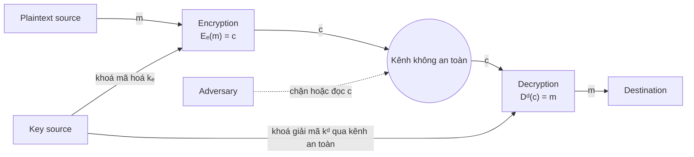

# Bài 2A – Mã hoá cổ điển và mã hoá hiện đại

## Vị trí trong môn học

1. Tổng quan môn học
2. **Các kỹ thuật mã hoá**
   - **A. Mã hoá cổ điển và mã hoá hiện đại** ← bài này
   - B. Chứng thực dữ liệu
3. Dò tìm lỗ hổng bảo mật thông tin (thăm dò, quét mạng)
4. Các nguy cơ bảo mật trên hệ thống
5. Mã độc và kỹ thuật phân tích mã độc
6. Bảo mật ứng dụng Web
7. Nguy cơ bảo mật ứng dụng di động
8. Tường lửa, hệ thống phát hiện và ngăn ngừa xâm nhập
9. Quản lý rủi ro an ninh thông tin
10. Một số xu thế an ninh thông tin hiện đại

## Nội dung bài học

1. Giới thiệu về mật mã hoá
2. Lịch sử của mật mã
3. Giải thuật mã hoá cổ điển
4. Giải thuật mã hoá hiện đại
5. Bẻ gãy một hệ thống mật mã
6. Bài tập

---

## 1. Giới thiệu về mật mã hoá

### Giới thiệu

- Mật mã hoá được sử dụng từ thời cổ đại đến tận ngày nay.
- Hiện nay các giao dịch tài chính, chuyển khoản, mua sắm hàng hoá, thư từ, tài liệu… được thực hiện nhiều qua môi trường mạng, đòi hỏi dữ liệu phải được bảo mật tốt → phải được mã hoá.

### Một số khái niệm

| Khái niệm | Định nghĩa | Ký hiệu |
|---|---|---|
| Thông báo, văn bản | Chuỗi hữu hạn các ký hiệu lấy từ một bảng chữ cái Z | `m` |
| Mật mã hoá | Biến đổi một thông báo sao cho không ai hiểu được ngoài người nhận mong muốn | `e(m)` |
| Khoá | Tham số đầu vào của phép mã hoá/giải mã | `ke` (mã hoá), `kd` (giải mã) |
| Chuỗi mật mã | Chuỗi nguỵ trang, là thông báo sau khi mã hoá | `c = e(m, ke)` |
| Phép giải mã | Xác định lại thông báo gốc từ chuỗi mật mã và khoá giải mã | `d(c, kd) = m` |

### Mô hình truyền tin có mã hoá



### Phân loại mật mã (tổng quan)

- **Classical ciphers**: Substitution cipher (thay thế), Transposition cipher (hoán vị).
- **Theo loại khoá**: Private key (cùng một khoá để mã hoá và giải mã) và Public key (hai khoá khác nhau).
- **Theo loại dữ liệu đầu vào**: Block cipher (mã hoá khối dữ liệu cố định) và Stream cipher (mã hoá luồng dữ liệu liên tục).

---

## 2. Lịch sử của mật mã

- Mật mã học có lịch sử hàng nghìn năm: mật mã học cổ điển với bút và giấy → mật mã học hiện đại với điện cơ, điện tử, máy tính.
- Sự phát triển của mật mã đi liền với sự phát triển của phá mã (thám mã):
  - Phát hiện bức điện Zimmermann khiến Hoa Kỳ tham gia Thế chiến I.
  - Phá mã thành công hệ thống mật mã của Đức Quốc xã góp phần đẩy nhanh thời điểm kết thúc Thế chiến II.
- Hai sự kiện khiến mật mã học trở nên đại chúng:
  - Sự xuất hiện của tiêu chuẩn mật mã hoá **DES**.
  - Sự ra đời của các kỹ thuật mật mã hoá **khoá công khai**.

### Mật mã học cổ điển

- Các chữ tượng hình không tiêu chuẩn trên tượng Ai Cập cổ đại (khoảng 4500 năm trước CN).
- Mã thay thế bảng chữ cái đơn giản như **Atbash** (khoảng 500–600 năm trước CN).
- Người La Mã xây dựng mật mã **Caesar**.

### Mật mã học trong Thế chiến II

- Đức dùng rộng rãi máy rôto cơ điện tử **Enigma**.
- Đồng minh dùng máy **TypeX** (Anh) và **SIGABA** (Mỹ) – cũng là thiết kế cơ điện dùng rôto tương tự Enigma nhưng có nhiều nâng cấp hơn.

### Mật mã học hiện đại

- **DES** (Data Encryption Standard) được công bố tại Mỹ ngày 17.03.1975. Khoá chỉ 56 bit nên không đủ sức chống tấn công vét cạn (brute force).
- Năm 2001, DES chính thức được thay bởi **AES** (Advanced Encryption Standard).
- Trước thời kỳ này, hầu hết thuật toán hiện đại là **khoá đối xứng**: người gửi và người nhận dùng chung một khoá và cả hai phải giữ bí mật khoá đó.
- **Khoá bất đối xứng** cần một cặp khoá: một để mã hoá, một để giải mã. Phổ biến nhất là **RSA**.

---

## 3. Giải thuật mã hoá cổ điển

### Yêu cầu cơ bản đối với giải thuật mật mã hoá

- Có tính bảo mật cao.
- Công khai, dễ hiểu. Khả năng bảo mật được "chốt" vào **khoá**, không phải vào bản thân giải thuật.
- Có thể triển khai trên các thiết bị điện tử.

### 3.1. Mã thay thế đơn giản (Substitution Cipher)

- Khoá là một hoán vị `h` (hay `p: Z26 → Z26`) của bảng chữ cái; mỗi ký hiệu của thông báo được thay bằng ảnh của nó qua hoán vị.
- Khoá thường biểu diễn bằng chuỗi 26 ký tự. Số khoá: 26! ≈ 4 × 10²⁶.
- Ví dụ: khoá là chuỗi `UXEOS…` thì A → U, B → X…
- Ví dụ trong slide:

| Plain | a | b | c | d | e | f | g | h | i | j | k | l | m |
|---|---|---|---|---|---|---|---|---|---|---|---|---|---|
| Cipher | X | N | Y | A | H | P | O | G | Z | Q | W | B | T |

| Plain | n | o | p | q | r | s | t | u | v | w | x | y | z |
|---|---|---|---|---|---|---|---|---|---|---|---|---|---|
| Cipher | S | F | L | R | C | V | M | U | E | K | J | D | I |

  - Mã hoá: `ep(a) = X`
  - Giải mã: `dp(A) = d`
- Phá mã: dựa vào phân tích tần suất (xem mục "Phương pháp phá mã cổ điển").

### 3.2. Mã hoán vị bậc d (Permutation Cipher)

- Với số nguyên dương `d`, chia thông báo `m` thành các khối dài `d`, rồi áp dụng một hoán vị `h` của (1, 2, …, d) lên mỗi khối.
- Ví dụ: `d = 5`, `h = (4 1 3 2 5)` → hoán vị (1 2 3 4 5) được thay bằng (4 1 3 2 5).
- Ví dụ: `m = JOHN IS A GOOD ACTOR` → `c = NJHO AI S DGOO OATCR`.

### 3.3. Mã dịch chuyển (Shift Cipher): Vigenère và Caesar

- **Vigenère**: khoá gồm chuỗi `d` ký tự, viết lặp lại bên dưới thông báo rồi cộng modulo 26. Ký tự trắng giữ nguyên, không cộng.
- **Caesar**: trường hợp `d = 1` (khoá là một ký tự đơn), do Julius Caesar dùng đầu tiên.

**Ví dụ Caesar (dịch 5):** `C = (p + 5) mod 26`

```
Plaintext : CRYPTOGRAPHY
Ciphertext: HWDUYTLWFUMD
```

**Ví dụ Vigenère** (Blaise de Vigenère, 1523–1596 – mã khối):

```
Từ khoá : CHIFFRE
Bản rõ  : VIGENERE
Kết quả : XPOJSVVG
```

### 3.4. Mã tuyến tính (Affine Cipher)

- Là mã thay thế có dạng: `e(x) = ax + b (mod 26)`, với `a, b ∈ Z26`.
- Nếu `a = 1` thì thành mã dịch chuyển.
- Giải mã – tìm `x`:
  - `y = ax + b (mod 26)`
  - `ax = y – b (mod 26)`
  - `x = a⁻¹ (y – b) (mod 26)`

### 3.5. Mã Playfair

- Mật mã đa ký tự: mỗi lần mã hoá **2 ký tự** liên tiếp.
- Dựa trên ma trận chữ cái n×n (n = 5 hoặc 6) xây dựng từ một khoá (chuỗi ký tự).

**Xây dựng ma trận khoá:**

- Lần lượt thêm từng ký tự của khoá vào ma trận.
- Nếu ma trận chưa đầy, thêm các ký tự còn lại của bảng chữ cái theo thứ tự A–Z.
- I và J xem như 1 ký tự.
- Các ký tự trong ma trận không được trùng nhau.

**Giải thuật mã hoá:**

- Mã hoá từng cặp 2 ký tự liên tiếp. Nếu dư 1 ký tự, thêm "x" vào cuối.
- 2 ký tự **cùng dòng** → thay bằng 2 ký tự bên phải (ký tự ở cột cuối được thay bằng ký tự ở cột đầu).
- 2 ký tự **cùng cột** → thay bằng 2 ký tự bên dưới (ký tự ở hàng cuối được thay bằng ký tự ở hàng trên cùng).
- 2 ký tự **tạo thành hình chữ nhật** → thay bằng 2 ký tự cùng dòng ở hai góc còn lại.

**Ví dụ (Cryptool):** khoá `PLAYFAIR`

| | | | | |
|---|---|---|---|---|
| P | L | A | Y | F |
| I | R | B | C | D |
| E | G | H | K | M |
| N | O | Q | S | T |
| U | V | W | X | Z |

```
Plaintext      : THANH PHO HO CHI MINH
Sau pre-format : TH AN HP HO HO CH IM IN HX
Ciphertext     : QM PQ EA GQ GQ BK DE EU KW
```

### 3.6. Mã Hill

- Dùng `m` ký tự liên tiếp của plaintext, thay bằng `m` ký tự của ciphertext bằng phương trình tuyến tính. Gán giá trị: A = 01, B = 02, …, Z = 26.
- Chọn ma trận vuông Hill (ma trận `H`) làm khoá.
- Mã hoá từng chuỗi `n` ký tự của plaintext (vector `P`), `n` là kích thước ma trận Hill.
- Công thức:
  - `C = H·P mod 26`
  - `P = H⁻¹·C mod 26`

**Ví dụ (Cryptool):** ma trận khoá 2×2 `H = [[Q, F], [W, Y]]` = `[[17, 06], [23, 25]]`; plaintext `THANH PHO HO CHI MINH`.

- Mã hoá khối "TH" (vector `P = [20, 08]`):
  - X ← 17·20 + 06·08 = 24 (mod 26)
  - J ← 23·20 + 25·08 = 10 (mod 26)
  - → "TH" thành "XJ".
- Giải mã: ma trận nghịch đảo `H⁻¹ = [[Y, T], [C, Q]]` = `[[25, 20], [03, 17]]`; từ "XJ" = `[24, 10]` thu lại được "TH".

### Phương pháp phá mã cổ điển

- Dựa vào đặc điểm ngôn ngữ.
- Dựa vào **tần suất xuất hiện** của các chữ cái (thống kê từ nhiều nguồn văn bản), và số lượng các ký tự trong bảng mã, để xác định thông báo đầu vào.
- (Slide minh hoạ bảng tần suất ký tự trong tiếng Anh.)

---

## 4. Giải thuật mã hoá hiện đại

- Thường dùng **mã khối** kết hợp các phép **hoán vị** và **thay thế**.
- Biến đổi văn bản được thực hiện nhiều lần qua một số vòng lặp.
- Khoá con của mỗi vòng khác nhau và được sinh từ khoá ban đầu.
- Phổ biến: DES, AES, RSA…

### 4.1. Phân loại

- **Mã hoá khoá đối xứng (symmetric):**
  - *Block ciphers*: mã hoá các khối có chiều dài cố định 64 hoặc 128 bit. Phổ biến: IDEA, RC2, DES, Triple DES, Rijndael (AES), MARS, RC6, Serpent, Twofish, DESX, DESL, DESXL.
  - *Stream ciphers*: mã hoá từng bit của thông điệp. Đại diện: RC4.
- **Mã hoá khoá bất đối xứng (asymmetric):** RSA.

### 4.2. Chuẩn mã hoá dữ liệu DES

- DES (Data Encryption Standard) được dùng rộng rãi trên thế giới.
- Dùng khoá **56 bit** để mã hoá khối dữ liệu **64 bit**.
- Bên mã hoá và giải mã dùng chung một khoá → thuộc hệ mã khoá bí mật.
- Về độ an toàn, hiện nay **3DES** (cải tiến của DES) được đánh giá có độ an toàn cao vì độ dài khoá gấp 3 lần DES.

**Mốc thời gian:**

| Thời điểm | Sự kiện |
|---|---|
| 17.03.1975 | DES được công bố để công chúng đóng góp ý kiến |
| 11.1976 | DES được phê chuẩn làm tiêu chuẩn chính thức |
| 1992 | Biham và Shamir công bố tấn công thám mã vi sai có độ phức tạp thấp hơn tấn công bạo lực (trên lý thuyết); đòi hỏi 2⁴⁷ văn bản rõ được chọn – điều kiện không thực tế |
| 06.1997 | Dự án DESCHALL lần đầu phá được một bản tin mã hoá bằng DES |
| 07.1998 | Thiết bị Deep Crack của Electronic Frontier Foundation phá được một khoá DES trong 56 giờ |
| 01.1999 | Deep Crack cùng distributed.net phá DES trong 22 giờ 15 phút |
| 25.10.1999 | Triple DES được khuyến cáo dùng cho các hệ thống quan trọng |
| 26.05.2002 | AES trở thành tiêu chuẩn thay thế DES |

**Giải thuật DES:**

1. Dùng một khoá `K` tạo ra `n` khoá con `K1, K2, …, Kn`.
2. Hoán vị dữ liệu (IP).
3. Thực hiện `n` vòng lặp (DES dùng 16 vòng). Tại mỗi vòng:
   - Chia dữ liệu thành hai phần.
   - Áp dụng phép thay thế lên một phần, phần còn lại giữ nguyên.
   - Hoán vị hai phần cho nhau.
4. Hoán vị dữ liệu lần cuối (IP⁻¹).

Sơ đồ tổng quan: `Input block X → IP → Permuted input → 16 DES rounds → Pre-output → IP⁻¹ → Output block Y`; song song đó `Key K → PC1 → PC2(K) → 16 subkeys` cấp khoá con cho 16 vòng.

### 4.3. Giải thuật mã hoá AES

- AES (Advanced Encryption Standard) là giải thuật mã hoá **khoá đối xứng** công bố năm 2000 để thay DES. Mã hoá khối bằng cách lặp lại nhiều lần các bước xử lý.
- Còn gọi là **Rijndael**, do hai nhà mật mã học người Bỉ **Joan Daemen** và **Vincent Rijmen** đề xuất.
- Khối dữ liệu đầu vào **128 bit**; khoá **128, 192, 256 bit** (AES-128, AES-192, AES-256).
- Mỗi khoá con là một cột gồm 4 byte.
- Khối 128 bit = 16 byte tạo thành ma trận 4×4 byte gọi là **ma trận trạng thái (state)**; ma trận này biến đổi trong quá trình mã hoá.

**Giả mã AES (Cipher):**

```
state = in
AddRoundKey(state, w)
for round = 1 step 1 to Nr-1
    SubBytes(state)
    ShiftRows(state)
    MixColumns(state)
    AddRoundKey(state, w + round*Nb)
end for
SubBytes(state)
ShiftRows(state)
AddRoundKey(state, w + Nr*Nb)
out = state
```

**Bốn phép biến đổi:**

| Hàm | Mô tả |
|---|---|
| `SubBytes` | Mỗi byte trong state được thay bằng byte khác theo bảng tra **S-box** (bắt nguồn từ hàm ngược trên trường GF(2⁸)); b_ij = S(a_ij) |
| `ShiftRows` | Dịch vòng trái từng hàng: hàng 1 giữ nguyên, hàng 2 dịch 1 cột, hàng 3 dịch 2 cột, hàng 4 dịch 3 cột; đảm bảo mỗi cột đầu ra được tạo từ các cột khác nhau của state đầu vào |
| `MixColumns` | Mỗi cột được biến đổi tuyến tính: xem như đa thức trong GF(2⁸), nhân modulo x⁴ + 1 với đa thức cố định c(x) = 3x³ + x² + x + 2 |
| `AddRoundKey` | Mỗi byte của state được XOR với khoá vòng; quá trình thu được 11 khoá vòng từ khoá mã hoá ban đầu |

### 4.4. Hệ mã hoá công khai RSA

- Được dùng phổ biến trong thương mại điện tử.
- Đảm bảo an toàn với điều kiện độ dài khoá đủ lớn.
- Có hai khoá: **khoá công khai** (public key) và **khoá bí mật** (private key). Mỗi khoá là những số cố định dùng trong mã hoá/giải mã.
- Khoá công khai được công bố rộng rãi và dùng để mã hoá. Thông tin mã hoá bằng khoá công khai chỉ giải mã được bằng khoá bí mật tương ứng.

**Các ứng dụng (theo hình trong slide):**

1. **Sinh khoá**: chọn một số ngẫu nhiên lớn để sinh cặp khoá (công khai/bí mật).
2. **Mã hoá/giải mã**: Bob dùng khoá công khai của Alice để mã hoá; Alice dùng khoá bí mật của mình để giải mã.
3. **Ký và xác minh**: dùng khoá bí mật để ký một thông báo; dùng khoá công khai để xác minh chữ ký.
4. **Trao đổi khoá**: tổ hợp khoá bí mật của mình với khoá công khai của người khác để tạo ra khoá dùng chung chỉ hai người biết.

**Ví dụ số (slide):**

```
P  = 61     (số nguyên tố thứ nhất – huỷ sau khi tính E, D)
Q  = 53     (số nguyên tố thứ hai – huỷ sau khi tính E, D)
PQ = 3233   (modulus – công khai)
E  = 17     (số mũ công khai)
D  = 2753   (số mũ bí mật – giữ kín)

Khoá công khai: (E, PQ).  Khoá bí mật: D.
Mã hoá : encrypt(T) = T^E mod PQ = T^17 mod 3233
Giải mã: decrypt(C) = C^D mod PQ = C^2753 mod 3233

encrypt(123) = 123^17 mod 3233 = 855
decrypt(855) = 855^2753 mod 3233 = 123
```

**Kết hợp DES và RSA:**

- DES và RSA còn được ứng dụng vào chữ ký điện tử.
- RSA rất an toàn nhưng tốc độ mã hoá/giải mã chậm hơn DES hàng nghìn lần.
- Cách kết hợp thông thường:
  - **DES** mã hoá khối văn bản.
  - **RSA** mã hoá khoá mà DES đã dùng để mã hoá khối văn bản.

---

## 5. Bẻ gãy một hệ thống mật mã

- Chuyên gia mật mã/kẻ tấn công thường được giả thiết biết đầy đủ hàm mã hoá `e` và hàm giải mã `d`.
- Họ có thể có thêm thông tin hỗ trợ như thống kê ngôn ngữ, kiến thức về ngữ cảnh…
- Với một chuỗi mật mã `c`, họ chỉ thiếu khoá `k` để dùng `d` giải mã chính xác.
- Mô hình: Cryptanalyst quan sát `Y` trên kênh và cố suy ra `X̂` (bản rõ) và/hoặc `K̂` (khoá).

### Các khả năng tấn công trên hệ thống

1. Ciphertext-only attack
2. Known-plaintext attack
3. Chosen-plaintext attack
4. Chosen-ciphertext attack
5. Chosen-key attack
6. Adaptive chosen-plaintext attack
7. Timing attack
8. Rubber hose attack (cưỡng ép/tra tấn người giữ khoá)

### Thời gian trung bình để tìm khoá theo kiểu vét cạn

| Key size (bit) | Số khoá | Thời gian ở 1 giải mã/giây | Thời gian ở 10⁶ giải mã/giây |
|---|---|---|---|
| 32 | 2³² = 4,3 × 10⁹ | 2³¹ s = 35,8 phút | 2,15 ms |
| 56 | 2⁵⁶ = 7,2 × 10¹⁶ | 2⁵⁵ s = 1142 năm | 10,01 giờ |
| 128 | 2¹²⁸ = 3,4 × 10³⁸ | 2¹²⁷ s = 5,4 × 10²⁴ năm | 5,4 × 10¹⁸ năm |
| 168 | 2¹⁶⁸ = 3,7 × 10⁵⁰ | 2¹⁶⁷ s = 5,9 × 10³⁶ năm | 5,9 × 10³⁰ năm |
| 26 ký tự (hoán vị) | 26! = 4 × 10²⁶ | 2 × 10²⁶ s = 6,4 × 10¹² năm | 6,4 × 10⁶ năm |

Ước lượng thời gian bẻ khoá theo chi phí:

| Chi phí | 40 bit (5 ký tự) | 56 bit (7 ký tự) | 64 bit (8 ký tự) | 128 bit (16 ký tự) |
|---|---|---|---|---|
| 2K$ (1 PC, cá nhân làm được) | 1,4 phút | 73 ngày | 50 năm | 10²⁰ năm |
| 100K$ (công ty làm được) | 2 giây | 35 giờ | 1 năm | 10¹⁹ năm |
| 1M$ (tổ chức lớn/nhà nước) | 0,2 giây | 3,5 giờ | 37 ngày | 10¹⁸ năm |

### Công cụ phân tích: CrypTool

---

## 6. Bài tập

### Sử dụng công cụ CrypTool

- CrypTool là ứng dụng miễn phí chạy trên Windows, thường dùng để phân tích các giải thuật mã hoá. Phiên bản hiện nay là 1.4.30.

### Lập trình ứng dụng

Nêu cơ chế hoạt động và viết ứng dụng cho phép mã hoá và giải mã với **2 trong số** các giải thuật: Vigenère, Hill, Affine, Playfair, Solitaire.

### Bài tập nộp

**1. Mã hoá Vigenère**

- M = `TRUONG DAI HOC QUOC GIA`
- K = họ tên của sinh viên
- Yêu cầu: mô tả cách thức mã hoá để được Ciphertext.

**2. Mã hoá Playfair**

- M = `NHAP MON BAO DAM VA AN NINH THONG TIN`
- K = họ tên sinh viên
- Yêu cầu:
  - Xây dựng ma trận khoá.
  - Trình bày quá trình mã hoá để được Ciphertext.
  - Mô tả quá trình giải mã Ciphertext để thu được M ban đầu.

**Đặt tên file:** `Bài tập 1A - Họ tên_mssv.doc`
