# Bài 2B – Chứng thực dữ liệu

## Nội dung bài học

1. Mở đầu
2. Mã chứng thực thông điệp (MAC)
3. Hàm băm
4. Chữ ký số
5. Bài tập

---

## 1. Mở đầu

### Vai trò của chứng thực

Tình huống minh hoạ: Eve (kẻ giả mạo) gửi thư cho Bob với nội dung "Hello, I am Alice" → Bob cần cơ chế để biết thư có thật sự đến từ Alice hay không.

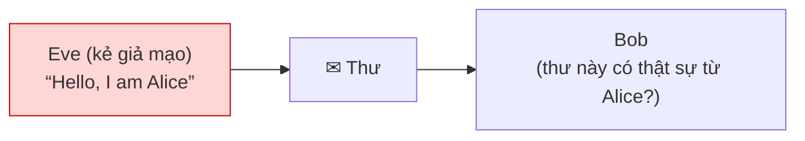


**Chứng thực** (xác thực, xác nhận – *authentication*) nhằm:

- Xác nhận nguồn gốc của dữ liệu.
- Thuyết phục người sử dụng rằng dữ liệu chưa bị sửa đổi hoặc giả mạo.

Chứng thực dữ liệu là cơ chế quan trọng để duy trì **tính toàn vẹn** và **tính không thể từ chối** của dữ liệu.

### Các phương pháp chứng thực

| Phương pháp | Mô tả |
|---|---|
| Mã hoá thông điệp | Dùng mật mã khoá bí mật hoặc khoá công khai để mã hoá thông điệp rõ thành mật mã |
| Mã chứng thực thông điệp (MAC – Message Authentication Code) | Một hàm và một khoá bí mật tạo ra giá trị có chiều dài cố định dùng để chứng thực |
| Hàm băm (Hash Function) | Hàm ánh xạ thông điệp có chiều dài bất kỳ thành giá trị băm có chiều dài cố định dùng để chứng thực |

### Chứng thực thông qua nhận dạng

Việc nhận dạng dựa trên một hoặc nhiều yếu tố:

- Password, PIN
- Smart card
- Biometric: vân tay, võng mạc…
- Chữ ký
- …

**Smart card** có thể tích hợp nhiều chức năng: Digital Certificate/PKI, Secure Mail, Network Login/VPN, Biometric, Digital Signature, e-Purse, Physical Access Control, Loyalty Card, Cafeteria… (cả dạng contact lẫn contactless).

**Mật khẩu và hàm một chiều:** Alice gửi "My password P is …"; Bob không lưu P mà tính `f(P)` bằng hàm một chiều `f` và lưu cặp (Alice, `f(P)`) để đối chiếu.

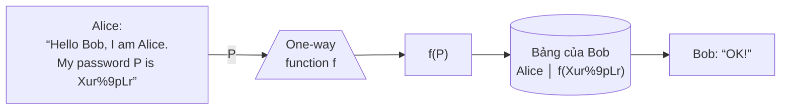


**One-time passwords (hàm một chiều lặp – iterated one-way function):**

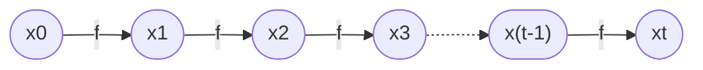

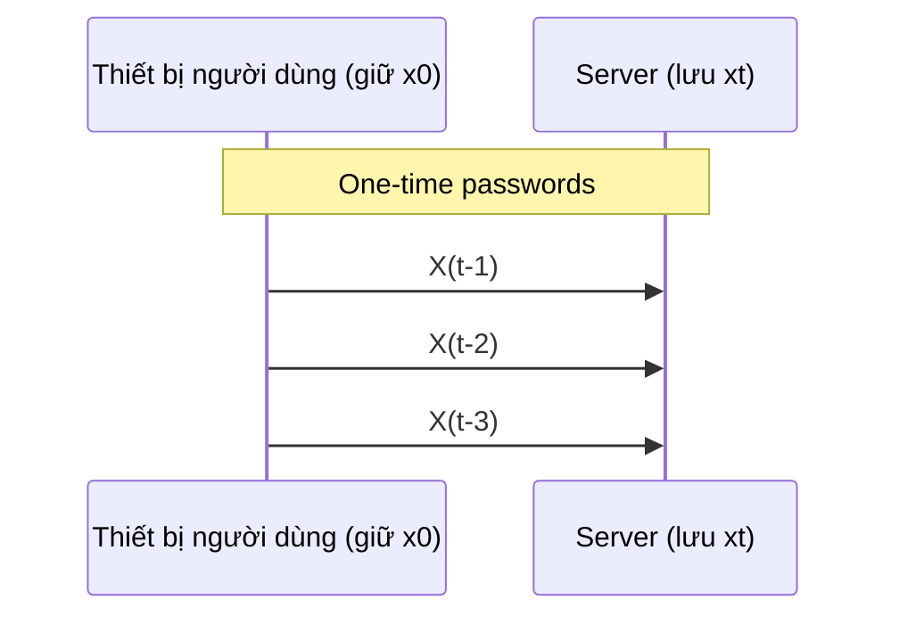

- Thiết bị của người dùng giữ `x0`; server lưu `xt`.
- Mỗi lần đăng nhập, người dùng gửi lần lượt `x(t-1)`, `x(t-2)`, `x(t-3)`, …; server áp dụng `f` lên giá trị nhận được và so với giá trị đang lưu.

**Certificate (chứng chỉ số)** gồm:

| Trường | Ý nghĩa |
|---|---|
| DN (Distinguished name) | Tên duy nhất của chủ sở hữu |
| Serial # | Số serial duy nhất |
| Start / End | Thời hạn hiệu lực (validity period) |
| CRL | Thông tin thu hồi (revocation information) |
| Key | Khoá công khai (public key) |
| CA DN | Tên CA phát hành |
| Chữ ký của CA | Chữ ký số của CA trên chứng chỉ |

### Ví dụ

Giả sử Alice và Bob chia sẻ khoá bí mật chung `K`. Alice muốn gửi chuỗi dữ liệu `M` cho Bob và thuyết phục Bob rằng `M` thực sự đến từ Alice và không bị sửa trong quá trình truyền:

- Alice gửi `M` cùng với `C` cho Bob, với `C = E_K(M)` và `E` là giải thuật mã hoá thông thường đã quy ước trước.
- Chỉ Alice và Bob biết `K` nên Bob dùng `K` giải mã `C` được `M'`.
- Bob tin `M` thực sự đến từ Alice và không bị thay đổi **nếu và chỉ nếu `M' = M`**.

**Nhược điểm:** phương pháp này cho phép Alice từ chối với Charlie rằng `M` xuất phát từ Alice, vì `M` cũng có khả năng xuất phát từ Bob (do cùng chia sẻ `K`). → Giải quyết bằng mật mã hoá khoá công khai.

**Tối ưu cho chuỗi dài:**

- Nếu `M` ngắn: có thể mã hoá trực tiếp `M` để xác nhận.
- Nếu `M` dài: chỉ cần tính một `h` ngắn đại diện cho `M` rồi mã hoá `h`.

**Các cách tạo `h`:**

- Không dùng khoá bí mật: gọi là **digital digest** hoặc **digital fingerprint** (dấu vân tay kỹ thuật số), thu được từ **hàm băm**.
- Dùng khoá bí mật: gọi là **MAC**.
- Dùng giải thuật checksum: kết hợp hàm băm và checksum tạo ra mã xác thực tin nhắn keyed-hash (**HMAC** – Keyed-Hash Message Authentication Code).

### Checksum của gói TCP

Trường `Checksum` (16 bit) nằm trong TCP header (20 octet) cùng với Source port, Destination port, Sequence number, Acknowledgment number, Data offset, Reserved, Flags, Window, Urgent pointer, Options + padding, rồi đến Application data.

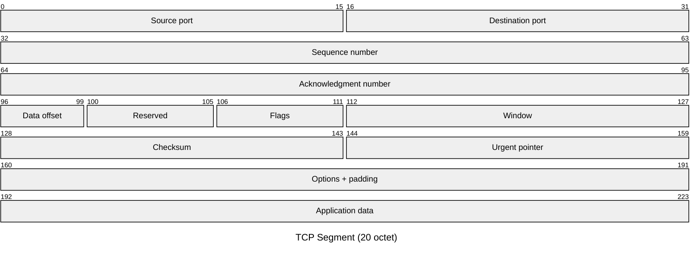

### Điều khiển lỗi khi gửi thông điệp

- **(a) Internal error control**: `A → B: E(K, [M ‖ F(M)])` – tính `F(M)` rồi ghép vào `M`, sau đó mã hoá cả khối. Bên nhận giải mã, tính lại `F` trên `M` và so sánh.
- **(b) External error control**: `A → B: E(K, M) ‖ F(E(K, M))` – mã hoá `M` trước, rồi tính `F` trên bản mã và ghép vào. Bên nhận tính `F` trên bản mã để so sánh, sau đó mới giải mã.

**(a) Internal error control**

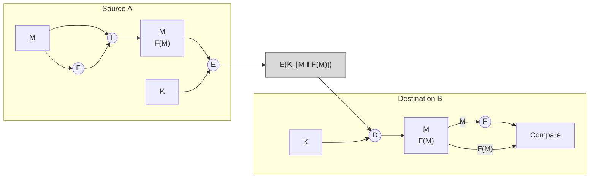

**(b) External error control**

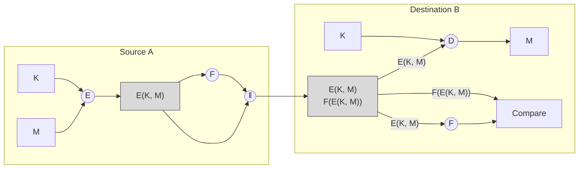


### Những công dụng cơ bản của mã hoá thông điệp

**(a) Symmetric encryption: confidentiality and authentication**

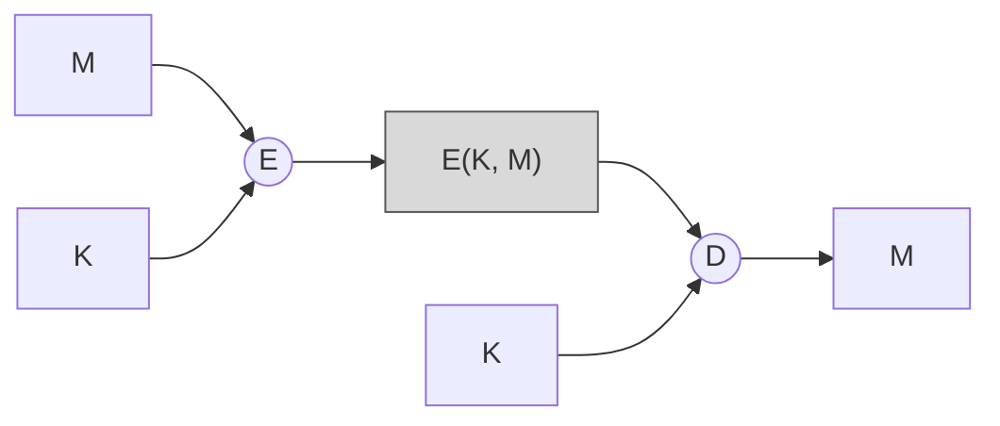

**(b) Public-key encryption: confidentiality**

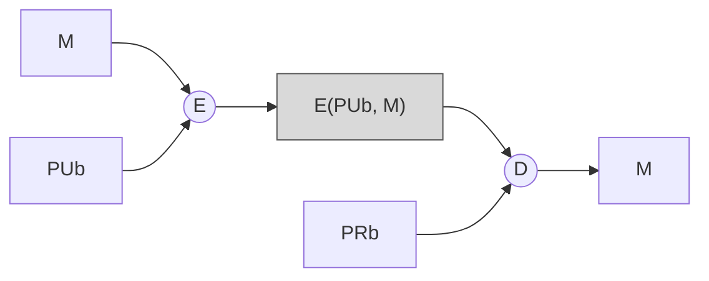

**(c) Public-key encryption: authentication and signature**

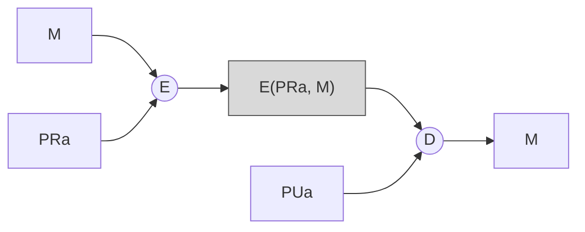

**(d) Public-key encryption: confidentiality, authentication, and signature**

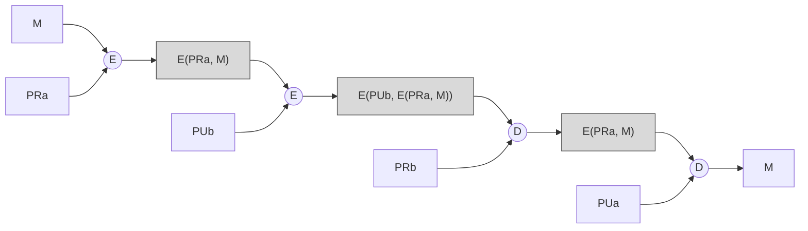

**a. Mã hoá khoá đối xứng (khoá bí mật):** `A → B: E(K, M)`

- Bảo mật: chỉ A và B chia sẻ `K`.
- Chứng thực:
  - Có thể đến chỉ từ A.
  - Không thay đổi trong quá trình truyền.
  - Yêu cầu một số định dạng và dự phòng.
- **Không cung cấp chữ ký**:
  - Người nhận có thể giả mạo thông điệp.
  - Người gửi có thể phủ nhận đã gửi thông điệp.

**b. Mã hoá khoá bất đối xứng (khoá công khai):** `A → B: E(PUb, M)`

- Bảo mật: chỉ B có `PRb` để giải mã.
- **Không cung cấp chứng thực**: bất cứ ai cũng có thể dùng `PUb` để mã hoá và tự xưng là A.

**c. Mã hoá khoá công khai: chứng thực và chữ ký số:** `A → B: E(PRa, M)`

- Cung cấp chứng thực và chữ ký số:
  - Chỉ A có `PRa` để mã hoá.
  - Không bị thay đổi trong quá trình truyền.
  - Yêu cầu một số định dạng và dự phòng.
  - Bất kỳ ai cũng có thể dùng `PUa` để xác minh chữ ký số.

**d. Mã hoá khoá công khai: bảo mật, chứng thực và chữ ký số:** `A → B: E(PUb, E(PRa, M))`

- Bảo mật nhờ `PUb`.
- Chứng thực và chữ ký số nhờ `PRa`.

---

## 2. Mã chứng thực thông điệp (MAC)

### Khái niệm

- MAC là kỹ thuật chứng thực dùng một **khoá bí mật** để tạo ra một khối dữ liệu có kích thước nhỏ, cố định (checksum hoặc MAC) và được thêm vào thông điệp.
- Giả sử hai bên A và B chia sẻ khoá bí mật `K`. Khi A gửi thông điệp cho B, A tính `MAC = C(K, M)`, với:
  - `M`: thông điệp đầu vào, kích thước biến đổi
  - `C`: hàm MAC
  - `K`: khoá bí mật chia sẻ giữa người gửi và người nhận
  - `MAC`: mã chứng thực thông điệp, chiều dài cố định
- Thông điệp + MAC được truyền tới người nhận. Người nhận tính MAC mới trên thông điệp nhận được bằng cùng khoá bí mật, rồi so với MAC nhận. Giả sử chỉ người nhận và người gửi biết khoá:
  - **MAC khớp** → thông điệp không bị thay đổi và chắc chắn đến từ người gửi đã biết.
  - **MAC khác** → thông điệp đã bị thay đổi hoặc giả mạo, do attacker gửi.
- Chiều dài thông thường của MAC: **32–96 bit** → để tấn công cần 2ⁿ lần thử (n là số bit của MAC).
- Chiều dài thông thường của khoá K: **56–160 bit** → để tấn công cần 2ᵏ lần thử (k là số bit của khoá).
- Ứng dụng:
  - Banking: MAC kết hợp triple-DES.
  - Internet: HMAC và MAC kết hợp AES.

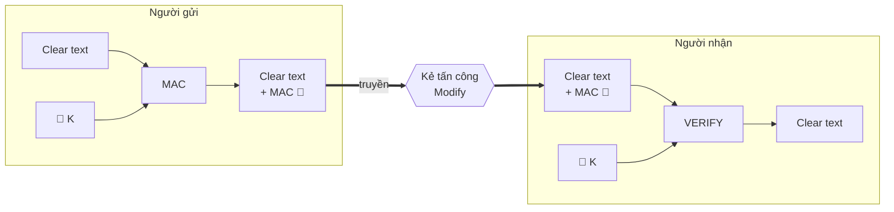


### Các công dụng cơ bản của MAC

| | Mô hình | Chứng thực | Bảo mật |
|---|---|---|---|
| a. Chứng thực | `A → B: M ‖ C(K, M)` | Chỉ A và B chia sẻ `K` | – |
| b. Chứng thực và bảo mật, chứng thực gắn liền với **plaintext** | `A → B: E(K2, [M ‖ C(K1, M)])` | Chỉ A và B chia sẻ `K1` | Chỉ A và B chia sẻ `K2` |
| c. Chứng thực và bảo mật, chứng thực gắn liền với **ciphertext** | `A → B: E(K2, M) ‖ C(K1, E(K2, M))` | Dùng `K1` | Dùng `K2` |

**(a) Message authentication**

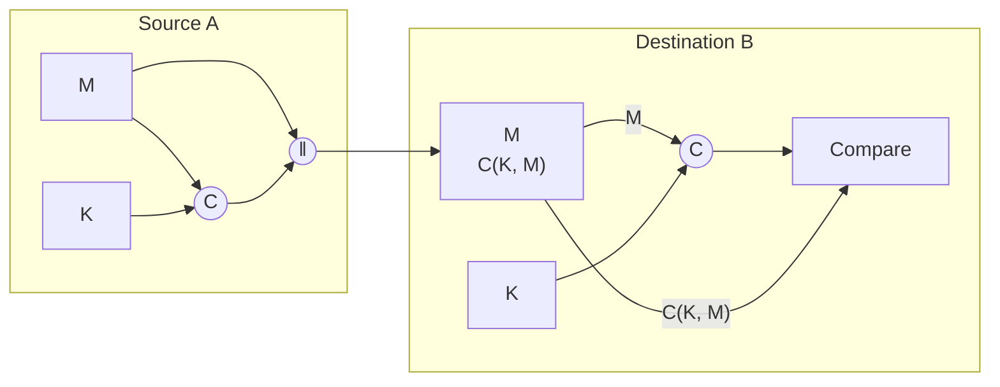

**(b) Message authentication and confidentiality; authentication tied to plaintext**

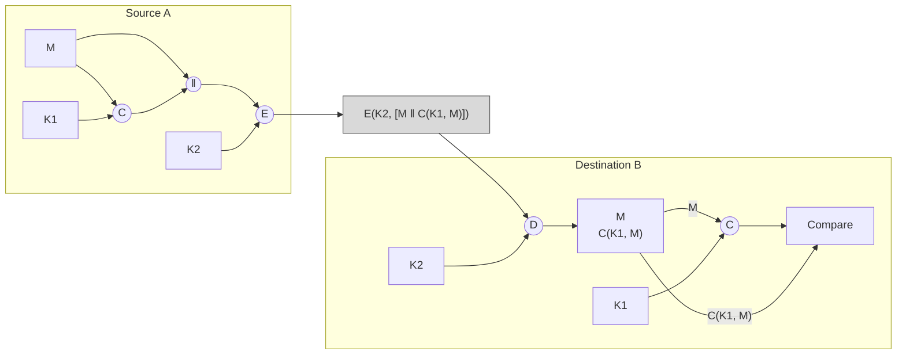

**(c) Message authentication and confidentiality; authentication tied to ciphertext**

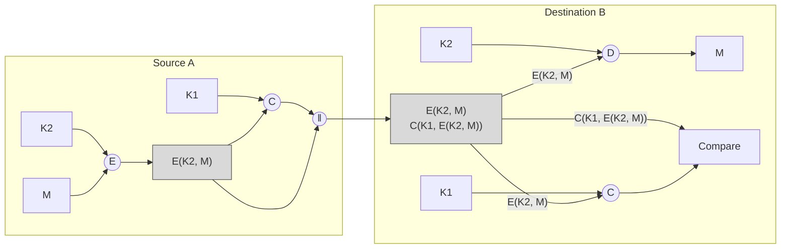

### Các yêu cầu đối với MAC

- Khi thông điệp được mã hoá (để bảo mật), độ bảo mật phụ thuộc vào độ dài bit của khoá. Tấn công brute-force phải thử tất cả các khoá; trung bình mất **2^(k−1)** lần thử cho khoá k-bit.
- Với tấn công chỉ biết ciphertext `C` (`Pi = D(Ki, C)`), phải brute-force mọi `Ki` đến khi `Pi` khớp với một plaintext chấp nhận được.
- **MAC khác biệt vì là hàm nhiều–một.** Giả sử `k > n` (khoá dài hơn MAC) và `MAC1 = C(K, M1)`. Thám mã phải tính `MACi = C(Ki, M1)` với mọi `Ki`, và ít nhất có một khoá cho `MACi = MAC1`.
- Có 2ᵏ khoá nhưng chỉ có 2ⁿ < 2ᵏ giá trị MAC khác nhau → nhiều khoá cùng tạo ra MAC đúng và attacker không biết đó là khoá nào. Trung bình có 2ᵏ / 2ⁿ = **2^(k−n)** khoá khớp, nên attacker phải lặp lại cuộc tấn công.

**Các vòng tấn công:**

| Vòng | Dữ liệu | Việc phải làm | Số khoá còn lại |
|---|---|---|---|
| 1 | `M1`, `MAC1 = C(K, M1)` | Tính `MACi = C(Ki, M1)` với 2ᵏ khoá | ≈ 2^(k−n) |
| 2 | `M2`, `MAC2 = C(K, M2)` | Tính `MACi = C(Ki, M2)` với 2^(k−n) khoá còn lại | ≈ 2^(k−2n) |
| … | … | … | … |

Trung bình cần **α vòng** nếu `k = α × n`.

**Ví dụ:** khoá 80 bit, MAC 32 bit:

- Vòng 1: còn khoảng 2⁴⁸ khoá có thể.
- Vòng 2: thu hẹp còn 2¹⁶ khả năng.
- Vòng 3: còn đúng một khoá duy nhất – chính là khoá của người gửi.

### MAC dựa trên giải thuật mã hoá DES

- Dữ liệu chia thành các khối 64 bit `D1, D2, …, DN`.
- `O1 = DES_K(D1)`; sau đó `Oi = DES_K(Di ⊕ O(i−1))` (nối tiếp, mỗi bước XOR khối dữ liệu với kết quả bước trước rồi mã hoá DES với cùng khoá `K` 56 bit).
- MAC (còn gọi là **DAC** – Data Authentication Code) lấy từ `ON`: **16 đến 64 bit**.

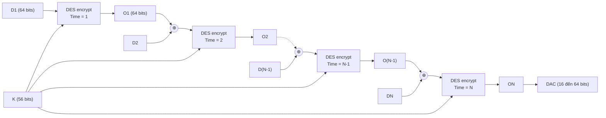

---

## 3. Hàm băm

### Khái niệm

- Hàm băm nhận một chuỗi dài ở đầu vào, ngắt thành nhiều mảnh, trộn lẫn và tạo ra một chuỗi mới có chiều dài ngắn.
- **Không phải mọi hàm băm đều thích hợp** để tạo dấu vân tay kỹ thuật số.

**Ví dụ hàm băm kém (XOR):**

- Xét hàm băm đơn giản `H⊕` dùng toán tử XOR biến chuỗi đầu vào độ dài tuỳ ý thành chuỗi 16 bit.
- Cho `M = M1 M2 … Mk`, mỗi `Mi` (có thể trừ `Mk`) là chuỗi nhị phân 16 bit. Nếu `Mk` ngắn hơn 16 bit, thêm các bit 1 vào cuối để đủ 16 bit.
- `H⊕(M) = M1 ⊕ M2 ⊕ … ⊕ Mk`.
- Hàm này **không thích hợp** vì dễ tìm được các chuỗi khác nhau có cùng giá trị băm. Ví dụ:
  - `S1`: "He likes you but I hate you"
  - `S2`: "He hates you but I like you"
  - Mã hoá bằng ASCII 8 bit, bỏ khoảng trắng giữa các từ → `H⊕(S1) = H⊕(S2)`.
- → Hàm băm cần đáp ứng một số tiêu chuẩn mới tạo được dấu vân tay kỹ thuật số.

### Tiêu chuẩn xây dựng hàm băm

- Cho `H` là hàm băm được xây dựng. Trước tiên thiết lập cận trên **Γ** cho chiều dài chuỗi input (số rất lớn, đơn vị bit).
- **γ** là chiều dài cố định của chuỗi output (γ < Γ).
- Để sinh dấu vân tay kỹ thuật số tốt, `H` cần có:
  - **Thuộc tính một chiều** (one-way property).
  - **Thuộc tính duy nhất** (kháng đụng độ).
- Hàm băm như vậy gọi là **hàm băm mật mã** (Cryptographic Hash Function – CHF).

### Tìm kiếm hàm băm

- Dù đã có nhiều nỗ lực, vẫn chưa xác định được có tồn tại hàm băm thoả mãn tính chất một chiều và duy nhất hay không.
- Đã có nhiều hàm băm được xây dựng và dùng trong thực tế, nhưng vẫn có thể chứa lỗ hổng bị kẻ tấn công khai thác → cần xác định điểm yếu để đưa ra hàm băm mạnh hơn.
- **2004**: nhà toán học Trung Quốc Xiaoyun Wang và cộng sự chứng minh một số hàm băm được dùng rộng rãi lúc đó (MD4, MD5, HAVAL-128, RIPEMD…) **không đáp ứng tiêu chí kháng đụng độ**. *(Slide ghi "HACAL-128"; tên thường gặp là HAVAL-128.)*
- **2005**: họ chứng minh **SHA-1** không kháng đụng độ mạnh như mọi người nghĩ, và phát triển phương pháp tìm hai chuỗi `x`, `y` khác nhau có cùng giá trị băm.

### Cấu trúc cơ bản của hàm băm chuẩn

- MD5, Whirlpool, SHA-1, SHA-2… đều có cùng cấu trúc cơ bản do **Ralph C. Merkle** đề xuất năm 1978.
- Trung tâm của cấu trúc là một **hàm nén**; mỗi giải thuật băm dùng hàm nén khác nhau.
- Ký hiệu: `M` là khối rõ, `IV` là vector khởi tạo, `F` là hàm nén, `+` là một dạng cộng modular.

```
H0 = IV
Hi = F(H(i-1), Mi) + H(i-1)      với i = 1..N
H(M) = HN
```

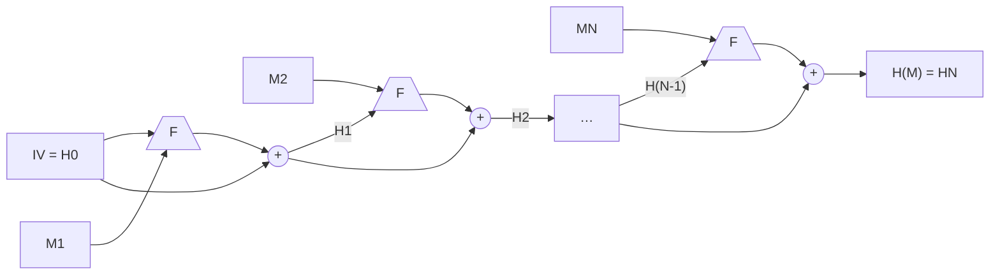


### Các công dụng cơ bản của hàm băm

| | Mô hình | Tính chất |
|---|---|---|
| a. Mã hoá thông điệp cộng với mã băm | `A → B: E(K, [M ‖ H(M)])` | Bảo mật: chỉ A, B chia sẻ `K`. Chứng thực: `H(M)` được bảo vệ bằng mật mã |
| b. Mã hoá mã băm bằng khoá bí mật chia sẻ | `A → B: M ‖ E(K, H(M))` | Chứng thực: `H(M)` được bảo vệ bằng mật mã |
| c. Mã hoá mã băm bằng khoá riêng của người gửi | `A → B: M ‖ E(PRa, H(M))` | Chứng thực và chữ ký số: `H(M)` được bảo vệ bằng mật mã; chỉ A tạo được `E(PRa, H(M))` |
| d. Mã hoá kết quả của (c) bằng khoá bí mật chia sẻ | `A → B: E(K, [M ‖ E(PRa, H(M))])` | Bảo mật: chỉ A, B chia sẻ `K`. Chứng thực và chữ ký số |
| e. Tính mã băm của thông điệp cộng với trị bí mật | `A → B: M ‖ H(M ‖ S)` | Chứng thực: chỉ A, B chia sẻ `S` |
| f. Mã hoá kết quả của (e) | `A → B: E(K, [M ‖ H(M ‖ S)])` | Chứng thực: chỉ A, B chia sẻ `S`. Bảo mật: chỉ A, B chia sẻ `K` |

**(a)**

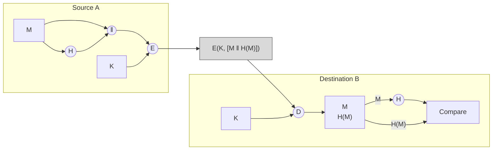

**(b)**

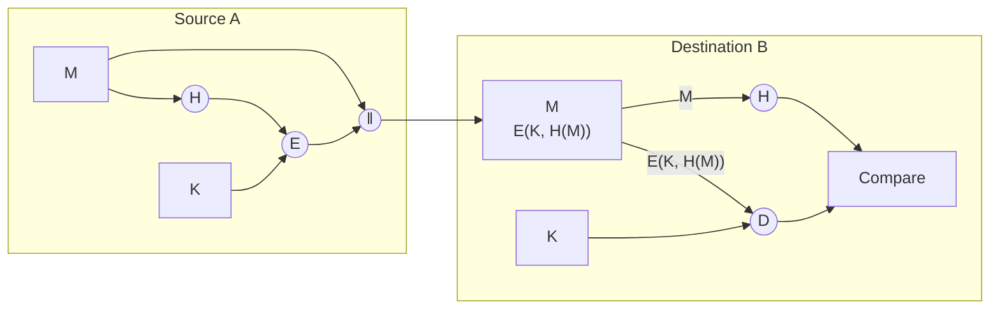

**(c)**

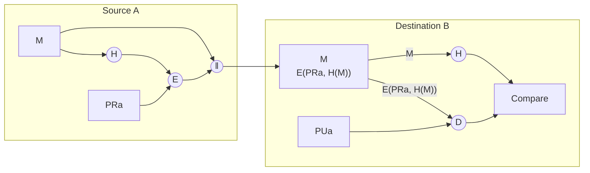

**(d)**

```mermaid
flowchart LR
    subgraph A["Source A"]
        M1["M"] --> CAT1(("‖"))
        M1 --> H1(("H"))
        H1 --> E1(("E"))
        K1["PRa"] --> E1
        E1 --> CAT1
        CAT1 --> E2(("E"))
        K2["K"] --> E2
    end
    E2 --> X["E(K, [M ‖ E(PRa, H(M))])"]
    X --> D1(("D"))
    subgraph B["Destination B"]
        K3["K"] --> D1
        D1 --> BL["M<br/>E(PRa, H(M))"]
        BL -->|"M"| H2(("H"))
        H2 --> CMP["Compare"]
        BL -->|"E(PRa, H(M))"| D2(("D"))
        K4["PUa"] --> D2
        D2 --> CMP
    end
    classDef cipher fill:#d9d9d9,stroke:#555
    class X cipher
```

**(e)**

```mermaid
flowchart LR
    subgraph A["Source A"]
        M1["M"] --> CAT1(("‖"))
        M1 --> CATS1(("‖"))
        S1["S"] --> CATS1
        CATS1 --> H1(("H"))
        H1 --> CAT1
    end
    CAT1 --> BL["M<br/>H(M ‖ S)"]
    subgraph B["Destination B"]
        BL -->|"M"| CATS2(("‖"))
        S2["S"] --> CATS2
        CATS2 --> H2(("H"))
        H2 --> CMP["Compare"]
        BL -->|"H(M ‖ S)"| CMP
    end
```

**(f)**

```mermaid
flowchart LR
    subgraph A["Source A"]
        M1["M"] --> CAT1(("‖"))
        M1 --> CATS1(("‖"))
        S1["S"] --> CATS1
        CATS1 --> H1(("H"))
        H1 --> CAT1
        CAT1 --> E1(("E"))
        K1["K"] --> E1
    end
    E1 --> X["E(K, [M ‖ H(M ‖ S)])"]
    X --> D1(("D"))
    subgraph B["Destination B"]
        K2["K"] --> D1
        D1 --> BL["M<br/>H(M ‖ S)"]
        BL -->|"M"| CATS2(("‖"))
        S2["S"] --> CATS2
        CATS2 --> H2(("H"))
        H2 --> CMP["Compare"]
        BL -->|"H(M ‖ S)"| CMP
    end
    classDef cipher fill:#d9d9d9,stroke:#555
    class X cipher
```

**Áp dụng cho mật khẩu:** Bob lưu `f(K ‖ S)` (mật khẩu `K` kèm giá trị `S` – tức *salt*) thay vì lưu mật khẩu. Ví dụ: (Alice, `f(Xur%9pLr ‖ 987&*)`, `987&*`).

```mermaid
flowchart LR
    Alice["Alice:<br/>“Hello Bob, I am Alice.<br/>My password P is Xur%9pLr”"] -->|"K"| F[/"One-way<br/>function f"\]
    S["S"] --> F
    F --> FK["f(K ‖ S)"]
    FK --> T[("Bảng của Bob<br/>Alice │ f(Xur%9pLr ‖ 987&*) │ 987&*")]
    T --> OK["Bob: “OK!”"]
```


### MD5

- MD5 (Message-Digest algorithm 5) là hàm băm mật mã, giá trị băm dài **128 bit**, biểu diễn bằng số thập lục phân 32 ký tự (RFC 1321).
- Dùng chủ yếu để **kiểm tra tính toàn vẹn của tập tin**: hai dữ liệu vào X và Y hoàn toàn khác nhau thì xác suất có cùng MD5 hash là rất nhỏ.
- Thiết kế bởi GS Ronald Rivest (MIT) năm **1991** để thay MD4 (không còn an toàn).
- Hiện nay MD5 ít được dùng do giá trị băm chỉ 128 bit, dễ bị tấn công brute-force; được thay bằng Whirlpool, SHA-1…
- Minh hoạ: file `vi du 1.txt` chứa "Truong Dai Hoc Cong Nghe Thong Tin"; chỉ sửa `T` thành `t` ở chữ cuối ("tin") thì MD5 hash thay đổi hoàn toàn:
  - Trước: `61 DD 6D 27 27 A2 96 E9 17 43 B2 23 0A 86 DB 5F`
  - Sau: `FF F7 61 A1 03 9E 6E DA DE 32 B1 7A 60 FD D6 8A`

```mermaid
flowchart LR
    F1["vi du 1.txt<br/>“Truong Dai Hoc Cong Nghe Thong Tin”"] --> H1["MD5"]
    H1 --> R1["61 DD 6D 27 27 A2 96 E9<br/>17 43 B2 23 0A 86 DB 5F"]
    F1 -->|"sửa T thành t"| F2["vi du 1.txt<br/>“Truong Dai Hoc Cong Nghe Thong tin”"]
    F2 --> H2["MD5"]
    H2 --> R2["FF F7 61 A1 03 9E 6E DA<br/>DE 32 B1 7A 60 FD D6 8A"]
    R1 -. "MD5 hash khác nhau" .- R2
```

### SHA

- **SHA** (Secure Hash Algorithm – Giải thuật băm an toàn) do Cục An ninh Quốc gia Mỹ (**NSA**) phát triển.
- Tính an toàn:
  - Cho một giá trị băm do SHA tạo ra, việc tìm lại dữ liệu gốc là không khả thi.
  - Việc tìm hai đoạn dữ liệu khác nhau có cùng giá trị băm là không khả thi. Bất kỳ thay đổi nhỏ nào ở dữ liệu gốc cũng tạo giá trị băm hoàn toàn khác với xác suất rất cao.

| Phiên bản | Kết quả | Ghi chú |
|---|---|---|
| **SHA-1** | 160 bit | Dùng rộng rãi thay MD5 trong nhiều ứng dụng và giao thức: TLS, SSL, PGP, SSH, S/MIME, IPSec |
| **SHA-2** – SHA-224 | 224 bit | |
| SHA-256 | 256 bit | |
| SHA-384 | 384 bit | |
| SHA-512 | 512 bit (γ = 512) | Có Γ = 2¹²⁸ − 1 |
| **SHA-3** (SHA3-224/256/384/512) | 224–512 bit | Phiên bản tiếp theo của SHA-2, dùng cấu trúc hoàn toàn khác gọi là **Keccak**; thiết kế để khắc phục mọi điểm yếu tiềm tàng của SHA-2 (dù SHA-2 hiện vẫn được tin tưởng); dùng cho ứng dụng có yêu cầu đặc biệt hoặc làm dự phòng cho SHA-2 trong tương lai |

---

## 4. Chữ ký số

### Khái niệm chung

Dùng khoá công khai để tạo chữ ký số. Giả sử A cần gửi cho B một thông điệp mật kèm chữ ký điện tử:

- A dùng khoá công khai của B để mã hoá thông điệp, rồi dùng khoá cá nhân của mình để mã hoá chữ ký, sau đó gửi cả thông điệp lẫn chữ ký cho B.
- B dùng khoá công khai của A để giải mã chữ ký, rồi dùng khoá cá nhân của mình để giải mã thông điệp của A.
- Việc tạo chữ ký và kiểm chứng chữ ký thường được thực hiện nhờ **hàm băm**.

### Ký vào thông điệp

1. Dùng giải thuật băm biến thông điệp cần truyền thành một **message digest** (MD5 → digest 128 bit, SHA-1 → digest 160 bit).
2. Dùng **private key** của người gửi mã hoá message digest vừa thu được (thường dùng RSA). Kết quả gọi là **digital signature** của thông điệp ban đầu.
3. Gộp digital signature vào thông điệp ban đầu ("ký nhận"). Mọi thay đổi trên message sau đó sẽ bị phát hiện, và người nhận tin rằng thông điệp xuất phát từ người gửi chứ không phải ai khác.

### Các bước kiểm tra

1. Dùng **public key** của người gửi (được thông báo đến mọi người) để giải mã chữ ký số của thông điệp → thu được digest.
2. Dùng giải thuật (MD5 hoặc SHA) băm thông điệp nhận được → thu được digest mới.
3. So sánh kết quả ở bước 1 và 2. Nếu **trùng nhau** → thông điệp không bị thay đổi trong quá trình truyền và là của người gửi.

### Không mã hoá

- **Người gửi ký**: tính digest (hash) từ nội dung thông điệp → dùng private key của người gửi mã hoá digest (ký) → gửi *Signed message* (thông điệp + digital signature).
- **Người nhận kiểm tra**: dùng public key của người gửi giải mã chữ ký thành digest; đồng thời tính digest từ nội dung thông điệp nhận được; so sánh hai digest để xác minh **tính toàn vẹn** (INTEGRITY).

```mermaid
flowchart LR
    subgraph S["Người gửi ký thông điệp"]
        MSG["Message"] -->|"Compute digest (hash)<br/>từ nội dung thông điệp"| DG1["digest"]
        DG1 -->|"SIGN THE MESSAGE: dùng private key<br/>của người gửi để mã hoá digest"| SIG["digital signature"]
        MSG --> SM["Signed message<br/>(Message + digital signature)"]
        SIG --> SM
    end
    SM ==>|"TRANSMIT"| SM2["Signed message<br/>(Message + digital signature)"]
    subgraph R["Người nhận kiểm tra chữ ký"]
        SM2 -->|"digital signature"| VER["VERIFY SIGNATURE: dùng public key của người gửi<br/>giải mã chữ ký thành digest"]
        VER --> DG2["digest"]
        SM2 -->|"Message"| HS["Compute digest (hash)<br/>từ nội dung thông điệp"]
        HS --> DG3["digest (mới tính)"]
        DG2 --> CMP{"So sánh<br/>→ xác minh INTEGRITY"}
        DG3 --> CMP
    end
```

### Có mã hoá

- **Người gửi ký và mã hoá**: tính digest → ký bằng private key của người gửi → **mã hoá thông điệp và chữ ký bằng public key của người nhận** → gửi *Encrypted Signed Message*.
- **Người nhận giải mã và kiểm tra**: giải mã thông điệp và chữ ký bằng private key của người nhận → dùng public key của người gửi giải mã chữ ký thành digest → tính digest từ nội dung thông điệp → so sánh để xác minh tính toàn vẹn.

```mermaid
flowchart LR
    subgraph S["Người gửi ký và mã hoá thông điệp"]
        MSG["Message"] -->|"Compute digest (hash)<br/>từ nội dung thông điệp"| DG1["digest"]
        DG1 -->|"SIGN THE MESSAGE: dùng private key<br/>của người gửi để mã hoá digest"| SIG["digital signature"]
        MSG --> SM["Signed message<br/>(Message + digital signature)"]
        SIG --> SM
        SM -->|"ENCRYPT MESSAGE AND SIGNATURE:<br/>dùng public key của người nhận"| ESM["Encrypted<br/>Signed Message"]
    end
    ESM ==>|"TRANSMIT"| ESM2["Encrypted<br/>Signed Message"]
    subgraph R["Người nhận giải mã và kiểm tra chữ ký"]
        ESM2 -->|"DECRYPT MESSAGE AND SIGNATURE:<br/>dùng private key của người nhận"| SM2["Signed message<br/>(Message + digital signature)"]
        SM2 -->|"digital signature"| VER["VERIFY SIGNATURE: dùng public key của người gửi<br/>giải mã chữ ký thành digest"]
        VER --> DG2["digest"]
        SM2 -->|"Message"| HS["Compute digest (hash)<br/>từ nội dung thông điệp"]
        HS --> DG3["digest (mới tính)"]
        DG2 --> CMP{"So sánh<br/>→ xác minh INTEGRITY"}
        DG3 --> CMP
    end
```

---

## 5. Bài tập

1. Tìm 3 phần mềm có kèm theo mã băm; kiểm tra mã băm (dùng phần mềm hoặc website) để suy ra độ tin cậy của các phần mềm này.
2. Tìm 3 chứng chỉ số đính kèm trên các trang web có yêu cầu bảo mật cao. Cho biết hàm băm tương ứng.
3. Dựa trên 6 công dụng của hàm băm trong bài học:
   - Xây dựng 1 mô hình có bảo mật, chứng thực, chữ ký số.
   - Phân tích hoạt động.
   - Nêu ưu nhược điểm của mô hình này.
